<div align="center">

# yokoten · 横展

### A guide for the journey. A guard at the bridge.

**Anyone can build software the way good teams do.**

A free tool that puts a good team's process into your project. Its checks run in your repo and CI, for people and AI agents alike.

**[yokoten.app](https://yokoten.app/?from=github)** &nbsp;·&nbsp; English | [简体中文](docs/i18n/zh-CN/README.md) | [繁體中文](docs/i18n/zh-TW/README.md) | [日本語](docs/i18n/ja/README.md)

[](https://github.com/yokoten-labs/yokoten/actions/workflows/yokoten.yml)
[](LICENSE)
[](https://www.npmjs.com/package/yokoten)
[](https://nodejs.org/)

</div>

## Works with any agent

The guard stops risky actions before they run in these agents
([setup for each](docs/guide.md#works-with)):

- Claude Code
- Codex CLI
- GitHub Copilot CLI
- Antigravity CLI
- Muse Code
- DeepSeek Harness
- Grok CLI

In any other agent, or with no agent at all, the commit check and CI still stop a bad change.

## Works with any language

yokoten itself runs on Node 22.23.4, 24.22.1 or 26.12.1 (or a newer 22, 24 or 26 release), on your machine and in CI, but your project can be in any language.
The guard, the privacy and secrets check, CI, and the issue and pull request checks
work the same in every language.

One step reads your language: `doctor` looks for your test command.

| | Languages |
|---|---|
| Finds your test command | JavaScript and TypeScript (npm, Deno), Python, Go, Rust, Java (Maven, Gradle), .NET, Ruby, PHP, Swift, Elixir, Dart and Flutter, and any project with `make test` |
| In progress ([#550](https://github.com/yokoten-labs/yokoten/issues/550)) | Writes the CI job that runs your tests, so you don't write it by hand |

The first steps (install, init, doctor) have been tried on Python, Go, Rust, .NET, Ruby and PHP projects.
So far the whole road, from install to release, has been run on TypeScript projects.

## Why

On a good team, every change has a reason, a test and a review. Most people learn
these habits over years, often after something breaks. yokoten gives a newcomer the
habits on day one: plan, build, test, review, release, one stage at a time. Its guard
stops an AI agent before the worst mistakes, such as a force push, a test edited to
pass, or a private detail made public.

No lesson stays in one project. *Yokoten* (横展) is a word from Toyota's factories: a
fix that one line finds goes to every line. When one project learns a lesson, yokoten
offers the check to every other project.

## Install

You need [Node](https://nodejs.org/) 22.23.4 or later (on Node 24, 24.22.1 or later; on
Node 26, 26.12.1 or later). Nothing else. Releases 22.18 to 22.23.3 still run yokoten,
but do not use them: they have security holes that Node fixed on 2026-10-21
([advisory](https://nodejs.org/en/blog/vulnerability/october-2026-security-releases)). That is why npm warns about
them when you install, and why `yokoten doctor` asks you to upgrade.

```sh
npx yokoten install      # once per computer
cd your-project
npx yokoten init         # once per project
npx yokoten doctor       # where you are, and the one next step
```

### Good to know

- **Commit in UTC.** Run `TZ=UTC git commit`, or add `export TZ=UTC` to your shell profile once.
  A commit's time zone tells strangers roughly where you live, so the commit check asks for UTC.
- **In Claude Code, a plugin is another way in.** Run `/plugin marketplace add yokoten-labs/yokoten`,
  then `/plugin install yokoten@yokoten`. Use the plugin or `npx`, not both
  ([more](docs/guide.md#the-claude-code-plugin)).
- **CI only?** [Use it as a GitHub Action](docs/guide.md#use-it-as-a-github-action).

## What you see

An agent tries a force push. yokoten stops it, says why, and gives the fix. Then
`doctor` names the one next step:



## Where this is going

<p align="center">
<picture>
  <source media="(prefers-color-scheme: dark)" srcset="docs/assets/road-dark.svg">
  
</picture>
</p>

The guard is done. The guide is being built now. Next come more agents and hosts, then
the whole cycle. At the top is *yokoten*: what one project learns, every project gets.
The [roadmap](docs/guide.md#where-this-is-going) has the five stages. The
[board](https://github.com/orgs/yokoten-labs/projects/1) shows today's work.

## Learn more

- **[yokoten.app](https://yokoten.app/?from=github)**: the site, with the guide and the records as pages.
- **[The guide](docs/guide.md)**: the twelve rules, every command, how it works, and what it can't do.
- **[Server setup](docs/server.md)**: protect `main` and release tags on GitHub.
- **[Decisions](docs/records/)**: why it's built this way.
- **[Changelog](CHANGELOG.md)**: what each version changed.
- **[Contributing](CONTRIBUTING.md)**: how to report a problem or send a change.
- **[Security](.github/SECURITY.md)**: how to report a security problem.

---

<p align="center"><sub>MIT · Built by <a href="https://coolwhite.us/">coolwhite</a> and a team of AI agents, under yokoten’s own rules: Claude Code built v0.1.0, and Muse Code leads v0.1.1. With lessons from the factory floor.</sub></p>
