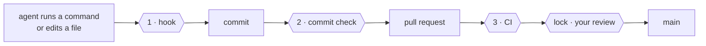

<div align="center">

# yokoten · 横展

[](https://github.com/coo1white/yokoten/actions/workflows/test.yml)
[](docs/records/0002-typescript.md)
[](https://nodejs.org/)
[](package.json)
[](LICENSE)
[](https://claude.com/claude-code)

**Carry what one project learned into every project.**

English | [中文](README.zh-CN.md)

</div>

AI coding agents don't carry lessons from one project to the next. You teach one
project "don't change a test to make it pass", "never push a release tag", "keep
personal data out of the repo". Then you start another project, and you have to say it
all again. Forget one, and the agent never hears it.

yokoten writes those lessons down as rules, and checks them in every project,
automatically. (*Yokoten* is Toyota's word for rolling one line's fix out to every line.)

## What you'll see

When a session starts, the agent hears what this project is still missing, and offers
to set it up:

```
yokoten: this project is missing 2 practice(s):
- rules: no AGENTS.md: the agents have no written rules here
- ci: CI does not run `yokoten check`, so a commit made without the hook gets through
```

When the agent tries something only you should decide, it's stopped before it runs:

```
yokoten: git push --tags pushes tags. Only the owner decides when to release.
```

## How it keeps you safe



| Check | When | Stops |
|-------|------|-------|
| **1 · hook** | before the agent acts | risky git commands; editing a test to make it pass |
| **2 · commit check** | every commit | personal data; changes the hook didn't see |
| **3 · CI** | every pull request | anything that skipped 1 and 2 |
| **lock** | before merging | anything you haven't approved |

## Quick start

You need [Node](https://nodejs.org/) 22.18 or later. Nothing else.

```sh
git clone https://github.com/coo1white/yokoten
node yokoten/bin/yokoten.ts install                 # once per computer
cd your-project
node ~/.local/share/yokoten/bin/yokoten.ts init      # once per project
```

Then open the project in Claude Code. It tells you what's still missing.

## Learn more

- **[The guide](docs/guide.md)**: the twelve rules, every command, how it works, and what it can't do.
- **[Server setup](docs/server.md)**: protect `main` and release tags on GitHub.
- **[Decisions](docs/records/)**: why it's built this way.

---

MIT · Built by [coolwhite](https://coolwhite.us/): factory discipline for software built by AI.
