<div align="center">

<picture>
  <source media="(prefers-color-scheme: dark)" srcset="docs/assets/banner-dark.svg">
  
</picture>

<br/>

One person, a few AI agents, and the habits of a good software team.<br/>
yokoten was built that way, and every issue, review, and release is in this repo.

**[yokoten.app](https://yokoten.app)** &nbsp;·&nbsp; English | [中文](docs/zh-CN/README.md)

<br/>

[](https://github.com/coo1white/yokoten/actions/workflows/yokoten.yml)
[](https://claude.com/claude-code)
[](docs/records/0002-typescript.md)
[](https://nodejs.org/)
[](package.json)
[](LICENSE)

[Works with](docs/guide.md#works-with) Claude Code, Codex CLI and Gemini CLI.

</div>

## What changes on day one

| Your agent tries to… | Without yokoten | With yokoten |
|---|---|---|
| force-push, or tag a release | it happens | stopped before it runs, and told why |
| "fix" a failing test by editing the test | the test passes, the bug stays | not allowed in a fix |
| commit your email, a server IP, your city | it goes public | the commit stops; the report names the file and line, never the text |
| open a pull request | as you, with all your rights | as a bot; nothing merges without you |
| work in another project | starts from zero | sees what that project is missing, and offers to set it up |

When it stops something, the agent reads a reason, not just "no":

```
yokoten: git push --tags pushes tags. Only the owner decides when to release.
```

## The road

Software teams work in a loop: plan, build, test, review, release. yokoten takes you
along it one stage at a time. Every stage is something this repo already does, so you
can see it working:

| Stage | You learn | See it here |
|---|---|---|
| **1 · Safety net** | rules your agents read, and checks that stop them when rules aren't enough | [AGENTS.md](AGENTS.md) |
| **2 · Issues and pull requests** | every change starts as an issue and merges only when CI passes; labels, milestones, and a board keep track | [issues](https://github.com/coo1white/yokoten/issues?q=is%3Aissue), [pull requests](https://github.com/coo1white/yokoten/pulls?q=is%3Apr), [the board](https://github.com/users/coo1white/projects/1) |
| **3 · Release** | commit messages that say what changed and why, a changelog, a version number for every release | [CHANGELOG.md](CHANGELOG.md) |
| **4 · A team of agents** | a bot opens pull requests, workers take tasks, a reviewer checks them; only you merge | [the guide](docs/guide.md#managing-agents-like-a-team) |
| **5 · Going public** | scan every past commit for private data, turn on security settings, protect `main` | [security policy](.github/SECURITY.md) |

## Where this is going

**The dream: anyone can build software the way good teams do.** On a good team, every
change has a reason, a test, and a review. Most people pick up those habits over years,
often after something breaks. With yokoten, a newcomer starts with them on day one, and
the guard stops their agents before the worst mistakes. The whole cycle is the SDLC:
plan, build, test, review, release, maintain. You learn it by doing it in your own
project, one stage at a time.

And no lesson stays stuck in one place. When one project learns something the hard way,
yokoten offers the fix to every other project. That is what the name means.

<p align="center">
<picture>
  <source media="(prefers-color-scheme: dark)" srcset="docs/assets/road-dark.svg">
  
</picture>
</p>

| Stage | Name | What it means | Now |
|---|---|---|---|
| 1 | **Guard** | AI agents are stopped before a dangerous action: a force push, a test edited to pass, a private detail leaked | ✅ done |
| 2 | **Guide** | a beginner walks the five stages with `doctor`, one thing at a time; an agent reads an old project and drafts how to adopt yokoten | 🚧 now, around the hackathon |
| 3 | **Any tool, any host** | Claude Code, Codex, Gemini CLI and Muse Code keep the same rules; GitHub, Gitea and GitLab all work | next |
| 4 | **The whole cycle** | from a short spec to build, test, review, release and maintenance, the full SDLC has a guide | later |
| 5 | **Yokoten** | a lesson one project learns becomes a check, and the check spreads to every project. What one person learns, everyone gets | the goal |

The word *yokoten* (横展) comes from Toyota's factories: the lessons learned on one line
spread to every line. That is where the name comes from.

The near steps are in [M0](https://github.com/coo1white/yokoten/milestone/1) and
[M1](https://github.com/coo1white/yokoten/milestone/2); the [board](https://github.com/users/coo1white/projects/1) shows what is being built today.

## Quick start

You need [Node](https://nodejs.org/) 22.18 or later. Nothing else.

```sh
git clone https://github.com/coo1white/yokoten
node yokoten/bin/yokoten.ts install                 # once per computer
cd your-project
node ~/.local/share/yokoten/bin/yokoten.ts init      # once per project
```

Then open the project in Claude Code. It tells you which stage you are at, and the one
next step.

## Learn more

- **[The guide](docs/guide.md)**: the twelve rules, every command, how it works, and what it can't do.
- **[Server setup](docs/server.md)**: protect `main` and release tags on GitHub.
- **[Decisions](docs/records/)**: why it's built this way.

---

<p align="center"><sub>MIT · Built by <a href="https://coolwhite.us/">coolwhite</a>, with lessons from the factory floor.</sub></p>
