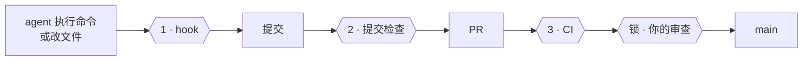

<div align="center">

# yokoten · 横展

[](https://github.com/coo1white/yokoten/actions/workflows/test.yml)
[](docs/records/0002-typescript.md)
[](https://nodejs.org/)
[](package.json)
[](LICENSE)
[](https://claude.com/claude-code)

**把一个项目里学到的东西，带到每一个项目里去。**

[English](README.md) | 中文

</div>

AI 编程助手不会把一个项目里学到的教训带到下一个项目。你在一个项目里教会它「别为了让测试通过
去改测试」「不要推发版 tag」「个人信息别进仓库」，换一个项目，又得从头说一遍。漏说一条，它就
永远不知道。

yokoten 把这些教训写成规则，在每个项目里自动检查。（「横展」是丰田的说法：一条产线找到的
对策，推广到所有产线。）

## 你会看到什么

每次会话开始，agent 会先知道这个项目还缺什么，并主动提出帮你补上：

```
yokoten: this project is missing 2 practice(s):
- rules: no AGENTS.md: the agents have no written rules here
- ci: CI does not run `yokoten check`, so a commit made without the hook gets through
```

agent 想做只有你才能决定的事时，命令还没执行就被拦下：

```
yokoten: git push --tags pushes tags. Only the owner decides when to release.
```

（提示是英文的，因为 agent 读英文最稳。）

## 它怎么保护你



| 检查 | 什么时候 | 拦下什么 |
|------|---------|---------|
| **1 · hook** | agent 动手之前 | 危险的 git 命令；为了让测试通过而改测试 |
| **2 · 提交检查** | 每次提交 | 个人信息；hook 没看到的改动 |
| **3 · CI** | 每个 PR | 绕过了前两道的一切 |
| **锁** | 合并之前 | 没经过你同意的一切 |

## 快速开始

只需要 [Node](https://nodejs.org/) 22.18 或更高版本，别的都不用装。

```sh
git clone https://github.com/coo1white/yokoten
node yokoten/bin/yokoten.ts install                 # 每台电脑一次
cd your-project
node ~/.local/share/yokoten/bin/yokoten.ts init      # 每个项目一次
```

然后用 Claude Code 打开这个项目，它会告诉你还缺什么。

## 了解更多

- **[使用指南](docs/guide.zh-CN.md)**：12 条规则、全部命令、工作原理，以及它做不到的事。
- **[服务器设置](docs/server.md)**：在 GitHub 上保护 `main` 和发版 tag（英文）。
- **[决定记录](docs/records/)**：为什么这样设计（英文）。

---

MIT · 由 [coolwhite](https://coolwhite.us/) 制作：用工厂的纪律，做 AI 写的软件。
