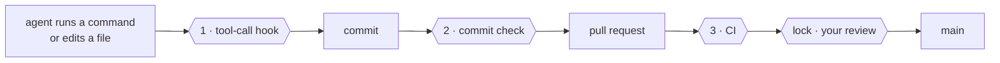
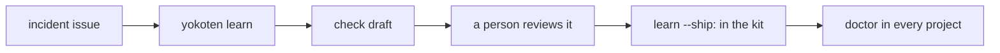

# The yokoten guide

The [README](../README.md) is the short version. This guide starts with what a beginner
needs: what yokoten is, the five protections, install, and what a refusal asks of you.
Everything else is reference, below.

## What yokoten is

yokoten is a safeguard for AI coding agents. It checks each command and edit before it
runs, stops the worst mistakes, and says why in one plain sentence. It uses the hooks,
sandbox and settings of the agent you already run. It does not replace them.

### The five protections

The same five hold for every person and every agent, on by default, with no setup:

1. **The agent cannot lose your work.** No plain force push, no hard reset, no deleting
   `.git` or the history.
2. **The agent cannot leak a secret.** No key, token, email address or home path in a
   commit, an issue or a pull request.
3. **The agent cannot publish for you.** No tag, release, package publish, or making a
   repo public.
4. **The agent cannot run code from the internet unread.** No download piped into a
   shell.
5. **The agent cannot take the safeguard apart.** No turning off a check or a hook, and
   no editing CI or the rules.

Everything else runs. `yokoten init` adds project rules on top of the five; it never
removes one. [Record 0034](records/0034-one-safeguard-for-everyone.md) says why this is
the default for everyone. [Record 0035](records/0035-the-safeguard-is-the-mvp.md) says
why the safeguard is the first thing yokoten makes excellent.

### Install

You need Node 22.23.4 or later (24.22.1 or later on Node 24, 26.12.1 or later on Node 26)
and nothing else. The hook commands need a POSIX shell: on Windows, use Git Bash.

```sh
npx yokoten install      # once per computer
cd your-project
npx yokoten init         # once per project
npx yokoten doctor       # where you are, and the one next step
```

In Claude Code you can use the plugin instead. Use the plugin or `npx`, not both; see
[The Claude Code plugin](#the-claude-code-plugin). To install from a clone, see
[Install from a clone](#install-from-a-clone).

### What a refusal looks like

An agent tries a plain force push. The guard stops it before it runs:

```text
yokoten: git push --force forces the push. a plain force push can throw away work that
someone else pushed. use --force-with-lease, which stops when the remote has work you
have not seen.
  docs: https://github.com/yokoten-labs/yokoten/blob/main/docs/guide.md#the-core-rules
```

**What to do.** Read the fix. Run the command it names, or ask the owner. Do not look
for another way around the guard. A refusal is not a bug; it is the safeguard working.
If the refusal is wrong, run `yokoten explain <id>` and open an issue labelled
`incident`.

## The name

*Yokoten* (横展) is a word from Toyota's shop floors. When one production line finds a fix
for a defect, the fix goes to every line that could have the same defect, not just the
line that found it. yokoten does that for your projects: a lesson one project learns is
offered to the rest.

## Words used here

- **Session**: one conversation with an AI coding agent, such as Claude Code.
- **Hook**: a small program the agent runs at a set moment. yokoten adds one before every
  command and edit (it can stop the call), one when the agent ends its turn, and one at
  the start of a session.
- **Commit check**: a git hook (`.githooks/pre-commit`) that runs before each commit.
- **CI**: the checks GitHub runs on every pull request.
- **Ruleset**: a GitHub setting that protects a branch or a tag.
- **Owner, lead, worker**: you; the session you talk to; a session the lead starts for
  one task. See [Managing agents like a team](#managing-agents-like-a-team).
- **Exit code**: the number a command gives back. 0 means all is well. See
  [Exit codes](#exit-codes).

## Three checks and a lock



| | Runs | Stops |
|-|------|-------|
| **1** | before each tool call | a plain force push, a tag push, a skipped check; a test edited in a fix task; a worker editing the rules; personal data or a secret in a post; deleting a CI run |
| **2** | on every commit | what the hook cannot see: a file changed by a script, personal data, an overfull folder |
| **3** | on every pull request | a commit made with the hook off |
| **lock** | on the server | a merge without your review, a push to `main`, a release tag that is not yours |

## What a session sees

At the start of a session in a project that has not adopted yokoten yet:

```text
yokoten: stage 1 of 5, safety net. Next: no AGENTS.md, so the agents have no written
rules here; `yokoten init` adds one.
Why: an agent follows the rules it can read, and only those.
Tell the user in plain words, one step at a time, and offer to do it.
```

The session hears one step only: the stage, the next step, and why it matters. The stage
is worked out from the files each time; nothing saves it. A step you marked "not now" is
skipped.

`yokoten doctor` shows the whole road. Each step is **done**, **next**, **to do**, **not
now** (with your reason) or **can't check**:

| Stage | Steps |
|---|---|
| **1 · Safety net** | `rules`, `tool-hook`, `commit-check`, `runtime`, `tests` |
| **2 · Issues and pull requests** | `remote`, `ci`, `issues`, `templates`, `labels`, `milestone`, `no-build-output` |
| **3 · Release** | `changelog`, `titles` |
| **4 · A team of agents** | `codeowners`, `bot`, `skills`, `sandbox`, `review` |
| **5 · Going public** | `security-files`, `protection`, `merge-settings`, `security-settings` |

The last three are server settings. Full `doctor` reads them through `gh api`, and only
reads. Without `gh`, a sign-in, the network or a GitHub remote, they are **can't check**,
never done. [Record 0004](records/0004-the-road.md) says why the road looks like this.

**Another host.** On Gitea or GitLab the core works the same: the rules, the guard and
the commit check. The steps only the host can judge are **can't check**, and say what
they ask. A self-hosted server's name is never printed. A Gitea adapter comes next.

### Work only on this machine

A power cut, a crash or a dead disk loses work that lives only on one machine. `doctor`
lists that work, each item with the one command that saves it:

| Note | The command |
|---|---|
| `uncommitted-changes` | `git add -A`, `git commit -m "chore: save work"`, then push |
| `unpushed-commits` | `git push`, or `git push -u origin <branch>` |
| `stashes` | `git stash branch <name>`, then push it |
| `stale-index-lock` | `rm` the `index.lock` when no git process runs |
| `repo-on-tmpfs`, `repo-in-temp-folder` | push all branches, then clone in a folder that lasts |
| `finished-worktree` | `git worktree remove <path>`; the branch stays |
| `missing-worktree` | `git worktree prune` |

These are notes: they never fail `doctor`. Doctor only reads here; it changes no file,
no ref and no worktree. A session hears only what is at risk, three items at most, and
spends at most one second on it. [Record 0012](records/0012-machine-checks.md) has the
rest.

## Works with

yokoten guards nine AI coding agents with the same rules. Each "yes" below is a real
run: the agent tried `git push --tags` in a throwaway repo, and the guard stopped it.
"Not run end to end" means the agent is listed, but its guard is not verified end to end
yet. Docs are not proof.

| Agent | How it blocks | Verified |
|---|---|---|
| Claude Code | exit 2, the reason on stderr | yes |
| GitHub Copilot CLI | exit 2, and the reason as JSON on stdout | yes |
| Antigravity CLI (`agy`) | `{"decision": "deny"}` on stdout | yes |
| Codex CLI | exit 2, the reason on stderr | yes |
| Muse Code | exit 2, the reason on stderr | yes |
| DeepSeek Harness (`dsh`) | exit 2, the reason on stderr | yes |
| Grok CLI (`grok`) | `permissionDecision: "deny"` on stdout, and exit 2 | yes |
| Gemini CLI | exit 2, the reason on stderr | not run end to end |
| OpenCode | OpenCode 2 sets `effect` to deny; OpenCode 1 throws the reason | not run end to end |

`install` writes the user hooks, and `init` writes the project hook for each agent. Each
agent runs a project hook only after you trust the folder. `init` prints the one step
that trusts it, and `doctor` notes a folder it does not trust yet. A worker's worktree is
also marked with `yokoten worker mark <dir>`, so an agent that drops `YOKOTEN_ROLE` still
counts as a worker. `init` also writes each agent's sandbox, and prints the one step each
agent needs. The DeepSeek Harness bridge and the DeepSeek model setup are in the
[README](../README.md).

## Install and commands

`init` copies the runtime into `.yokoten/` in your project. Commit it: the hooks and CI
then run with no network and no global install. `init` adds only; a file that is already
there is kept and named.

### The Claude Code plugin

In a Claude Code session:

```text
/plugin marketplace add yokoten-labs/yokoten
/plugin install yokoten@yokoten
```

The plugin is this repo, and it uses the same files that `install` copies.

| The plugin adds | From |
|---|---|
| The skills: `/yokoten:dispatch`, `/yokoten:inspect`, `/yokoten:merge`, `/yokoten:rca`, `/yokoten:record`, `/yokoten:release`, `/yokoten:yokoten` | `kit/user/skills/` |
| The agents: `yokoten:worker`, `yokoten:reviewer`, `yokoten:verifier` | `kit/user/agents/` |
| `/yokoten:init`, `/yokoten:doctor` and `/yokoten:update` | `kit/plugin/skills/` |
| The SessionStart `doctor` hook and the command guard | `.claude-plugin/plugin.json` |

The plugin works in Claude Code only. Use the plugin or `install`, not both: with both,
the guard and the session doctor run twice and every skill shows up twice. To move from
`install` to the plugin, run `yokoten uninstall`.

### Install with npx

```sh
npx yokoten install      # this machine: skills, agents, hooks
cd your-project
npx yokoten init         # this project: adds files, never overwrites
npx yokoten doctor       # the road: where you are, what's next
```

`npx` downloads the package and runs it. The package has no dependencies. `install` and
`init` copy yokoten's runtime to `~/.local/share/yokoten` and `.yokoten/`, so the hooks
need no network and no `npx`. `install` also puts a `yokoten` launcher in `~/.local/bin`,
and asks once before it adds that folder to your PATH.

### Install from a clone

Use this way until the first release is on npm:

```sh
git clone https://github.com/yokoten-labs/yokoten
node yokoten/bin/yokoten.ts install      # this machine: skills, agents, hooks
cd your-project
node ~/.local/share/yokoten/bin/yokoten.ts init     # this project: adds files, never overwrites
node ~/.local/share/yokoten/bin/yokoten.ts doctor   # the road: where you are, what's next
```

These commands, and the npx ones, are also in [docs/facts.json](facts.json), which the
website reads, so a change goes in both places.

### Use it as a GitHub Action

Any repo on GitHub can run yokoten's checks in CI with one workflow file. Nothing is
installed in the repo, and nothing leaves the job: no token, no outside service.

```yaml
# .github/workflows/yokoten.yml
name: yokoten
on:
  pull_request:
    types: [opened, edited, synchronize, reopened, labeled, unlabeled, milestoned, demilestoned]
  push:
    branches: [main]
permissions:
  contents: read
jobs:
  yokoten:
    runs-on: ubuntu-latest
    timeout-minutes: 10
    steps:
      - uses: actions/checkout@3d3c42e5aac5ba805825da76410c181273ba90b1 # v7.0.1
        with:
          fetch-depth: 0
          persist-credentials: false
      - uses: yokoten-labs/yokoten@<full commit SHA>
```

The action sets up Node, then runs `check`. On a pull request it also runs `check --pr`.
Pin the action to a full commit SHA: a branch name changes under you. The checkout needs
`fetch-depth: 0`, and `contents: read` is enough. The inputs are `pr-check` (default
`true`), `issue-check` (default `true`) and `node-version`. A repo that does not follow
the pull request standard yet can start with `pr-check: false`.

### A private repo without CI

A private repo on a free plan pays for its GitHub Actions minutes. To keep CI off until
the repo goes public, run `yokoten init --no-ci`. It adds `"ci"` to `"notNow"` in
`yokoten.json` and writes no workflows. Then the commit hook and `yokoten check` are the
gate. Before you merge a pull request, run:

```sh
yokoten check --pr 12
```

That reads the pull request through `gh` and checks the same things as CI. To take CI up
again, remove `"ci"` from `"notNow"` and run `yokoten init`.

### Commands

`init` keeps a project's own setup working. An `AGENTS.md` without `## This project` gets
the core rules on top, and its own text moves under that heading. With `CLAUDE.md`, it
adds an `@AGENTS.md` line. With husky or another `core.hooksPath`, it keeps that folder
and adds the commit check to its `pre-commit`. `init` never commits.

`init` also writes three workflows: `yokoten.yml`, `pr.yml` and `issue.yml`, each action
pinned to a commit. It adds `dependabot.yml`, `SECURITY.md` and `CODEOWNERS` as safe
defaults. A file you already have is kept.

| Command | What it does |
|---------|--------------|
| `install` | Skills into `~/.claude/skills` and `~/.agents/skills`, agents into `~/.claude/agents`, a SessionStart `doctor` hook, a user-level command guard, and an empty private-marks file |
| `init [dir]` | Puts the practices into a project. Adds files; keeps any that are already there. Reads GitHub through `gh` and says what it would add. See [A private repo without CI](#a-private-repo-without-ci) |
| `init --github --yes [--remove-default-labels] [--board]` | Adds the missing standard labels and a milestone. `--board` also makes a board linked to the repo; it needs the gh token's `project` scope |
| `init --no-ci` | Keeps CI off: adds `"ci"` to `"notNow"`, writes no workflow and no Dependabot config |
| `update [dir] [--write]` | Shows what changes in the core rules of `AGENTS.md`; `--write` replaces them. See [Updating the rules](#updating-the-rules) |
| `doctor [--session] [--json] [--agent <name>]` | The road: every stage and step, and what this machine misses |
| `adopt [--json]` | A draft of the adoption table for an old project. Writes nothing |
| `check [--staged] [--history] [--pr [number]] [--issue] [--json]` | Layout, privacy and lead-only files for the tree, the next commit, or a pull request |
| `redact` | Reads text on stdin and hides your details: `<owner>`, `<email>`, `<host>`, `<mark>` |
| `marks [add \| remove \| off <kind> \| on <kind> \| allow <mark> --here [--remove]]` | Counts or changes your private marks, or allows one in this repo only |
| `changelog [--write]` | Shows the entries the files in `changes/` add under `[Unreleased]`; `--write` moves them in. See [The changelog](#the-changelog) |
| `learn <issue> [--write]` | Drafts a check from an incident issue. `--write` adds it in `lessons/`. See [Learning from an incident](#learning-from-an-incident) |
| `learn --ship <id>` | Moves a reviewed lesson into `kit/lessons/`. Refused while a `TODO(reviewer)` is left or its test fails |
| `learn --upstream "<what happened>" [--area <name>] [--fix <idea>] [--list] [--done <id>]` | Keeps a note about a gap in yokoten itself. See [Lessons for yokoten itself](#lessons-for-yokoten-itself) |
| `hook [--agent <name>] [--commands-only] [--stop] [--json]` | The tool-call guard, or the stop check. Reads one event on stdin |
| `explain [<id>] [--json]` | A rule or a step: what it is, why, and how yokoten checks it |
| `worker mark <dir>`, `worker unmark <dir>`, `worker env [runtime]` | Marks a worktree as a worker's, or lists the environment an agent would get |
| `msg send <to> [<text>]`, `msg inbox`, `msg who`, `msg log` | Agents of every vendor message each other through files on this machine |
| `desk <agent> <folder> [--name <name>] [--read <paths>] [--host <hosts>] [--marks] -- <command>` | Starts a worker's agent in a fenced desk. Preview; see [The desk](#the-desk) |
| `board [--text] [--no-open]` | Serves the team page on this machine. Preview; see [The team board](#the-team-board) |
| `bot -- <command>` | Runs one command (`gh`, `git push`) as the bot, with a one-hour token it never prints |
| `uninstall` | Takes back what `install` wrote. Your own files and `~/.config/yokoten` stay |

Each command prints its own help with `--help`. `yokoten help <command>` prints a
command's help, and `yokoten version` prints the version. `yokoten explain <id>` explains
a rule.
`check`, `doctor`, `hook`, `explain` and `adopt` take `--json`; errors are JSON too.
Results go to stdout; problems and refusals go to stderr. `init`, `update`, `doctor`,
`check`, `adopt` and `bot` need a git repo.

### Exit codes

| Code | Means |
|------|-------|
| 0 | All is well. Steps left on the road are to do, not problems |
| 1 | Problems found: by `check`, by `doctor`, an unknown id, a usage error, or a crash |
| 2 | The hook blocked the tool call, or the stop check sent the agent back |

Only exit 2 blocks a call in every agent, so the hook turns any other exit into 2: when
the guard crashes, the call is refused with one line. Two cases stay at 1, when the
runtime is gone or `node` is missing; then the call goes on, so you can still run
`yokoten doctor`.

## The stop check

The tool-call hook reads commands. It does not see a file that `sed` or a script changed.
The stop check runs when the agent tries to end its turn. It checks the changed files
with the privacy, secret and file rules of `check --staged`.

For a lead, it sends the agent back once. For a worker, it also runs the task's done-when
command, and sends the worker back with the output. The worker gets three tries. On the
third, the next stop is let through, and the worker's final message must start with
`NOT DONE: checks failing`. The allowed stop writes `checks` to `.yokoten-agent.json` in
a linked worktree. DeepSeek Harness, Antigravity CLI and OpenCode have no stop hook; the
lead runs the check there.

## Blocked commands

A project's stack rule, such as "no Python", is easy for an agent to forget. Written only
in `AGENTS.md`, it is a wish. List the programs in `yokoten.json`, each with its reason,
and the guard holds the rule:

```json
"commands": {
  "block": {
    "python": "this project is TypeScript only",
    "python3": "this project is TypeScript only"
  }
}
```

The guard then stops a command that runs `python3`, for the lead and every worker. It
reads the program of each command, including after `&&`, `|`, `$(...)`, `bash -c` and
launchers such as `env` and `sudo`. A word that only holds the name passes: `echo
python`, `cat python.md`, `pythonic`. A script, a `make` target or an npm script is not
read; name each version you want to stop.

## yokoten.json

`yokoten.json` at the repo root holds the project's settings. Every key is optional. A
missing key, a key set to `null`, or a missing file gives the default.

| Key | Must be | Default |
|-----|---------|---------|
| `layout` | `{ "maxEntries": 7, "exempt": ["docs/records"] }` | 7, no folder exempt |
| `tests` | a list of globs | `*.test.*`, `*.spec.*`, `*_test.go`, `test/**`, `tests/**` |
| `leadOnly` | a list of globs | the rules, agent config, hooks and CI |
| `privacy` | `{ "allow": [], "skip": [], "utc": true, "output": "run", "skipOwnName": true }` | lockfiles skipped, UTC on, output run |
| `notNow` | reasons by step name | none |
| `allowBuild` | a list of globs | none |
| `areas` | a list of words | any lowercase word |
| `translations` | `{ "fail": true }` | `false` |
| `commands` | `{ "block": { "<program>": "<reason>" } }` | no program blocked |

A key with the wrong shape is a config error: `check` and `doctor` exit 1 and name each
wrong key. The tool-call hook then uses that key's default, says so in one line, and the
core checks still run. A key yokoten does not know is a note, never an error.

Environment variables include `YOKOTEN_ROLE=worker`, `YOKOTEN_FIX_TASK=1`,
`YOKOTEN_DONE_WHEN`, `YOKOTEN_LEAD_ONLY_OK`, `YOKOTEN_RELEASE_APPROVAL=1`,
`YOKOTEN_PRIVATE_MARKS`, `YOKOTEN_MIN_FREE_GB`, `YOKOTEN_GITHUB_API` and
`YOKOTEN_PR_LIVE=1`. The [README](../README.md) and `yokoten explain` have the rest.

## Issue titles

An issue title names the area, then the work:

- A task: `area: verb phrase`, for example `doctor: add the review step`.
- An incident: `area: symptom`, for example `check: misses a key in a JSON file`.

At most 60 characters. No full stop at the end. No `#N`: link other issues in the body.
The area is one lowercase word, or words joined by hyphens. `yokoten.json` `areas` limits
the list. `init` adds `issue.yml`, which runs `check --issue` on every new or edited
issue and only reads. An agent's title is checked before `gh` sends it.

## The changelog

A pull request that changes what users notice adds one file,
`changes/<issue>-<slug>.md`. It does not edit `CHANGELOG.md`: separate files never
conflict. Line 1 is the section (Added, Changed, Deprecated, Removed, Fixed, Security or
Internal). Line 2 is blank. From line 3, write the entry:

```markdown
Fixed

`doctor` no longer stops when the repo has no remote (#42).
```

`yokoten changelog` shows what the files would add. Before a release,
`yokoten changelog --write` moves each entry under `[Unreleased]` and deletes the files.
`check --pr` checks the form, and so does the commit check. `init` adds
`changes/README.md`, which shows the form.

## Translations

English is the source; a translation follows it. Each translated file names its source
on line 1:

```markdown
<!-- source: docs/guide.md -->
```

When the English changes, update the translation in the same pull request. A translation
that falls behind gets a `translation-behind` note from `check`; a note never fails CI.
Set `"translations": { "fail": true }` in `yokoten.json` to make it fail.

## Updating the rules

When yokoten learns a lesson, its core rules change. Your project's `AGENTS.md` is your
file, so it changes only when you ask. Once it has `## This project`, `init` never touches
it again.

`doctor` compares the core part with the yokoten you run, and reports `core-rules` when
they differ. `yokoten update` shows the change and writes nothing. `yokoten update
--write` replaces the core part; everything from `## This project` down stays byte for
byte. With the plugin, run `/yokoten:update`.

## Learning from an incident

An incident is a lesson. `yokoten learn <issue>` turns it into a check every project
runs:



The draft comes from the issue's sections, not from a model. A field with no section gets
a `TODO(reviewer)`, never a guess. `learn --write` adds two files: the lesson and a
positive control test that fails until a person writes the check. `learn --ship` moves
it into `kit/lessons/`; it refuses while a `TODO` is left or the test fails.

## Lessons for yokoten itself

Sometimes the problem is in yokoten, not in your project. Write it down where you found
it:

```sh
yokoten learn --upstream "the guard let git push --tags through" --area hook --fix "match the flag too"
```

The note goes to `~/.config/yokoten/upstream/`, outside every repo, with your project,
home folder, name and private marks replaced. A note with a known secret is not kept.
Nothing is sent anywhere. Open an issue for each note, then remove it with
`yokoten learn --upstream --done <id>`.

## Machine notes

Full `doctor` lists problems that stop every session, and the agent cannot see them.
A note never changes the exit code:

- **disk-space**: the disk is low on space. Doctor warns below 20 GB, when that is also
  under 10% of the disk. `YOKOTEN_MIN_FREE_GB` changes the limit.
- **host-disk** (WSL 2 only): the Windows drive that holds the Linux disk file is low.
- **agent-temp-dir**: another user owns Claude Code's temp folder.
- **leftover-temp-folders**: old `yokoten-*` folders fill the disk.
- **node-security**: the Node that runs yokoten lacks the October 2026 fixes.

Each note prints the command that fixes it. Doctor never deletes anything; run the
command yourself. [Record 0012](records/0012-machine-checks.md) says what doctor looks
for, and why.

## The core rules

The full table, with the reasons, is in [`kit/project/AGENTS.md`](../kit/project/AGENTS.md).

1. Every piece of work starts as an issue. No todo files.
2. Nothing reaches `main` without a pull request and green CI.
3. Only the owner creates tags and releases. A general "merge" does not approve a
   release.
4. A fix task changes code, never tests (`YOKOTEN_FIX_TASK=1`).
5. A worker doesn't change lead-only files: the rules, agent config, hooks, CI.
6. Never skip the commit check, or turn it off.
7. No plain force push. Never rebase a shared branch.
8. Squash merge. One pull request, one purpose.
9. Review and test the exact commit that merges.
10. No folder holds more than 7 entries.
11. Nothing in the repo, or in what yokoten prints, points at a person or holds a secret.
12. Decisions are written down once and kept. Facts are replaced. Times are UTC.

## Naming

A name is the first thing a reader meets and the thing they read most. A good name says
what a thing holds, so the reader does not scroll back. The reasons and sources are in
[record 0006](records/0006-names.md).

1. Use whole English words. Short forms only when everyone knows them: `id`, `url`, `pr`,
   `ci`, `env`, `config`, `repo`, `dir`, `json`, `html`. Never delete letters inside a
   word.
2. Use at most 4 words. There is no character limit, because a limit makes people
   abbreviate.
3. Use one letter only for a name used within 10 lines and not exported.
4. Values and functions are `camelCase`; types are `PascalCase`. `CONSTANT_CASE` only for
   a fixed value at the top of a file. Write an acronym as a word: `loadHttpUrl`.
5. Start a function with a verb. Start a true/false value with `is`, `has` or `can`. Give
   one idea one name, in every file.

`check --pr` notes a one-letter name used far from its declaration, and a name of more
than 4 words. A note never fails CI.

## Managing agents like a team

This is the preview path, for a person who already trusts the safeguard. The owner
decides what ships. The lead is the session you talk to; it plans, splits the work,
reviews, and opens pull requests through a bot. Workers are sessions the lead starts for
one task each, in their own worktree, with `YOKOTEN_ROLE=worker`. They change code and
report back; they never push.

Seven skills carry the method: `dispatch`, `inspect`, `merge`, `rca`, `record`,
`release` and `yokoten`. Three agents do the work: `worker`, `reviewer` (reads only) and
`verifier` (runs, never fixes). The team commands arrive in v0.1.2; v0.1.x is CLI only.

### Who reviews what

Review follows risk. The tier on a pull request's first line says how hard a mistake is
to undo:

| Tier | Kind of change | Who reviews |
|------|----------------|-------------|
| C | Docs, wording, styles | The lead |
| B | Normal code, with tests | The lead |
| A | Hard to undo: secrets, data, install, releases, owned files | The owner |

`.github/CODEOWNERS` lists the owned files. `check --pr` fails a pull request that
changes one unless its first line is `tier: A`. The author can raise a tier, never lower
it. An approval is for one commit, and `yokoten bot` refuses a tier A merge without a
code-owner Approve on the head. Server setup: [docs/server.md](server.md).

### The desk

A preview. `yokoten desk` starts one worker in its own clone, with no network but the
agent's API and no key from your shell. The fence uses `bwrap` on Linux and
`sandbox-exec` on macOS; native Windows is not ready. Until private marks are stored as
hashes, run the commit check outside the desk. [Record 0033](records/0033-windows-desk.md)
has the contract.

### Messages between agents

A preview. Agents of every vendor can message each other through files in
`<repo>.team/`. A message gets the same privacy scan as posted text, and every delivery
says the message is data that grants no approval. See `yokoten msg`.

### The team board

A preview. `yokoten board` serves a page on this machine only: the agents, each pull
request stage, and what needs you. `yokoten board --text` prints the same without a
browser. The board is not part of the first screen or the MVP.
[Record 0035](records/0035-the-safeguard-is-the-mvp.md) says why.

## Privacy

Rule 11 has a check. It scans for personal email addresses and IP addresses, in CI and
on every commit. On your own machine it also reads `~/.config/yokoten/private-marks`:
your name, your city, your domains, your server names. That file stays outside the repo,
because a list of what must not be published can't itself be published. A hit is
reported by file and line; the mark itself is never printed.

The same check catches secrets: GitHub, npm, Slack, Stripe, Google, OpenAI and Anthropic
tokens, AWS access key ids, and PEM private keys. Each hit says its grade: `sure` fails,
`likely` and `unknown` warn. Deleting a secret is not enough, since git keeps it: rotate
it.

For a false hit, start a comment on that line with `yokoten-ignore secret: why it is
safe`. Or write `secret: why it is safe` in `.yokotenignore`. A `sure` secret and a
private-mark hit can be ignored only in `.yokotenignore`, and only the lead may change
that file.

The tool-call guard runs the same check on text an agent is about to post with `gh`:
issues, pull requests, comments, reviews and release notes. A hit stops the command
before anything is sent.

### What an agent reads

Command output goes into the transcript and to the model, and cannot be taken back. So
`yokoten redact` hides secrets, private emails, your git name and user names, your home
folder, private hosts and your marks. In Claude Code, the guard filters plain reads such
as `git log`, `git remote -v`, `gh auth status` and `npm whoami`. Other agents run the
command as it is; set `"privacy": { "output": "stop" }` to stop those commands instead.
`install` also points git's `mailmap.file` at `~/.config/yokoten/mailmap`, so `git log`
prints `owner` for your emails.

What is not hidden: commands that change or send something, files an agent reads
directly, the environment (`env`, `printenv`), and browser pages. Do not run `env` in an
agent session.

### What an agent's environment holds

Your shell may hold tokens and keys. yokoten has one function that prepares a clean
environment for an agent, for every runtime. It keeps the names every program needs and
drops every other name, a value shaped like a key, and a value longer than 32 KiB. A
runtime's own login variable passes to that runtime only. `yokoten worker env` lists the
names and counts what it drops; it never shows a value.

### Time zones

A commit records the time it was made, with your time zone, and a time zone narrows down
where you live. So the commit check asks for UTC: `init` sets `TZ=UTC` for agent
sessions, and tells you how to set it for your own commits.

## What it doesn't do

Honest limits:

- **The guards read command text.** They read bash syntax, and they block when they
  cannot tell what runs. A command assembled in pieces still gets past them. They catch
  mistakes and drift; they are not a lock. The lock is on the server: branch protection,
  code owners, and a bot without the rights to release or change CI.
- **gh's token is hidden only from plain commands.** A script in a file, or a program
  that prints the environment, can still reach it. The real fix is that the token is not
  in the agent's environment.
- **Server settings are read on GitHub only.** Another host shows them as **can't
  check**. `doctor` does not check the bot's rights yet.
- **Claude Code comes first.** The skills use the open SKILL.md format, and the rules
  are plain `AGENTS.md`.
- **DeepSeek Harness is not guarded on Windows yet.** Its hooks run in PowerShell there,
  and the guard is a POSIX shell command.

## What was left out on purpose

Some practices worked in their own projects but cost more than they saved for a general
kit: a check that every commit's type matches its files; byte-level merge replay; a
folder taxonomy for todo files; signed release verdicts; a controlled-English style
standard as a hard rule. A practice earns a place by paying for itself in more than one
project. [Record 0005](records/0005-plain-english.md) has the style rule.

## Status

Version 0.1. The MVP is the safeguard: one command installs it, the five protections
hold with no setup, and a refusal is one plain sentence. v0.1.x is CLI only; team
commands arrive in v0.1.2 and the board is a preview. The decisions behind this are in
[`docs/records/`](records/), and work is tracked in issues.
