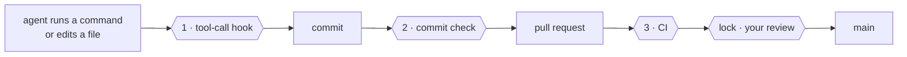
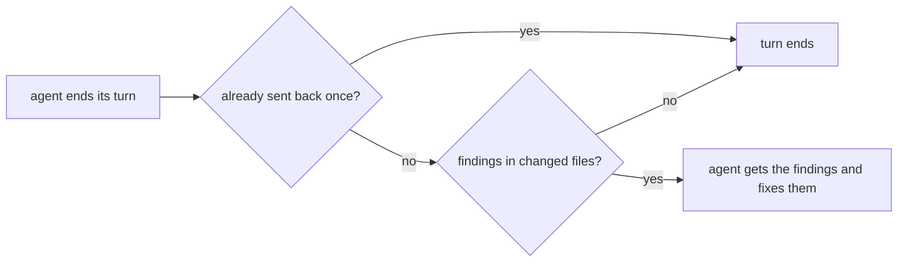
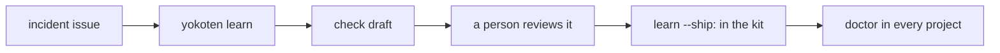

# The yokoten guide

The [README](../README.md) is the short version. This is everything else: why yokoten exists, how it works, the rules, the commands, and what it can't do.

## A race track

**Think of it as a race track.** An AI coding agent is a fast car. yokoten is the track
it runs on. The guardrails stop a mistake from becoming a wreck (the guard). The racing
line shows the next turn, one stage at a time (the guide). And every crash makes every
track safer: when one project learns a lesson, every project gets the check (*yokoten*).

## Words used here

- **Session**: one conversation with an AI coding agent, such as Claude Code.
- **Hook**: a small program the agent's tool runs at a set moment. yokoten adds one that
  runs before every command or edit (and can stop it), one when the agent ends its turn,
  and one at the start of each session.
- **Commit check**: a git hook (`.githooks/pre-commit`) that runs before each commit.
- **CI**: the checks GitHub runs on every pull request.
- **Ruleset**: a GitHub setting that protects a branch or tag, for example "no merge
  without review".
- **Owner, lead, worker**: you; the agent session you talk to; a session the lead starts
  for one task. See [Managing agents like a team](#managing-agents-like-a-team).
- **Exit code**: a number a command gives back when it ends. 0 means all is well. A
  script or an agent reads it. See [Exit codes](#exit-codes).
- **JSON**: a plain text format for data that programs read. `--json` prints it.

## The name

*Yokoten* (横展) is a word from Toyota's shop floors. When one production line finds a
fix for a defect, the fix goes to every line that could have the same defect, not just
the line that found it. yokoten does that for your projects: a lesson one project learns
is offered to the rest.

## The problem

You run a project with AI agents for a few months. You learn things the hard way: an
agent "fixes" a failing test by changing the test, a pull request merges with a commit
nobody reviewed, a server address ends up in a tracked file. You add a rule, a hook, a
check. That project gets better.

Then you start a new project, or go back to an old one, and none of it is there. The
lessons live in one repo and in your head. If you forget to ask for them, the agent
starts from zero.

yokoten turns those lessons into something that checks itself:

- **Rules with reasons.** Twelve core rules. Each one says why it exists (an incident,
  or a risk if nothing has gone wrong yet) and which check holds it. A rule without a
  check is a wish.
- **Guards that run on their own.** A tool-call hook stops an agent before a bad
  command runs. A commit check catches what the hook can't see. CI runs the same
  check for commits made without either.
- **A reminder you don't have to remember.** Every session starts with `doctor`. It
  tells the agent the project's stage on the road, and the one next step. The agent
  brings it up, so you don't have to.

## What changes on day one

| Your agent tries to… | Without yokoten | With yokoten |
|---|---|---|
| force-push, or tag a release | it happens | stopped before it runs, and told why |
| "fix" a failing test by editing the test | the test passes, the bug stays | not allowed in a fix |
| commit your email, a server IP, your city | it goes public | the commit stops; the report names the file and line, never the text |
| post your email or a token in an issue or a pull request | it goes public | stopped before it is sent, and told what to change |
| open a pull request | as you, with all your rights | as a bot; nothing merges without you |
| work in another project | starts from zero | sees what that project is missing, and offers to set it up |

All of this is on from the start, for everyone: you don't answer a question or edit a file to be safe. Every setting that changes it has a way back to the default. [Record 0014](records/0014-safe-by-default.md) says how yokoten decides what it does by itself, what it asks first, and what it never does.

## Three checks and a lock



| | Runs | Stops |
|-|------|-------|
| **1** | before each tool call | tag pushes, force pushes, skipped checks; test edits in a fix task; a worker editing the rules; a program the project blocks; an issue or pull request title that breaks the title rules; personal data or a secret in an issue, pull request, comment or release note an agent posts with `gh` |
| **1b** | when a Claude Code agent ends its turn | the same personal data, secrets and file rules as the commit check, in the changed files. It sends the agent back once with the findings |
| **2** | on every commit | what the hook can't see: files changed by `sed` or a script, personal data, an overfull folder |
| **3** | on every pull request | a commit made with the hook off |
| **lock** | on the server | a merge without your review, a push to `main`, a release tag that isn't yours |

## What a session sees

At the start of a session in a project that hasn't adopted yokoten yet:

```
yokoten: stage 1 of 5, safety net. Next: no AGENTS.md, so the agents have no written rules here; `yokoten init` adds one.
Why: an agent follows the rules it can read, and only those.
Tell the user in plain words, one step at a time, and offer to do it (as-is, lighter, or not now with a reason).
```

The session hears about one step only: the stage, the next step, and why it matters.
The stage is worked out from the files each time; nothing saves it. A step you marked
"not now" is skipped. The order is advice: a later step done early counts as done.
When every step is done or "not now", the session hears one line that says so.
A file missing here but on the default branch is named with that branch, not with `init`.
After Claude Code compacts the context, the session hears only notes that changed.
Each session keeps what it heard in `~/.config/yokoten/sessions/`, and files older than 7 days are removed.
The agent tells you in your own language. yokoten prints English, which agents read most
reliably.

`yokoten doctor` shows the whole road. Each step is **done**, **next**, **to do**, **not
now** (with your reason) or **can't check**. Steps that yokoten can't check yet are not
listed:

| Stage | Steps |
|---|---|
| **1 · Safety net** | `rules`, `tool-hook`, `commit-check`, `runtime`, `tests` (a test command, and CI runs it) |
| **2 · Issues and pull requests** | `ci` (CI runs `check`, or uses the yokoten Action), `issues` (no todo file), `templates`, `labels` (the standard set), `milestone` (an open one), `no-build-output` (nothing in `dist/`, `build/` or `out/`, no built binaries) |
| **3 · Release** | `changelog`, `titles` (CI runs `check --pr`, or uses the Action on pull requests without `pr-check: false`) |
| **4 · A team of agents** | `codeowners`, `bot`, `skills`, `review` (a merge to the default branch needs one approval) |
| **5 · Going public** | `security-files` (a security policy, Dependabot, a license), `protection` (rulesets on the default branch and `v*` tags), `merge-settings` (squash only, delete branch on merge), `security-settings` (secret scanning, push protection, private reporting, Dependabot alerts) |

The last three are server settings. Full `doctor` reads them through `gh api`, and only reads.
Without `gh`, a sign-in, the network or a GitHub remote, they are **can't check**, never done.
A session never calls the network, so there they are always **can't check**.

`labels` and `milestone` in stage 2 are read the same way. The standard labels are `bug`, `feat`,
`docs`, `refactor`, `ci`, `owner`, `incident`, `good first issue`, `hotfix`, and the tier labels
`tier A`, `tier B` and `tier C`. `init` shows which are missing, and `init --github --yes` adds
them.

`review` in stage 4 reads the server the same way. It is done when the default branch's ruleset, or
its branch protection, asks for at least one approving review. GitHub does not let you
approve your own pull request. So the bot opens the pull requests, and you approve and
merge them. To set it up, edit the ruleset on the default branch: in "Require a pull
request", set "Required approvals" to 1. Also keep "Allow GitHub Actions to create and
approve pull requests" off, in Settings, Actions, General. If it is on, a workflow the bot
pushes could approve the bot's own pull request, so `review` is not done. OpenSSF
Scorecard should then count each change as reviewed, because the person who merges it
did not write it. We read this in the Scorecard docs and have not checked it in a real
Scorecard run yet. A private repo on a free plan has no rulesets, so there `review` is
**can't check** and waits for stage 5, when the repo goes public. It is not **not now**:
that mark is only for a decision you make.

`init --github --yes` also adds your own areas from `yokoten.json` "areas" as labels, in one
grey colour. It does this only for 8 areas or fewer: a longer list is noise, so make the few you
use by hand. An area label that is there is kept as it is, and yokoten never deletes one.

The board is optional. `init --github --yes --board` makes one named after the repo and links
it. Its Status field gets Todo, In progress, In review and Done. A board needs the gh token's
`project` scope; without it, init skips the board and says to run `gh auth refresh -s project`.
A second run finds the board by its title and makes nothing. The API can't set a board's views
or workflows. So when a board is linked, full `doctor` lists them as "by hand" lines. They never
fail doctor.

After a step, `yokoten doctor` names the outside standard it meets, when there is one,
for example `ci (Scorecard: CI-Tests)`. The session message leaves it out.

[Record 0004](records/0004-the-road.md) says why the road looks like this.

This repo walks the same road, so you can see each stage working:

| Stage | You learn | See it here |
|---|---|---|
| **1 · Safety net** | rules your agents read, and checks that stop them when rules aren't enough | [AGENTS.md](../AGENTS.md) |
| **2 · Issues and pull requests** | every change starts as an issue and merges only when CI passes; labels, milestones, and a board keep track | [issues](https://github.com/yokoten-labs/yokoten/issues?q=is%3Aissue), [pull requests](https://github.com/yokoten-labs/yokoten/pulls?q=is%3Apr), [the board](https://github.com/orgs/yokoten-labs/projects/1) |
| **3 · Release** | commit messages that say what changed and why, a changelog, a version number for every release | [CHANGELOG.md](../CHANGELOG.md) |
| **4 · A team of agents** | a bot opens pull requests, workers take tasks, a reviewer checks them; only you merge | [Managing agents like a team](#managing-agents-like-a-team) |
| **5 · Going public** | scan every past commit for private data, turn on security settings, protect `main` | [security policy](../.github/SECURITY.md) |

And when an agent tries to push a release tag:

```
yokoten: git push --tags pushes tags. Only the owner decides when to release. If the owner asked for this, they start a new session with `YOKOTEN_RELEASE_APPROVAL=1 claude` (or your agent's command); do not look for another way.
  docs: https://github.com/yokoten-labs/yokoten/blob/main/docs/guide.md#the-core-rules
```

The fix names the command that starts the agent the hook ran for: `codex`, `gemini`, `agy` or
`dsh tui --patch .dsh/yokoten.patch.yml`. Copilot CLI sends the same call as Claude Code, so
that message says "or your agent's command". Muse Code passes its hooks only a short list of
variables, and `YOKOTEN_ROLE` is lost. It is not known to pass `YOKOTEN_RELEASE_APPROVAL`
either, so in Muse Code the message says to release outside it. If Gemini CLI's strict
environment sanitization is on, the variable is dropped, and the owner releases outside Gemini CLI.

Every message has the same three parts: **what** happened, **why** it matters, and the
**fix**, a command or an edit. A problem in a file starts with its place, `file:line:`.
A hit names the kind of thing it found, never the thing: a secret or a private mark
is never printed. When a section of this guide explains the rule, the message ends with
a link to it, on its own line: `docs: <url>`.

To ask why a rule exists, run `yokoten explain <id>`. The id is the rule or step name,
such as `secret` or `commit-check`. With no id, or an unknown one, it lists every id.

```
$ yokoten explain force-push
force-push: no plain force push (core rule 7).
Why: a plain force push can throw away work that someone else pushed.
Check: the tool-call guard stops `git push --force`, `-f` and a `+ref`; `--force-with-lease` passes; a branch ruleset on the server is the lock.
Docs: https://github.com/yokoten-labs/yokoten/blob/main/docs/guide.md#the-core-rules
```

### Work only on this machine

A power cut, a crash or a dead disk loses work that lives only on one machine. So
`doctor` lists that work, each item with the one command that saves it:

| Note | What it means | The command |
|---|---|---|
| `uncommitted-changes` | A worktree has changed files: how many, and how old the oldest is | `git add -A` and `git commit` there, then push |
| `unpushed-commits` | A branch has commits that no remote has, or a detached HEAD has commits that no branch holds | `git push`, or `git push -u origin <branch>` for a branch with no upstream of its own; `git switch -c <name>` first for a detached HEAD |
| `stashes` | There are stashes. A stash is never pushed | `git stash branch <name>`, then push it |
| `stale-index-lock` | An `index.lock` is left from a crash, and no git process runs in the repo | `rm` the file |
| `repo-on-tmpfs` | The repo is on a tmpfs, so a restart empties it | `git push --all origin`, then clone it again in a folder that lasts |
| `repo-in-temp-folder` | The repo is under the temp folder, which the system may empty on restart | `git push --all origin`, then clone it again in a folder that lasts |
| `finished-worktree` | A worktree with no changes whose branch is merged, or whose upstream is gone, or whose detached HEAD is in the default branch | `git worktree remove <path>`; the branch stays |
| `missing-worktree` | git still lists a worktree whose folder is gone | `git worktree prune` |

A commit that is not pushed is still only on this machine. A branch made from
`origin/main` tracks it, so its commits go to a branch of its own, never to main.

A squash merge leaves no sign in the branch's history. So a branch whose upstream is gone
counts as merged too. A worktree with uncommitted changes is never called safe to remove.
A branch, or a detached HEAD, that has not moved since it was made is not called merged: it is new.

For an `index.lock`, doctor looks for a git process that works in the repo. On Linux it
reads each process's folder. On macOS and Windows it can't, so any git process means "can't
tell". Then doctor never says to delete the file. git's long-running helpers, such as the
credential cache, do not count. The tmpfs check reads `/proc/mounts`, so it runs on Linux only.

The temp folders are the system's own (`TMPDIR`, or `%TEMP%` on Windows) and `/tmp`. WSL
empties `/tmp` on restart, even though it is not a tmpfs. To check other folders, list them
in `YOKOTEN_TEMP_DIRS`, split like `PATH`. Set it empty to turn the check off.

The repo itself in such a folder always gets a note: that is a setup problem. A worktree
there is named only when it holds work at risk, and then in that work's own note. For
example: "../w has 3 uncommitted files, the oldest changed 2 days ago, and is under the temp
folder (/tmp), which the system may empty on restart". The worktrees there that hold nothing
at risk get one line in full `doctor`, with the count, and none in a session.

All of these are notes: they never fail `doctor`. Doctor only reads here. It changes no
file, no ref and no worktree, and git runs with optional locks off. Paths show relative to
the repo, or from `~`.

A session hears only what is at risk, three items at most. It hears uncommitted changes
only once the oldest is an hour old, because work going on now is not forgotten. Worktrees
to tidy up are left to full `doctor`. When two or more worktrees in the temp folder hold work
at risk, one line gives the count first.

A session spends at most one second on this, because a session must not wait on a cold
disk. When the time is up, it shows what it read and says "doctor stopped early". Full
`doctor` has no time limit.

## Four layers

| Layer | What | How |
|-------|------|-----|
| **Machine** | Skills, agents, and two user-level hooks, the same on every computer | `yokoten install`, or the Claude Code plugin |
| **Project** | Rules, the commit check, the tool-call hook, CI, issue and PR templates, Dependabot (monthly, one pull request), a security policy | `yokoten init`, then the `yokoten` skill for an old project |
| **Server** | Branch and tag rulesets, squash merge, code owners, a bot with limited rights, the security switches | Set once by the owner; `doctor` lists the steps |
| **Rules** | `AGENTS.md`: twelve core rules, plus the project's own | Every rule names its check |

An old project isn't a blank slate. Some of its habits are better than ours. So the
`yokoten` skill goes through the practices one at a time with you, and each one gets a
decision: **as-is**, **lighter** (and what's left out), or **not now** (with the reason
and when to look again). "Not now" goes into `yokoten.json`, and `doctor` stops asking.

### A first draft of the table

`yokoten adopt` drafts that table before the talk starts. It reads the project's files
and says what the project does today for each step: **done**, **missing**, **partial**
or **unknown**. Partial means the project has its own way, such as husky hooks, or a CI
that doesn't run yokoten. Unknown means yokoten can't check the step from here, such as
a server setting; `yokoten doctor` reads it. A model then proposes a decision and a one-sentence reason
for each row.

- The model gets only those short facts. It never gets file contents.
- yokoten runs its privacy check on the request first. On a hit, it sends nothing.
- With no key, a failed call or a bad answer, rules draft the table instead: done or
  missing is as-is, partial is lighter, unknown is as-is once `doctor` has checked it.
  The output says which one drafted it.
- `adopt` never writes a file. You still decide every row.
- A partial row is not lost when you run `init`: it imports `AGENTS.md` from your
  `CLAUDE.md`, and it adds the commit check to husky's `pre-commit`.

The model runs on Meta's model API, through its OpenAI-compatible endpoint
(`https://api.meta.ai/v1`, model `muse-spark-1.3`). Set `LLAMA_API_KEY` or `MODEL_API_KEY`
to your key. `LLAMA_API_BASE` and `LLAMA_MODEL` point it at any other OpenAI-compatible
endpoint and model.

## Works with

yokoten guards eight AI coding agents with the same rules. Each "yes" below is a real
run: the agent tried `git push --tags` in a throwaway repo, and the guard stopped it.
Docs are not proof.

| Agent | Hook file (`init` writes it) | How it blocks | Verified | Caveats |
|---|---|---|---|---|
| Claude Code | `.claude/settings.json`: PreToolUse and Stop | exit 2, the reason on stderr | yes, 2026-10-19: headless, on DeepSeek `deepseek-flash` | none |
| GitHub Copilot CLI | the same `.claude/settings.json`: Copilot reads it | exit 2, and the reason as JSON on stdout | yes, 2026-10-19: Copilot CLI 1.0.98, `copilot -p`, model `gpt-6-luna` (Auto) | Runs repo hooks only after you trust the folder: run `copilot` there and choose "Yes, and remember this folder for future sessions". Skips them without a word otherwise. A hook that times out lets the call go on |
| Antigravity CLI (`agy`) | `.agents/hooks.json`: the `yokoten` entry, PreToolUse | `{"decision": "deny"}` on stdout | yes, 2026-10-19: agy 1.4.2, `agy -p`, model `gemini-3.8-flash-high` | No stop check yet. Without `.yokoten/`, every call is refused: agy fails closed |
| Codex CLI | `.codex/hooks.json`: PreToolUse and Stop | exit 2, the reason on stderr | yes, 2026-10-19: Codex 0.163.0, `codex exec`, on DeepSeek `deepseek-flash` | Runs the hooks only after you trust the folder, and then both hooks in `/hooks`. `codex exec` skips an untrusted hook without a word |
| Muse Code | `.muse/hooks.json`: PreToolUse and Stop | exit 2, the reason on stderr | yes, 2026-10-19: Muse Code 1.4.10, `muse exec --trust-workspace`, model `muse-spark-1.3-contributor` | Runs the hooks only after you trust the folder: run `muse` there and choose "Trust and continue". Muse passes no `YOKOTEN_ROLE` to a hook, so every Muse session counts as the lead. It is not known to pass `YOKOTEN_RELEASE_APPROVAL` either, so release outside Muse. A hook that fails or times out lets the call go on |
| DeepSeek Harness (`dsh`) | `.dsh/hooks.json`: PreToolUse, and `.dsh/yokoten.patch.yml` to load it | exit 2, the reason on stderr | yes, 2026-10-20: dsh 0.2.1-rc.2, `dsh headless --patch .dsh/yokoten.patch.yml`, default DeepSeek model | Runs hooks only through a bridge you add to each profile: see [DeepSeek Harness](#deepseek-harness). Without it, or without the patch, dsh runs no hooks and says nothing. Not guarded on Windows yet (#332). No stop check |
| Grok CLI (`grok`) | `.grok/hooks/yokoten.json`: PreToolUse and Stop | `permissionDecision: "deny"` on stdout, and exit 2 | yes, 2026-10-20: Grok CLI 1.0.52, `grok -p --trust --always-approve`, default model | Runs project hooks only after you trust the folder: run `grok` there and type `/hooks-trust`. Skips them without a word otherwise. Also runs the hooks in `.claude/settings.json`, so the guard may run twice for one call, on purpose |
| Gemini CLI | `.gemini/settings.json`: BeforeTool and AfterAgent | exit 2, the reason on stderr | not run end to end: personal sign-in retired 2026-06-18; needs a paid API key or an org license | Google's agent for individuals is now Antigravity CLI |
| Any other agent | none | the rules in `AGENTS.md`, and the commit check, which stops a bad commit whoever made it | | |

`install` writes the user hooks: the guide at the start of each session, and the command
guard. They go in `~/.claude/settings.json`, and in `~/.codex/hooks.json` and
`~/.gemini/settings.json` when those folders exist. Grok CLI gets only the command guard,
in `~/.grok/hooks/yokoten.json`, when `~/.grok` exists: it shows a session-start hook's
output to you, not to the agent. `doctor` counts every folder as trusted when
Grok's trust gate is off: `GROK_FOLDER_TRUST=0`, or `[folder_trust] enabled = false` in
`~/.grok/config.toml`. In Codex, the guard checks the files
of an `apply_patch`, also one run through the shell.

Each agent runs a project hook only after you trust it:

- **Claude Code** runs project hooks in a folder you trust.
- **Copilot CLI** runs them in a folder you trust. In `copilot -p`, set
  `COPILOT_ALLOW_ALL=true`: that exact value trusts the folder. `--allow-all-tools` alone
  does not, and then the hooks do not run.
- **Antigravity CLI** ran `.agents/hooks.json` in `agy -p`, in a folder not on its trust
  list. It runs the hook with the `.agents` folder as its working folder. Guides say
  `--dangerously-skip-permissions` skips the hooks. In agy 1.4.2 the hook still ran with it.
  Don't count on either.
- **Codex** runs project hooks only in a trusted project. Then approve each hook in
  `/hooks`. Codex remembers the command, so a changed command must be approved again.
- **Muse Code** runs `.muse/hooks.json` only in a trusted workspace, and skips it without a
  word otherwise. In `muse exec`, `--trust-workspace` trusts the folder for that run.
  It also reads the project's skills in `.agents/skills` only then.
- **Grok CLI** runs `.grok/hooks/` only in a trusted folder, and skips it without a word
  otherwise. Type `/hooks-trust` in a session there, or start it once with `grok --trust`.
  yokoten never trusts a folder for you. Grok also runs the hooks in `.claude/settings.json`,
  so a call may be checked twice. That is on purpose. Grok can skip its own hook: in a folder
  it does not trust, or when a repo commits an empty hook file. The Claude Code hook then
  still guards the call. The second check costs about 0.1 s.
- **Gemini CLI** runs project hooks only in a trusted folder. Start Gemini at the repo
  root: it reads `.gemini/settings.json` from the folder it starts in, and nowhere else.
  It warns once before it runs a new or changed hook.

`init` prints the one step that trusts the folder for each agent. `doctor` then reads
each agent's own trust store, read-only, and notes a folder it does not trust yet:

| Agent | Trust store | Counts as trusted |
|---|---|---|
| Copilot CLI | `trustedFolders` in `~/.copilot/config.json` (or `$COPILOT_HOME`) | the folder, or a folder above it |
| Codex | `~/.codex/config.toml` (or `$CODEX_HOME`): `[projects]` and `[hooks.state]` | the repo folder exactly, and each hook as it is now |
| Muse Code | `~/.config/muse/trust.json` (or `$XDG_CONFIG_HOME/muse/trust.json`) | the repo folder exactly |
| Grok CLI | `~/.grok/trusted_folders.toml` (or `$GROK_HOME`): `[folders."<folder>"]` with `trusted = true` | the repo folder exactly |

Doctor checks an agent only when its home folder is there (`~/.copilot`, `~/.codex`, `~/.config/muse`, `~/.grok`).
When that folder has no store, or one doctor can't read, it says "can't check", never ok.

A worker is a session with `YOKOTEN_ROLE=worker`. In Codex, a subagent whose
`agent_type` names a worker is a worker too. Copilot CLI and Antigravity CLI name no
subagent role in a hook call, nor does DeepSeek Harness: `YOKOTEN_ROLE` decides. Gemini CLI's strict environment
sanitization removes `YOKOTEN_ROLE` from the hooks. Then yokoten can't tell a worker in
Gemini CLI: every session counts as the lead, and the lead-only guard does not stop a
worker's edit. Muse Code passes a hook only a short list of variables, and `YOKOTEN_ROLE` is not
one of them. So in Muse Code, too, every session counts as the lead. The server lock still
holds: code owners, and a bot without the rights to change CI. Grok CLI passes
`YOKOTEN_ROLE` to its hooks, and a subagent whose `subagentType` names a worker is a
worker too.

The guard stops a worker's shell writes to lead-only files as well as its edits (#402). It
reads redirects (`>`, `>>`, `>|`, `&>`), `sed -i`, `perl -i`, `tee`, `cp`, `mv`,
`install`, `ln`, `dd of=`, `truncate`, `rm`, and git's `checkout`, `restore`, `rm`, `mv`
and `apply`. A redirect counts with its file in quotes or glued to the word before it
(`echo x>"AGENTS.md"`). For `git apply`, the guard reads the patch to see its files, only
from a plain file under 1 MB; any other patch file stops a worker. A `git commit` that
would commit a lead-only file is stopped too: the commit check knows the role only from
`YOKOTEN_ROLE`, and a Claude Code subagent such as `yokoten:worker` has none. Reads such
as `cat` and `grep` pass. As for edits, this holds only in a repo that uses yokoten (one
with a `yokoten.json`). When the brief asks for a change to a lead-only file, the lead
starts the worker with `YOKOTEN_LEAD_ONLY_OK=AGENTS.md,.github/workflows/ci.yml`: paths
from the repo root, comma-separated, an entry with `*` read as a glob. `*` alone grants
every lead-only file. The guard and the commit check let those paths through. A subagent
shares the lead's environment, so give such a task to a separate session. At session
start, `doctor` tells a session with `YOKOTEN_ROLE=worker` "this session is a worker:
lead-only files are guarded". A separate worker session that does not hear it has no role
set. A subagent starts no session, so it hears nothing.

### DeepSeek Harness

DeepSeek Harness (`dsh`) runs Claude Code command hooks through a bridge plugin. The
bridge is not in the dsh package. `init` writes the hook and a launch patch, and prints
the rest. It installs nothing, and it leaves `~/.dsh` alone.

1. Add the bridge and its peer to each profile you use (`tui`, `headless`, `web`).
   `dsh plugin add` needs `pnpm` on your PATH. Without the peer, the bridge loads no hooks.

   ```sh
   dsh plugin --profile tui add @deepseek-ai/dsh-hooks-claude-code@0.2.1-rc.2
   dsh plugin --profile tui add @deepseek-ai/dsh-hook-protocol@0.2.1-rc.2
   ```

2. Start dsh at the repo root, with the patch right after the profile name:

   ```sh
   dsh tui --patch .dsh/yokoten.patch.yml
   dsh headless --patch .dsh/yokoten.patch.yml --json "<task>"
   ```

   The patch names `.dsh/hooks.json` by a relative path, which dsh reads from the folder
   it starts in. Started anywhere else, or without the patch, dsh runs no hooks.
   yokoten owns `.dsh/yokoten.patch.yml`, and `init` rewrites it. Put overlays of your own
   in another file.

dsh matches tool names exactly, in lowercase: the hook's matcher is `bash|pwsh|edit|write`.
`pwsh` is dsh's shell on Windows. It is in the matcher for later, but Windows is not
guarded yet. There dsh runs the hook itself in PowerShell, which can't run yokoten's
POSIX shell command. The bridge takes that failure as "go ahead", so every call goes
through. On Windows `doctor` says so, and `init` does too (#332).
There is no stop check: the bridge's Stop event has no loop guard. `doctor` checks both
files, and looks in `${DSH_HOME:-~/.dsh}/profiles` for the two packages. Without a dsh home
it says it can't check. The bridge fails open without a word, so files in place prove
nothing. Only a real deny proves the guard runs: ask dsh to run `git push --tags` in a
throwaway repo, and see it refused.

### Claude Code or Codex on DeepSeek

The guard sits in the agent, not in the model. So Claude Code and Codex keep the same
rules on a DeepSeek model. Both runs above used `deepseek-flash`.

Claude Code, through DeepSeek's Anthropic-compatible API:

```sh
export CLAUDE_CONFIG_DIR=~/.config/claude-deepseek   # a config folder with no claude.ai login
export ANTHROPIC_BASE_URL=https://api.deepseek.com/anthropic
export ANTHROPIC_API_KEY=<your DeepSeek key>
export ANTHROPIC_MODEL=deepseek-flash
claude
```

Keep the separate `CLAUDE_CONFIG_DIR`. With a claude.ai login in the config folder, Claude
Code sends that login's token, not the key. DeepSeek answers 401 each time, and Claude
Code retries without a word until it times out. It looks like a hang. Do not use
`--bare` either: it skips the hooks, so the guard does not run.

Codex, through DeepSeek's OpenAI-compatible API. Put this in `$CODEX_HOME/config.toml`
(default `~/.codex/config.toml`), and set `DEEPSEEK_API_KEY`:

```toml
model = "deepseek-flash"
model_provider = "deepseek"

[model_providers.deepseek]
name = "DeepSeek"
base_url = "https://api.deepseek.com"
env_key = "DEEPSEEK_API_KEY"
wire_api = "responses"
```

Codex 0.163.0 refuses `wire_api = "chat"`. It warns that it has no metadata for
`deepseek-flash`, and runs anyway.

## Install and commands

Requires Node 22.18 or later, which runs TypeScript as it is. No dependencies. There
are two ways to install: the Claude Code plugin, or the `install` command, from npm or
from a clone. Use one, not both. The hook commands that yokoten writes need a POSIX shell:
on Windows, use Git Bash.

### The Claude Code plugin

In a Claude Code session:

```text
/plugin marketplace add yokoten-labs/yokoten
/plugin install yokoten@yokoten
```

The first command adds this repo as a plugin marketplace. The second opens the plugin.
Choose "Install for you" (user scope). From your shell, `claude plugin marketplace add
yokoten-labs/yokoten` and then `claude plugin install yokoten@yokoten` do the same.

The plugin is this repo. It uses the same files that `install` copies, so the two ways
can't drift apart:

| The plugin adds | From |
|---|---|
| The skills: `/yokoten:dispatch`, `/yokoten:inspect`, `/yokoten:rca`, `/yokoten:record`, `/yokoten:release`, `/yokoten:yokoten` | `kit/user/skills/` |
| The agents: `yokoten:worker`, `yokoten:reviewer`, `yokoten:verifier` | `kit/user/agents/` |
| `/yokoten:init`, `/yokoten:doctor` and `/yokoten:update`, which run yokoten from the plugin | `kit/plugin/skills/` |
| The SessionStart `doctor` hook and the command guard: the same two hooks that `install` adds | `.claude-plugin/plugin.json` |

The command guard runs in every folder, so it keeps to the rules about commands, with one
exception: an edit to a file inside a yokoten repo (one with `yokoten.json`) gets that
repo's file rules, wherever the session started. A worker in a worktree outside the
session's folder can't change a lead-only file either.

Claude Code runs the plugin's `.ts` files with `node`. Node can do this because the
plugin folder is not under `node_modules`. To get a newer yokoten, open `/plugin`, select
yokoten on the **Installed** tab, and choose **Update now**. A third-party marketplace
does not update on its own until you turn on auto-update for it. From your shell,
`claude plugin update yokoten@yokoten` does the same; restart Claude Code after it. When the
plugin is older than the yokoten that runs `doctor`, `doctor` says so in a note.

The plugin works in Claude Code only. It does not make the private-marks file: `doctor`
names the file, and you make it. When the plugin is on in your user settings, `doctor`
counts its hooks and skills as installed.

Use the plugin or `install`, not both: with both, the guard and the session doctor run
twice and every skill shows up twice. `doctor` says so in a note. To move from `install`
to the plugin, run `yokoten uninstall`. It removes what `install` wrote and keeps
`~/.config/yokoten`.

### Install with npx

For Codex CLI and Gemini CLI, or without the plugin:

```sh
npx yokoten install      # this machine: skills, agents, hooks
cd your-project
npx yokoten init         # this project: adds files, never overwrites
npx yokoten doctor       # the road: where you are, what's next
```

`npx` downloads the package and runs it. The package has no dependencies. `install`
and `init` copy yokoten's runtime out of the package: to `~/.local/share/yokoten` and
to `.yokoten/`. The hooks run these copies, so they need no network and no `npx`.

The package runs built JavaScript, because Node does not run TypeScript under
`node_modules`. The repo has no build; `npm pack` makes the package's `dist/`
([record 0008](records/0008-npm-package.md)).

The owner publishes the package, as the owner creates a release tag. The tag starts the
release workflow. It runs the checks, then the publish job waits for the owner's
approval in the `release` environment. Only then does it publish to npm, with no npm
token stored anywhere ([record 0009](records/0009-release-environment.md)). The first
release is the one exception: the owner publishes it by hand, because npm can't trust a
workflow for a package it does not have yet. Until the
first release is on npm, [install from a clone](#install-from-a-clone).

### Install from a clone

The same commands, from a copy of this repo. Use this way until the first release is
on npm:

```sh
git clone https://github.com/yokoten-labs/yokoten
node yokoten/bin/yokoten.ts install      # this machine: skills, agents, hooks
cd your-project
node ~/.local/share/yokoten/bin/yokoten.ts init     # this project: adds files, never overwrites
node ~/.local/share/yokoten/bin/yokoten.ts doctor   # the road: where you are, what's next
```

A clone install puts no `yokoten` command on your PATH, but yokoten's messages say
`yokoten init` and `yokoten doctor`. So `install` ends with this line for your shell
profile (`~/.bashrc` or `~/.zshrc`). Add it yourself, then open a new shell:

```sh
alias yokoten='node ~/.local/share/yokoten/bin/yokoten.ts'
```

yokoten never edits your shell profile. When a `yokoten` on your PATH already runs this
copy, `install` leaves the line out.

These commands, and the npx ones, are also in [docs/facts.json](facts.json), which the
website reads, so a change to them goes in both places.

### Use it as a GitHub Action

Any repo on GitHub can run yokoten's checks in CI with one workflow file. Nothing is
installed in the repo, and nothing leaves the job: no token, no outside service.

```yaml
# .github/workflows/yokoten.yml
name: yokoten
on:
  pull_request:
    # `edited`, `labeled` and `milestoned` run `check --pr` again after a fix.
    types: [opened, edited, synchronize, reopened, labeled, unlabeled, milestoned, demilestoned]
  push:
    branches: [main]
permissions:
  contents: read
jobs:
  yokoten:
    runs-on: ubuntu-latest
    timeout-minutes: 10
    steps:
      - uses: actions/checkout@3d3c42e5aac5ba805825da76410c181273ba90b1 # v7.0.1
        with:
          fetch-depth: 0
          persist-credentials: false
      - uses: yokoten-labs/yokoten@<full commit SHA>
```

The action sets up Node, then runs `check`. On a pull request it also runs `check
--pr`. The findings show on the pull request page, as in yokoten's own CI.

It handles three events:

- **`push`**: `check`.
- **`pull_request`**: `check`, then `check --pr`.
- **`issues`**: `check`, then `check --issue` on the issue's title. To run it, add
  `issues:` with `types: [opened, edited]` under `on:`.

On `pull_request_target` the checkout holds the base branch, not the pull request, so the
action skips `check --pr` and leaves a notice: the pull request check runs on
`pull_request`, not `pull_request_target`.

- **Pin it.** Use a full commit SHA. A branch name like `@main` changes under you. Once
  there is a release, a release tag works too.
- **The checkout** needs `fetch-depth: 0`. `check --pr` lists the files between the base
  and the head commit, so it needs both.
- **Permissions**: `contents: read` is enough. The action takes no token.
- **Inputs**: `pr-check` (default `true`), `issue-check` (default `true`) and
  `node-version` (default `22`, at least 22.18). Set `pr-check: false` to skip the pull
  request standard, `issue-check: false` to skip the issue title standard.
- **Node**: the action sets up Node for the rest of the job too.

`check --pr` holds a pull request to the standard of core rule 8. A repo that does not
follow it yet can start with `pr-check: false`. A pull request Dependabot opens gets
the title check, and the other rules show as notes, because Dependabot writes its own
body. The `init` workflow in the kit still
runs `.yokoten/`. It moves to the action after the first release, so it never depends
on `@main`.

### Commands

`init` copies the runtime into `.yokoten/` in your project. Commit it: the hooks and CI
then run with no network and no global install.

`init` keeps a project's own setup working. An `AGENTS.md` without `## This project` gets
the core rules on top. Its own text moves under `## This project`, and its headings go one
level down; nothing else in it changes. `init` prints each heading it moved. When git has
the old file as it was, `init` prints the command that gives it back. Otherwise it keeps a
copy in `AGENTS.md.before-yokoten`. YAML front matter stays at the very top. An `AGENTS.md` that is a link stays as it is. With a `CLAUDE.md`, it adds an `@AGENTS.md`
line at the end, because Claude Code reads `AGENTS.md` only through that import. A
`.claude/CLAUDE.md` counts too, and gets `@../AGENTS.md` when there is no root one. With
husky or another `core.hooksPath`, it keeps that folder and adds the commit check to its
`pre-commit`. The project's own hook lines stay, and `init` says which file it changed.
git runs `pre-merge-commit`, not `pre-commit`, for a merge it commits itself, so `init` adds
the same check there too (`.githooks/pre-merge-commit`, or husky's `.husky/pre-merge-commit`).
A `.githooks/pre-commit` of the project's own gets the check too. A file under `.husky/`
keeps its mode, because husky 9 runs it with `sh`.

A clone can also have its own hooks in `.git/hooks`: from lefthook, the pre-commit
framework, or written by hand. Pointing git at `.githooks` would switch all of them off,
so `init` writes `.githooks/pre-commit` and `.githooks/pre-merge-commit` to run the check
first and then the old hook, and for each other executable hook, such as `commit-msg` or
`pre-push`, a `.githooks` file that only runs the old one. Each gets the same arguments
and stdin. The old hooks stay in `.git/hooks`, and `init` names each one it kept. A hook
that is not executable is skipped by git today, so `init` goes ahead and says how to keep
it. When it can't hand off (a commit hook comes from a global `core.hooksPath`, or the
project's own `.githooks` file has its check inside an `if`, or reads stdin like the old
hook), `init` leaves `core.hooksPath` unset and prints what to do. With a global
`core.hooksPath`, the files in `.git/hooks` never ran, so `init` leaves them out. `doctor`
does not count the commit check as done while such a hook would be dropped. For a
workflow of the project's own that `init` keeps, `doctor` gives the step to add to it.

`init` also writes three workflows into `.github/workflows/`: `yokoten.yml` (the
commit check, a lint job with actionlint and zizmor, and one `ci` job to make the required
check), `pr.yml` and `issue.yml`. Each action is pinned to a commit, each job has a time
limit, checkout keeps no token, and a new push cancels the old run on the same pull
request. Add your tests as a job in `yokoten.yml` and to the `needs` list of `ci`.

In `yokoten.yml`, a `changes` job reads which files a pull request changes. The pull
request is docs-only when each file is under `docs/` or `changes/`, or is a `README.md`
or `CHANGELOG.md`. A job of yours can then skip a docs-only pull request; the comment
above `ci` shows the two lines to add. `ci` counts that skip as green. The commit check
and the lint job always run. A push to main runs every job. So does a pull request whose
file list can't be read: a warning says so. In yokoten's own CI, a docs-only pull request
runs the tests once, on Ubuntu with Node 24, and skips `typecheck` and the Action job.

It puts three safe defaults in `.github/` too:

- `dependabot.yml` updates the actions that CI runs, and the packages `init` finds (npm,
  cargo, pip, Go and more, at the root and one folder down). It opens one pull request a
  month for each, and takes a release only when it is a week old. A file you already have
  is kept; `init` names the packages it does not update.
- `SECURITY.md` asks people to report a vulnerability privately, not in a public issue.
  For this, turn on private vulnerability reporting. `doctor` lists it with the other
  security switches.
- `CODEOWNERS` names the owner for every lead-only path in the defaults: `AGENTS.md`,
  `yokoten.json`, `.yokoten/`, the hooks, the agent config and `.github/`. The guard
  stops a worker on the machine; this file stops the same change on the server. The
  owner is the account in a GitHub `origin` remote. Without one, the file has a
  placeholder, and `doctor` asks you to put your GitHub handle in it. GitHub takes no
  organization as an owner, so when `gh` says the account is one, the file has the
  placeholder too, and `init` asks for a person or `@org/team`. Full `doctor` flags a
  file whose only owner is the organization. It bites only when
  branch protection has "Require review from Code Owners" on. A CODEOWNERS file the
  project already has, in `.github/`, at the root or in `docs/`, is kept as it is.

| Command | What it does |
|---------|--------------|
| `install` | Skills into `~/.claude/skills` and `~/.agents/skills`, agents into `~/.claude/agents`, a SessionStart `doctor` hook, a user-level command guard, and an empty private-marks file. The two hooks go to Claude Code, and to Codex and Gemini CLI when `~/.codex` or `~/.gemini` already exists. It adds the marks it finds on this machine, and sets a git mailmap. See [Privacy](#privacy) |
| `init [dir]` | Puts the practices into a project. Adds files; keeps any that are already there and says so. It also reads GitHub through `gh` and says which standard labels and milestone it would add. It never changes GitHub. Without `gh`, a sign-in or a GitHub remote, it says what it skipped |
| `init --github --yes [--remove-default-labels] [--board]` | Adds the missing standard labels, and a milestone "First release" when no milestone is open. When a closed milestone already has that title, the new one is "Next release". A closed milestone is never reopened. A standard label that is there gets the standard colour and description. With 8 areas or fewer in `yokoten.json`, it adds one grey label per area. A second run changes nothing. GitHub's default labels outside the set (`question`, `wontfix` and others) are deleted only with `--remove-default-labels`. `--board` also makes a board linked to the repo; it needs the gh token's `project` scope |
| `update [dir] [--write]` | Shows what this yokoten changes in the core rules of the project's `AGENTS.md`. `--write` replaces them, and keeps the "This project" part as it is. See [Updating the rules](#updating-the-rules) |
| `doctor [--session] [--json]` | The road: every stage and step, and what this machine is missing. `--session` prints only the next step, for the start of a session. With `--agent gemini`, it prints the step as the JSON that Gemini CLI reads |
| `adopt [--json]` | A draft of the adoption table for an old project: what it does today, and a proposed decision for each step. `--json` prints the rows. Writes nothing |
| `check [--staged] [--json]` | Layout, privacy and lead-only files, for the tree or the next commit. A commit may not add build output or binaries. Each change file is read the way `changelog` reads it, so a wrong one fails at commit. With nothing staged, `--staged` notes it and is ok. For the tree, a translation behind its English source is a note. See [Translations](#translations) |
| `check --pr` | In CI: the pull request's title, `tier:` line, sections, linked issue, change file, milestone and labels. See [The changelog](#the-changelog). A file that CODEOWNERS owns needs `tier: A`. Long sentences in changed Markdown, hard-to-read names in changed code, and a diff over 400 changed lines, are notes |
| `check --issue` | In CI: the issue's title. See [Issue titles](#issue-titles) |
| `redact` | Reads text on stdin and writes it with your details hidden: `<owner>`, `<email>`, `<host>`, `<mark>`. The tool-call guard sends risky commands through it. See [Privacy](#privacy) |
| `changelog [--write]` | Shows the entries the files in `changes/` add under `[Unreleased]`. `--write` puts them into `CHANGELOG.md` and deletes the files; run it before a release. See [The changelog](#the-changelog) |
| `learn <issue> [--write]` | Drafts a check from an incident issue, for a person to review. `--write` adds the files in `lessons/`. See [Learning from an incident](#learning-from-an-incident) |
| `learn --ship <id>` | In yokoten: moves a reviewed lesson into a group in `kit/lessons/`, where `doctor` from that yokoten runs it in every project. Refused while a `TODO(reviewer)` is left or its test fails |
| `learn --upstream "<what happened>" [--area <name>] [--fix <idea>]` | Keeps a note about a gap in yokoten itself, with the project and you hidden. `--list` shows the notes; `--done <id>` removes one. See [Lessons for yokoten itself](#lessons-for-yokoten-itself) |
| `check --history` | The privacy check over every commit on every branch. Run it before a private repo goes public. A shallow clone can't see old commits, so it fails without scanning; in CI, check out the whole history (`fetch-depth: 0`). A hit in a file names the commit that added it, and the path in that commit: `file @ <commit>`. It reads commits past `git replace`, and fails the same way when a grafts file can hide commits. |
| `hook [--agent <name>] [--commands-only] [--json]` | The tool-call guard. Reads one tool call on stdin: a Claude Code PreToolUse call by default, a Codex PreToolUse call with `--agent codex`, a Gemini CLI BeforeTool call with `--agent gemini`, an Antigravity CLI PreToolUse call with `--agent antigravity`, a Muse Code PreToolUse call with `--agent muse`, a DeepSeek Harness PreToolUse call with `--agent deepseek-harness`, a Grok CLI PreToolUse call with `--agent grok` |
| `hook --stop [--agent <name>]` | The stop check. Reads the end-of-turn event on stdin and checks the changed files: a Claude Code Stop event by default, a Codex Stop event with `--agent codex`, a Gemini CLI AfterAgent event with `--agent gemini`, a Grok CLI Stop event with `--agent grok`. See [The stop check](#the-stop-check) |
| `explain [<id>] [--json]` | A rule or a step on the road: what it is, why, and how yokoten checks it |
| `uninstall` | Takes back what `install` wrote: the skills and agents marked as managed by yokoten, its two hooks in `~/.claude/settings.json`, and `~/.local/share/yokoten`. Your own files, your other settings and `~/.config/yokoten` (keys, private marks) stay. A second run changes nothing |
| `bot -- <command>` | Runs one command (`gh`, `git push`) as the bot, with a one-hour token it never prints. Before `gh issue` or `gh pr` `create` or `edit` with a title, it checks the title by the CI rules. A bad title is refused, and nothing is sent. `gh api` on an issue or pull request path is checked the same way. With `--body` or `--body-file`, `gh pr create` and `gh pr edit` also check the body by the body rules of `check --pr`, against the pull request's branch and the base branch's CODEOWNERS. A bad body is refused too, and nothing is sent. `gh pr create` without a type or tier label gets them added: the type from the title (`bug` for `fix`), the tier from the body's `tier:` line. A label you pass is kept. A tier label that does not match the body is refused, with the message of `check --pr`. A label the repo does not have is named in a note and left out; the bot never creates labels. It runs `gh` and `git` only, so `env gh …` or `sh -c …` is refused. It does not read a gh alias, so a title set through one is not checked. Setup: [server.md](server.md#3-the-bot-a-github-app) |

Each command prints its own help with `--help` or `-h`: what it does, its options and
one example. `yokoten help <command>` prints the same, and `yokoten --help` lists the
commands. `yokoten version` (or `--version`, `-v`) prints the version. Help changes nothing
and exits 0. For a typo, yokoten names the closest command
or option: `yokoten docter` asks `Did you mean "doctor"?`. After `bot --`, every word
belongs to the command it runs, so `yokoten bot -- gh --help` runs `gh --help`.

`check`, `doctor`, `hook`, `explain` and `adopt` take `--json`. Then stdout holds JSON and
nothing else, for an agent or a script. An error is JSON too: a usage error or a crash
prints `{ command, ok: false, error }` with exit 1, and the message still goes to stderr. Each finding has the same fields: `id`, `what`,
`why`, `fix`, `docs` (the link) when the guide explains the rule, and `file` and `line`
when it is in a file. `yokoten explain <id>` takes the `id`. No field holds a private
value.

- `check --json`: `{ check, ok, findings, notes }`. `check` is `tree`, `staged`,
  `history`, `pr` or `issue`. A note never fails the check. When the CI run has no
  pull request or issue, `check --pr` and `check --issue` are ok and add `skipped`, the reason.
- `doctor --json`: `{ version, ok, selfTest, repo, stage, stages, next, findings, steps,
  notes, server, lessons }`. The findings of a lesson are in `notes`; a new lesson has `isNew: true`. With `--session`, only the next step, the private-marks finding, and `core-rules` when the rules are behind. Then `notes` holds the work only on this machine, if there is any.
- `hook --json`: `{ blocked: true, finding }` when it blocks, `{ blocked: false, toolCall: true }`
  when it allows, and `{ blocked: false, toolCall: false }` when stdin is not a tool call.
  The runtimes do not use it: they read the exit code and the reason on stderr, as their
  hook protocols say.
- `hook --stop --json`: `{ blocked, stop, findings }`. With `stop_hook_active`, or when the
  check fails, also `skipped`, the reason. When stdin is not a Stop event: `{ blocked: false, stop: false }`.
- `explain --json`: `{ found, id, kind, what, why, check, docs, stage, standard }`. For an
  unknown id: `{ id, found: false, ids }`, exit 1. With no id: `{ ids }`, exit 0.

Output for people follows one rule. Results go to stdout. Problems, refusals and errors
go to stderr. An unknown option is refused, never ignored.

`init`, `update`, `doctor`, `check`, `adopt` and `bot` need a git repo. Outside one, they
say so, write nothing, and exit 1. `init <dir>` also refuses a folder that does not exist.
`doctor --session` stays quiet outside a repo, so a session there gets no noise.

In CI, you don't need to open the log to see what failed. When `check` runs in GitHub
Actions, each finding is an annotation on the changed line of the pull request. The job
summary lists each finding with its place, rule, what, why and the fix. The rule links to
its section of this guide. A note shows as a warning and never fails the check. Like the rest of the output, these name a place,
never what matched.

### Exit codes

| Code | Means |
|------|-------|
| 0 | All is well. Steps left on the road are to do, not problems, so `doctor` gives 0 with them. `doctor --session` always gives 0, so a session always starts |
| 1 | Problems found: by `check`, or by `doctor` (a failed self-test, or a core-rules, tree or machine line marked MISSING), an unknown id (`explain`), a usage error, or an error in yokoten itself |
| 2 | The hook blocked the tool call, or the stop check sent the agent back. The reason is on stderr |

These codes do not change. yokoten itself gives 1 when it breaks. But only exit 2 blocks
a call in all three agents, so a guard that crashed would let the call through. The
tool-call hook that `init`, `install` and the plugin write turns any other exit into 2:
when the guard crashes, runs out of memory or is killed, the call is refused with one
line, `` yokoten's guard failed (exit N), so the command is refused; run `yokoten doctor` ``.
That line is all of stderr: node's own error and the shell's "Killed" line are dropped.
Two cases stay at 1: when the runtime is gone, or when `node` is not on the agent's
PATH, the hook says so in one line and the call goes on. A deleted folder or a missing
node does not block every tool call, so you can still run `yokoten doctor`. The stop
check and the session doctor pass a failure on as it is.

The runtimes also let a call through when a hook runs past their timeout, so when reading
a call takes the guard longer than 5 seconds (`YOKOTEN_GUARD_DEADLINE_MS` changes it, up
to 30 seconds), or fails, the guard refuses the call with 2 (`unreadable-command`).

### Machine notes

Some problems on the machine stop every agent session, and the agent can't see them.
Full `doctor` lists them under `machine:` as notes. A note never changes the exit code.
[Record 0012](records/0012-machine-checks.md) says which problems doctor looks for, and why.

- **disk-space**: the disk that holds the repo is low on space. A full disk stops every
  session. Doctor warns below 20 GB, when that is also under 10% of the disk. Set
  `YOKOTEN_MIN_FREE_GB` to use another limit, or `0` to turn the warning off. A session
  hears this note too.
- **host-disk**, in WSL 2 only: the Windows drive that holds the Linux disk file. Inside
  WSL, `df` shows the size of the disk file, not the free space on that drive. Full
  `doctor` reads the drive through `reg.exe`, and waits at most 3 seconds. It keeps the
  reading in `~/.config/yokoten/machine.json`. A session runs no program: it repeats the
  last reading when that was low and is at most 7 days old. Run `yokoten doctor` to read
  the drive again. Without `WSL_DISTRO_NAME`, as under `sudo`, doctor can't find the drive
  and says nothing about it. The VM's disk file only grows. Deleting files inside
  the VM frees nothing on the Windows drive. So the note says: back up your work to
  another drive first. Then free space on the Windows drive, or shrink or move the disk
  file with [Microsoft's guide](https://learn.microsoft.com/windows/wsl/disk-space).
  yokoten does not suggest WSL's sparse mode: WSL marks it unsafe.

- **agent-temp-dir**: another user owns Claude Code's temp folder, `claude-<uid>`. The
  folder is in `CLAUDE_CODE_TMPDIR`, else in `TMPDIR`, by default `/tmp`.
  This happens when a root process makes the folder first, for example after a restart.
  Claude Code then refuses to start. The note prints `sudo rm -rf '<folder>'`, quoted. Run it
  yourself: doctor never deletes anything.
- **leftover-temp-folders**: `yokoten-*` folders older than a day in the temp folder.
  Test runs leave them, and thousands of them fill the disk. Full `doctor` counts them.
  It does not add up their size, so it stays fast. The note prints a `find ... -exec rm -rf`
  command that removes only the old ones. Run it yourself: doctor never deletes anything.

### Troubleshooting

**An agent won't start.** Then it can't tell you why. Open a terminal in your project
and run `npx yokoten doctor`. Read the lines under `machine:`. A full disk and a temp
folder owned by root are the usual causes. Each note prints the command that fixes it.

### The stop check

The tool-call hook reads commands. It does not see a file that `sed` or a script
changed. The commit check sees it, but only at the commit. The stop check runs earlier:
when the agent tries to end its turn. That is the Stop event in Claude Code and Codex,
and AfterAgent in Gemini CLI.



- It checks the changed files only: staged, not staged, and new files that git does not
  ignore. It uses the privacy, secret and file rules of `check --staged`.
- It sends the agent back once. The agent then sets `stop_hook_active`, and the next
  stop always ends the turn. There is no loop.
- It reads no history and uses no network.
- On an error in yokoten, the turn ends and stderr gets one line.
- A new file you want to keep out of the check goes in `.gitignore`, or in
  `privacy.skip` in `yokoten.json`.

`init` adds it to `.claude/settings.json`, `.codex/hooks.json` and `.gemini/settings.json`.
`install` does not add it at user level: it
reads files, so each project turns it on, as with the file rules of the tool-call hook.

The commit check refuses a file in a `dist/`, `build/` or `out/` folder, and a binary file.
A build makes such files again, and a reviewer can't read a binary. Images and fonts
(`png`, `jpg`, `gif`, `webp`, `svg`, `ico`, `woff`, `woff2`) pass. To keep a file
anyway, list it in `yokoten.json` as a glob: `"allowBuild": ["docs/manual.pdf"]`.

### Blocked commands

A project's stack rule, such as "no Python" or "no yarn", is easy for an agent to forget
in the middle of a task. Written only in AGENTS.md, it is a wish. List the programs in
`yokoten.json`, each with its reason, and the tool-call guard holds the rule:

```json
"commands": {
  "block": {
    "python": "this project is TypeScript only",
    "python3": "this project is TypeScript only"
  }
}
```

The guard then stops a command that runs `python3`, for the lead and for every worker.
The message names the program, gives your reason, and tells the agent to use the
project's own stack.

- The guard looks at the program of each command, by its name: `/usr/bin/python3` and
  `python3.exe` count as `python3`.
- Every part of the command counts: `a && b`, `a | b`, `a; b`, `$(...)`, and the
  string a shell runs: `bash -c '...'`, `ssh host '...'`, `flock file -c '...'`.
- Assignments, redirects, launchers and shell keywords do not hide the program:
  `X=1 python3`; `2>/dev/null python3`;
  launchers such as `env`, `sudo`, `nice`, `timeout`, `xargs`, `setsid` and `stdbuf`;
  a command after `if`, `for`, `while` or `!`; a program `find -exec` runs; and the
  string in `env -S`.
- A word that only holds the name passes: `echo python`, `cat python.md`, `pythonic`,
  and a `case` pattern such as `python3)`.
  `command -v python3` passes too: it only says where the program is.
- A name has no folder and no space. A wrong shape in `"commands"` is a config error,
  as for any key in [yokoten.json](#yokotenjson). The guard then blocks no program and
  says so, and the core checks still run.

The guard reads command text. It does not see a program that a script, a `make` target,
an npm script or a shell function runs. Name each version you want to stop:
`python3.12` is not `python3`.

### yokoten.json

`yokoten.json` at the repo root holds the project's settings. Every key is optional. A
missing key, a key set to `null`, or a missing file gives the default.

| Key | Must be | Default |
|-----|---------|---------|
| `layout` | `{ "maxEntries": 7, "exempt": ["docs/records"] }`: a whole number above 0, and a list of folders | 7, no folder exempt |
| `tests` | a list of globs | `*.test.*`, `*.spec.*`, `*_test.go`, `test/**`, `tests/**` |
| `leadOnly` | a list of globs | the rules, agent config, hooks and CI |
| `privacy` | `{ "allow": [], "skip": [], "utc": true, "output": "run" }`: two lists of text, true or false, and `"run"` or `"stop"` | lockfiles skipped, UTC on, output run |
| `notNow` | reasons by step name: `{ "ci": "no remote yet" }` | none |
| `allowBuild` | a list of globs | none |
| `areas` | a list of words | any lowercase word |
| `translations` | `{ "fail": true }` | `false` |
| `commands` | `{ "block": { "<program>": "<reason>" } }` | no program blocked |

yokoten checks each key against this table, in one place:

- A key with the wrong shape, such as `"leadOnly": "x"`, is a config error. `check` and
  `doctor` exit 1. The message names each wrong key and says what it must look like, so
  one run shows them all.
- The tool-call hook then uses that key's default. It says so in one line on stderr, and
  the core checks still run. A wrong field in an object, such as `layout.maxEntries`,
  gives only that field's default. A wrong `"commands"` drops the whole block list.
- When `yokoten.json` is not valid JSON, or is not one JSON object, `check` and `doctor`
  report a config error. The hook then uses all the defaults, says so in one line, and
  still runs the core checks.
- A key that yokoten does not know is a note from `check`, never an error. A config
  written for a newer yokoten then still works with an older one. A field it does not
  know inside an object, such as `"commands": { "blok": ... }`, is a note too.

### Issue titles

An issue title names the area, then the work. A list of issues then reads like a list of
commits to come.

- A task: `area: verb phrase`, for example `doctor: add the review step`.
- An incident: `area: symptom`, for example `check: misses a key in a JSON file`. Name
  what you saw, not the fix.
- At most 60 characters. No full stop at the end. No `#N`: link other issues in the body.
- The area is one lowercase word, or words joined by hyphens.

`init` adds `.github/workflows/issue.yml`. It runs `check --issue` when an issue is
opened or edited. It only reads: it never comments on the issue or renames it. A red run
tells the author to fix the title.

An agent's title is checked before it is sent. In a repo with a `yokoten.json`, the
tool-call guard runs the same check on `gh issue create|edit` and `gh pr create|edit`
with a title, plain or through `yokoten bot`. A bad title stops the command, so CI never
sees it. The user-level hook does not check titles: another project has its own rules.

Any lowercase area passes. To limit the areas, list them in `yokoten.json`:
`"areas": ["doctor", "check", "docs"]`. Pull request titles then use the same list in
`type(area): summary`.

### The changelog

A pull request that changes what users notice adds one small file,
`changes/<issue>-<slug>.md`. It does not edit `CHANGELOG.md`. When every pull request
adds a line at the top of the same file, each merge makes the others conflict. Separate
files never conflict.

The file is plain Markdown. Line 1 is the section: Added, Changed, Deprecated, Removed,
Fixed, Security or Internal. Line 2 is blank. From line 3, write the entry as it should
read in the changelog. The `- ` is added for you. Several bullets in one file are fine.
The entry has no headings, and the file is a plain file right in `changes/`, not in a
folder or behind a link.

```markdown
Fixed

`doctor` no longer stops when the repo has no remote (#42).
```

`yokoten changelog` shows what the files would add, and writes nothing. Before a release,
`yokoten changelog --write` puts each entry under its section in `[Unreleased]`, and
deletes the files it used. It never touches released versions. If a file is wrong,
it says which file and why, and writes nothing.

`check --pr` takes a new file in `changes/` as the pull request's changelog entry, and
checks its form. A line in `CHANGELOG.md` still passes, for a project that has not moved
yet. `check` reads the files in `changes/` the same way, and `check --staged` reads the
staged ones. So the git hook stops a wrong file at commit, before CI does. It also notes
long sentences in a staged change file. A change file not yet added to git counts too, as
it does for `changelog`. `init` adds `changes/README.md`, which shows the form.
`changes/` may hold more than 7 files, since each release empties it.

### Translations

English is the source; a translation follows it. When the English text changes, the
translation falls behind, and nobody sees it. So each translated file names its source
on line 1, in an HTML comment. GitHub does not show it.

```markdown
<!-- source: docs/guide.md -->
```

The path is the English file, from the repo root. Only a relative path makes a marker:
an attribution comment such as `<!-- source: https://example.com/post -->`, or an
absolute path, is left alone. Write this line once; it never changes. When you change
the English, update the translation in the same commit or pull request.

`check` reads line 1 of each Markdown and HTML file. Then it reads the commits on the
current branch, first parent only, back to the commit that added the translation. A
commit that changes the English but not the translation puts the translation one commit
behind. Only a later commit that changes only the translation catches up. A commit that
changes both files is fine, but it does not cover an English-only commit before it. So
when one pull request changes only the English and another changes both, the first is
noted, whichever merges first. Any line of the translation counts.

Why not a line that records the English version? Every pull request that changes the
English would then edit that line. Two such pull requests would always conflict on it.
With a line that never changes, parallel pull requests touch only the paragraphs they
translate.

The costs. First, a commit that changes only the translation catches up with every
English change before it. A typo fix in the translation can hide an English change that
nobody translated. So run `check` before a typo fix. If it notes the translation as
behind, update the translation first. Second, with squash merges, an English-only pull
request stays noted until a commit changes only the translation. This is true even when
a later pull request translated it along with its own change. To clear the note, update
the translation in a pull request of its own.

In the work tree, an edit to the translation alone counts as a later change. An edit to
the English alone makes the translation behind. An edit to both counts as a commit that
changes both.

When a translation is behind, `check` gives a `translation-behind` note. The note says
how many commits behind, and how to see the change: `git diff <commit> HEAD -- docs/guide.md`.
A note never fails CI. To make it fail, put `"translations": { "fail": true }` in
`yokoten.json`.

An older form of line 1 adds the English blob:
`<!-- source: docs/guide.md blob 3b18e512dba79e4c8300dd08aeb37f8e728b8dad -->`.
`check` still reads it. A blob equal to the English text is current; otherwise the
commits decide. You can drop the blob at any time.

A shallow clone holds only the newest commits. When they are enough to tell, `check`
answers as usual; an English-only commit it sees is "at least" that many commits behind.
When they are not enough, `check` gives one note for the whole run. The note says how
many translations weren't checked, and there is no note for each file. That note never
fails, even with `"fail": true`. `check` never fetches. In CI, use `fetch-depth: 0`; the
kit's `yokoten.yml` does.

### Updating the rules

When yokoten learns a lesson, its core rules change. `yokoten install` updates the
skills and agents on your machine. Your project's `AGENTS.md` is your file, so it
changes only when you ask. Once it has `## This project`, `init` never touches it again.

`doctor` compares the part of `AGENTS.md` above `## This project` with the core rules
of the yokoten you run. When they differ, it reports `core-rules`, and a session hears
it too.

`yokoten update` shows the change and writes nothing. It names the sections that
changed, and lists each line it adds (`+`) or removes (`-`). `yokoten update --write`
replaces the core part. Everything from `## This project` down stays byte for byte.

A line you edited by hand in the core part shows as `-`, because the update replaces
it. Move your own rules under `## This project` first. Without that heading, yokoten
can't tell the core rules from yours. Then it says so, and compares and writes nothing.

The first line of `AGENTS.md` names the kit that wrote the core rules, as a comment
that GitHub does not show: `<!-- yokoten kit 0.1.0 -->`. `init` writes it, and
`update --write` sets the new version. When the project's kit is newer than the
yokoten you run, `update` refuses and writes nothing, so the rules never go back to
an older kit. `doctor` then says to update yokoten itself, not the project. A file
without that line compares by its text only.

The copy in `.yokoten/` keeps the kit's `AGENTS.md` and its lessons, so `doctor` in CI and the hooks
compares with the kit your project vendored. To take newer rules, run `update` from an
installed yokoten, the plugin or a clone. Run `init` again from there to refresh `.yokoten/` too.
Run from `.yokoten/` itself, `init` keeps that copy as it is.

With the Claude Code plugin, run `/yokoten:update`. It runs the plugin's own yokoten,
shows the change, and writes only after you agree.

### Learning from an incident

An incident is a lesson. `yokoten learn` turns it into a check that every project runs:



Give it the issue's number, or its URL for an issue in another repo. It reads the issue
through `gh`, with your own sign-in. It calls no AI model: the draft comes from the
issue's sections.

| Draft field | Comes from |
|---|---|
| `id` | `incident-<number>` |
| `what` | the title, after `area: ` |
| `why` | the "Why it matters" section. With none, "Why it got through" and a `TODO(reviewer)` to rewrite it |
| `fix` | the "Fix" section |

A field with no section in the issue gets a `TODO(reviewer)`, never a guess. The draft
also copies the issue's sections into a comment, for the reviewer.

`yokoten learn 138` prints the draft and writes nothing. `yokoten learn 138 --write`
adds two files in `lessons/incident-138/`:

- `lesson.ts`: the finding, and an empty `findProblems` for the check.
- `lesson.test.ts`: a positive control. It feeds the check a known-bad case and
  expects a catch.

The test fails until a person writes the check. So a draft never passes on its own.
`--write` adds only: it keeps a file that is already there.

`findProblems` gets the folder of a repo. It gives one finding for each place with the
problem. It reads files only: no network, no writes. Keep it fast, because `doctor` runs
it in every project.

When the review is done, ship the lesson. In a copy of yokoten, run
`yokoten learn --ship incident-138`. It moves the lesson into a numbered group, for example
`kit/lessons/1/incident-138/`, so no folder holds more than 7 entries: a group takes 5
lessons and 2 more groups, and a lesson goes in the first group with room. It adds a row to
the lessons table, `kit/lessons/README.md`: the id, the folder, the incident, and the
yokoten version. While a `TODO(reviewer)` is left or the test fails, it refuses and moves
nothing. A test in yokoten checks the same for every lesson in the kit. It is a command,
not a `git mv`, so the move, the table row and the test run are one step.

A project runs the lessons of the yokoten that runs its `doctor`. Each copy of yokoten reads
its own `kit/lessons/`: nothing is downloaded or synced. So after the ship:

| Who runs `doctor` in the project | Has the lesson |
|---|---|
| This copy: `node path/to/yokoten/bin/yokoten.ts doctor` | at once |
| This machine: `yokoten doctor` | after `node bin/yokoten.ts install` from this copy |
| The project's own copy: `node .yokoten/bin/yokoten.ts doctor` | after `init` again from this copy; commit `.yokoten/` |
| Everyone else, through npm or the plugin | when their yokoten updates, at the next release |

`learn --ship` prints the same list. A lesson that finds the problem gives a note:

```
project:
  note    lesson incident-138: test/api.test.ts: a test calls a server on this machine and does not set NO_PROXY; set NO_PROXY and no_proxy to 127.0.0.1,localhost while the test runs, then put the old values back
```

The first time a project's full `doctor` runs a new lesson, it also says so once, even
when the lesson finds nothing: `note    new lesson: incident-138 (<what>); doctor now
runs it in this project`. It keeps the lessons it has seen in `.git/yokoten/state.json`,
so the file is never committed. A session does not write it.

A note never fails `doctor`. To stop a lesson in one project, add its id to "notNow" in
`yokoten.json`, with the reason: `"notNow": { "incident-138": "a setup file sets it" }`.

**Try the loop.** In a clone of yokoten, run `node scripts/demo/loop.ts`. In about a second, it
walks the whole loop in a temp folder: an incident, the draft, a refused ship, the review,
the ship, and the note in a second project. It runs offline, with a fake `gh`, and removes
the folder after. `--keep` keeps the folder and prints where it is. The real loop is the same
commands, with your own issue and your own check, in a clone of yokoten.

### Lessons for yokoten itself

Sometimes the problem is in yokoten, not in your project: a guard missed a case, or a
message was hard to follow. Write it down where you found it:

```
yokoten learn --upstream "the guard let git push --tags through" --area hook --fix "match the flag too"
```

The note goes to `~/.config/yokoten/upstream/`, on your machine and outside every repo.
`--area` and `--fix` are optional; without `--area`, the part is `unknown`. Before it is
kept, the note is cleaned:

- the project's name becomes `<project>`, in any spelling: `secret-proj`, `secret_proj`,
  `SecretProj` and `secretproj` alike. A name of under three letters is left alone, as it
  would hide too many words; add it to your private marks if it points at you
- a path into the project starts with `<project>`, also when it goes through a symlink
- your home folder becomes `~`, also when a line cuts its path short
- your name, emails, gh login, Linux and Windows user names, private hosts and private
  marks become placeholders, as in `yokoten redact`; an email address becomes `<email>`

A note with a known secret shape is not kept: a token the commit check knows, a password in
a URL, `password=`, `token=` or `api_key=` with a value, a JSON web token, or an OpenAI
key. A note that still holds an IP address or a private mark after the cleaning is not kept
either. yokoten says which kind of detail it found, never the value. Nothing is sent
anywhere. Without a home folder (an empty HOME), nothing is kept.

In the yokoten repo, the session start and `doctor` say how many notes wait:
`yokoten: 3 lessons from other projects wait to become issues: yokoten learn --upstream --list`.
Other repos never see this line. Open an issue for each note, then remove it with
`yokoten learn --upstream --done <id>`.

### Settings

`yokoten.json` at the repo root holds the project's settings. Every key is optional.
A list you set replaces the default list; it does not add to it.

| Key | Default | What it does |
|-----|---------|--------------|
| `layout.maxEntries` | `7` | The most entries a folder may hold (core rule 10) |
| `layout.exempt` | none | Folders that may grow past it, such as a log of records |
| `tests` | `*.test.*`, `*.spec.*`, `*_test.go`, `test/**`, `tests/**` | The test files a fix task may not change |
| `leadOnly` | the rules, agent config, `.githooks/**`, `.github/**`, the vendored runtime `.yokoten/**` | The files a worker may not change |
| `privacy.allow` | none | Exact strings the privacy check lets through, such as a public support address, or this project's own name from your private marks |
| `privacy.skip` | lock files | Files the privacy check does not read |
| `privacy.utc` | `true` | Commit times must be in UTC |
| `privacy.output` | `"run"` | In an agent other than Claude Code, a command that prints account details runs as it is. `"stop"` stops it and shows the filtered command |
| `notNow` | none | Steps not taken up yet, by `doctor`'s name, each with a reason: `{ "ci": "no remote yet" }` |
| `allowBuild` | none | Build output and binaries the commit check lets through |
| `areas` | any | The areas a title may name. See [Issue titles](#issue-titles) |
| `translations.fail` | `false` | A translation behind its source fails the check |

Environment variables:

| Variable | What it does |
|----------|--------------|
| `YOKOTEN_ROLE=worker` | The session is a worker. It may not change lead-only files |
| `YOKOTEN_LEAD_ONLY_OK` | The lead-only paths this worker may change, comma-separated, from the repo root. See [Works with](#works-with) |
| `YOKOTEN_FIX_TASK=1` | The session is a fix task. It may not change test files |
| `YOKOTEN_RELEASE_APPROVAL=1` | The owner allows a release from this session. Muse Code is not known to pass it to a hook |
| `YOKOTEN_PRIVATE_MARKS` | Another path for the private-marks file |
| `YOKOTEN_MIN_FREE_GB` | `doctor` notes a disk with less free space than this, in GB. `0` turns the note off. See [Machine notes](#machine-notes) |
| `YOKOTEN_BOT_APP_ID`, `YOKOTEN_BOT_KEY`, `YOKOTEN_BOT_INSTALLATION` | The bot. They can also be lines in `~/.config/yokoten/keys.env`. See [server.md](server.md#3-the-bot-a-github-app) |
| `YOKOTEN_GITHUB_API` | Another GitHub API address, such as GitHub Enterprise Server |
| `LLAMA_API_KEY` or `MODEL_API_KEY`, `LLAMA_API_BASE`, `LLAMA_MODEL` | The model for `adopt`. See [A first draft of the table](#a-first-draft-of-the-table) |


## The core rules

The full table, with the reasons, is in [`kit/project/AGENTS.md`](../kit/project/AGENTS.md).

1. Every piece of work starts as an issue. No todo files.
2. Nothing reaches `main` without a pull request and green CI.
3. Only the owner creates tags and releases. A general "merge" or "ship it" does not approve a release.
4. A fix task changes code, never tests (`YOKOTEN_FIX_TASK=1`).
5. A worker doesn't change lead-only files: the rules, agent config, hooks, CI.
6. Never skip the commit check. Reading core.hooksPath is fine. A new hooks folder is fine
   when its pre-commit is an executable shell script that runs `yokoten check` on a line of
   its own and stops the commit when the check fails, as `yokoten init` sets up for husky.
   Change a setting by name: `git config --edit` and a new config include are refused.
7. No plain force push. Never rebase a shared branch.
8. Squash merge. One pull request, one purpose; small polish goes in one batch.
9. Review and test the exact commit that merges.
10. No folder holds more than 7 entries.
11. Nothing in the repo, or in what yokoten prints, points at a person or holds a secret.
12. Decisions are written down once and kept. Facts are replaced. Times are UTC.

## Naming

A name is the first thing a reader meets in code, and the thing they read most. A good
name tells them what a thing holds, so they don't scroll back to find out. In one study,
72 developers found defects about 19% faster when names were whole words.

yokoten's own code follows five rules. The reasons and the sources are in
[record 0006](records/0006-names.md).

1. Use whole English words. Use only the short forms everyone knows: `id`, `url`, `pr`,
   `ci`, `env`, `config`, `repo`, `dir`, `json`, `html`. Don't delete letters inside a word.
2. Use at most 4 words. There is no limit on characters, because a limit makes people
   cut words short.
3. Use one letter only for a name that is used within 10 lines and not exported. Use
   `_` only for a parameter you don't use.
4. Write values and functions in `camelCase` and types in `PascalCase`. Use
   `CONSTANT_CASE` only for a fixed value at the top of a file. Write an acronym as a
   word: `loadHttpUrl`.
5. Start a function with a verb. Start a true/false value with `is`, `has` or `can`.
   Give one idea one name, in every file.

| Instead of | Write | Why |
|---|---|---|
| `r`, used 30 lines later | `result` | By line 30, the reader has forgotten what `r` holds. |
| `cfgMgr` | `configManager` | Letters were deleted inside words; the reader must guess them. |
| `processTheUserInputDataNow` | `parseInput` | 6 words. "process", "data" and "now" tell the reader nothing new. |
| `_count` | `count` | The `_` adds nothing. |
| `MAX_TRIES`, inside a function | `maxTries` | `CONSTANT_CASE` says "fixed for the whole file". |
| `loadHTTPURL` | `loadHttpUrl` | Where does one acronym end and the next start? |
| `valid` | `isValid` | `is` says it is true or false. |
| `user()` | `loadUser()` | The verb says what the function does. |

Short is fine where the reader sees everything at once: `for (const n of numbers)` in a
three-line loop is clear. The further a name travels, the more it must say.

`test/repo/architecture.test.ts` checks rules 2 and 3, and `CONSTANT_CASE` inside a function.
Each failure says what to change:

```
src/rules/guards.ts:195: "i" is used for 101 lines. A reader must scroll back to learn what it holds. Name what it is, e.g. "index".
```

In any project, `check --pr` notes a one-letter name used far from where it is made,
and a name of more than 4 words. It reads only the lines a pull request adds to
TypeScript and JavaScript files. A note never fails CI.

Rules 1 and 5 need judgement, so the reviewer checks them.

## Managing agents like a team

The setup treats agents like staff on a line, each with a clear role and limited rights:

- **The owner** (you) decides what gets built and when it ships. Only you approve pull
  requests, create release tags, and change repo settings.
- **The lead** is the session you talk to. It plans, splits the work, reviews, and opens
  pull requests through a **bot**, never with your account.
- **Workers** are sessions the lead starts for one task each, in their own worktree,
  with `YOKOTEN_ROLE=worker`. They change code and report back. They never push. A
  fix task also gets `YOKOTEN_FIX_TASK=1`. Then the guard and the commit check stop a
  change to a test file.
- **The bot** is a GitHub App installed on the repo. It opens pull requests. If it has
  the Workflows permission, CODEOWNERS still sends every CI change to you, and a release
  waits for you in the protected `release` environment. A ruleset requires your review,
  so nothing it opens merges without you.

Six skills carry the method: `dispatch` (brief a worker), `inspect` (review one exact
commit in three passes), `rca` (root cause, a check, then spread it), `record` (write
decisions down), `release` (pick the next version and prepare the changelog; the owner tags),
and `yokoten` (adopt the practices). Three agents do the work:
`worker`, `reviewer` (reads only), and `verifier` (runs, never fixes).

### Who reviews what

Review follows risk. The tier on a pull request's first line says how hard a mistake
is to undo (record 0004):

| Tier | Kind of change | Who reviews |
|------|----------------|-------------|
| C | Standard: docs, wording, styles | The lead |
| B | Normal: other code, with tests | The lead |
| A | Hard to undo: secrets, data, install, releases, owned files | The owner |

`.github/CODEOWNERS` lists the owned files: the rules, the kit, agent config, CI and the
records. It does not list every file. In a new project, `init` writes one for the
lead-only paths. With "require review from code owners" on, the
host asks the owner to review a pull request that changes one of them.

`check --pr` ties the two together. A pull request that changes an owned file fails
unless its first line is `tier: A`. The paths set the lowest tier. The author can raise
a tier, never lower it. The check reads CODEOWNERS from the base branch, so a pull
request can't edit the file to lower its own tier. Without a base commit, on a local run,
it reads the working tree. The message says which one it read. No CODEOWNERS file, no
check.

A reviewer finds the tier through labels, so `check --pr` also reads them. A pull request
needs one type label and one tier label. A type label is a title type (`feat`, `fix`,
`docs`, `refactor`, `ci` and the others) or a common name for one: `bug`, `hotfix` or
`incident` for `fix`, `feature` or `enhancement` for `feat`, `documentation` for `docs`.
The tier label is `tier A`, `tier B` or `tier C` (`tier: B` also counts). It must match
the `tier:` line in the body. Each missing or wrong label gets its own message.

Server setup, step by step: [`docs/server.md`](server.md).

## Privacy

Rule 11 has a check. It scans for personal email addresses and IP addresses, in CI and
on every commit. On your own machine it also reads `~/.config/yokoten/private-marks`:
your name, your city, your domains, your server names. That file stays outside the
repo, because a list of what must not be published can't itself be published. A hit
is reported by file and line; the mark itself is never printed.

The marks file is for the whole machine, so a private project's name belongs in it. That
project's own repo can still use its name: list the name in `privacy.allow` in its
yokoten.json. A mark is let through when an entry there is the same string, upper or
lower case aside; a part or a longer string does not count. It is let through only in
that repo, by `check`, the commit hook and the guard for `gh` posts. Every other repo
still stops it. `doctor` says how many of your marks the project allows, never which.

Some files must name your account. So the forge login that yokoten added to the marks is
fine in a CODEOWNERS owner, an `@` mention in `.github/`, an author or owner field of
`package.json` or a plugin manifest, and a LICENSE copyright line. It is found everywhere
else. A mark you wrote yourself is found everywhere.

The IP check covers IPv4 only, private ranges such as `10.x` and `192.168.x` included;
IPv6 is not checked. Localhost and the documentation ranges (`192.0.2.0/24` and its two
siblings) are fine. Browser version strings such as `Chrome/120.0.0.0` are not
addresses, and neither is a retina image name such as `logo@2x.png`. An address after
`http://` or in a path such as `api/` is still caught.

The same check catches secrets: GitHub, npm, Slack, Stripe, Google, OpenAI and
Anthropic tokens, AWS access key ids, and PEM private keys. A hit names the kind of
secret, never the secret. Deleting it is not enough, since git keeps it: rotate it.

The tool-call guard runs the same check on text an agent is about to post with `gh`,
plain or through `yokoten bot -- gh`:

- `gh issue` `create`, `comment`, `edit` and `close`; `gh pr` `create`, `comment`,
  `edit`, `review`, `merge` and `close`; `gh release` `create` and `edit`.
- The text in `--title`, `--body`, `--notes`, `--subject` and a close `--comment`.
- The files that `--body-file`, `--notes-file` and `-F` name, after any `cd`. A file the
  guard can't find stops the command: give its full path.
- A body from stdin: a heredoc, a `<<<` here-string, or a `< file`.
- `gh api` fields and `--input`, on a call that writes: a POST, PATCH or PUT, or a GraphQL
  mutation. A read, such as a search or a GraphQL query, passes.

A hit stops the command with the same fix as the commit check. A public address goes in
`privacy.allow`. The guard does not see text built when the command runs:
`$(cat notes.md)`, a variable, or a pipe from another program. It reads files of at most
1 MB, and lets a bigger one through.

### What an agent reads

The check above keeps your details out of the repo. An agent also reads command output,
and that output goes into the transcript and to the model. It can't be taken back. So
yokoten hides your details before some commands run.

- **`yokoten redact`** reads text on stdin and writes it with placeholders. It hides
  secrets (`<secret>`), private email addresses (`<email>`), your git user.name and
  your Linux and Windows user names (`<owner>`), your home folder (`~`), the hosts of
  private remotes (`<host>`) and your private marks. A mark that looks like a domain
  becomes `<host>`; any other mark becomes `<mark>`. It matches a mark as a whole word.
  Without a private-marks file, it still hides the patterns and what git knows. If it
  can't start or read your marks, it says so in one line and passes the output through:
  it never stops the command.
- **In Claude Code, the guard filters plain reads.** These commands print account
  details: `git log`, `git show` and `git blame` without `--format`, `--pretty` or
  `--oneline`; `git remote -v`, `get-url` and `show`; `git config --list` and reads of
  `user.*` and `remote.*`; `gh auth status`; GET calls through `gh` on traffic and user
  paths; `npm whoami`; `wrangler whoami`. When the whole command is one of these, with
  nothing around it, the guard changes it to
  `set -o pipefail # yokoten-redact`, then `( <command> ) 2>&1 | { <node> <yokoten> redact || cat; }`.
  The exit code stays the command's. A command with `&&`, `;`, a pipe, a redirect, a
  substitution, a prefix such as `sudo`, or an option that writes a file, is left as it
  is.
- **Other agents run the command as it is.** Their hooks can't change a command.
  `doctor` and the session start say so once. To stop such commands there instead, set
  `"privacy": { "output": "stop" }` in `yokoten.json`. Then the guard stops the command
  and shows the filtered command to run.
- **git hides you at the source.** `install` points git's global `mailmap.file` at
  `~/.config/yokoten/mailmap`, outside every repo. Then `git log` and `git show`
  print `owner` for your emails. If the file is there, `install` only adds the lines it
  lacks. If you set your own `mailmap.file`, `install` keeps it and tells you which lines
  to add.
- **Marks fill themselves.** `install` and `doctor` add what this machine knows: your
  git email (unless it is a noreply address), the login `gh` uses, and the hosts of
  private remotes. Your git display name is left out: a common name would flag every
  file that holds the word. They only add lines, and never print a value. `doctor` tells
  you which kinds are still missing: your real name, your city, your domains. Only you
  can add those.

The wrapped command needs bash. On Windows, run agents in Git Bash or WSL; PowerShell has
no `pipefail`.

What is not hidden, said plainly:

- **Commands that change or send something.** `git push`, `fetch`, `pull` and `clone`,
  and `wrangler deploy` or `login`, run as they are. A push error can show a private
  host. Rewriting them would stop a worker that runs without prompts.
- **Files an agent reads.** `cat CODEOWNERS`, or the agent's own file reader, shows the
  file as it is.
- **The environment.** `env` and `printenv` are not filtered: they print secrets of
  every kind. Don't run them in an agent session.
- **Browser pages and screenshots.** Don't read account pages as text.

A hook can't know every command. When output shows your details, open an incident, and
give the command a row in `ACCOUNT_PRINTERS` (`src/rules/guards.ts`).

### Time zones

A commit also records the time it was made, with your time zone, and a time zone
narrows down where you live. So the commit check asks for UTC: `init` sets `TZ=UTC` for
agent sessions, and for your own commits it tells you how.

## What it doesn't do

Honest limits:

- **The guards read command text.** They read bash syntax (quotes, heredocs, `bash -c`,
  substitutions), and they block when they can't tell what runs. A command assembled in
  pieces still gets past them. They catch mistakes and drift; they aren't a lock. The
  lock is on the server: branch protection, code owners, and a bot without the rights to
  release or change CI. A worker's shell write to a lead-only file is stopped only when
  the guard sees the file in the command: a path from a variable or stdin (`xargs rm`,
  `find -exec`, `git apply < x.patch`), or a script that writes it, gets past.
- **Server settings are read on GitHub only.** Another host shows the server steps as
  **can't check**. `doctor` does not check the bot's rights yet.
- **Claude Code first.** Agents follow Claude Code's format.
  Skills are the open SKILL.md format, so `install` also puts them in `~/.agents/skills`,
  where Codex, Gemini CLI, Copilot, Cursor and other agents find them. The tool-call
  guard also runs in Copilot CLI, Antigravity CLI, Codex, Muse Code, DeepSeek Harness and Gemini CLI: see
  [Works with](#works-with) for which runs were seen to block (#30). `doctor` reports
  the other agents' hooks, and the user hooks once `~/.codex` or `~/.gemini` exists, but
  does not count them as missing: a project may use none of these agents. The rules are plain `AGENTS.md`, which
  Claude Code reads when a project has no `CLAUDE.md`, and so do most other agents. Muse
  Code reads `AGENTS.md` too.
- **DeepSeek Harness is not guarded on Windows yet.** dsh runs hooks in PowerShell there,
  and the guard is a POSIX shell command (#332). The guard also sees only `bash`, `pwsh`,
  `edit` and `write`. A profile that mounts dsh's optional `str_replace_editor` or the
  experimental `terminal_send` can edit files or type into a shell unchecked.

## What was left out on purpose

These came from the same projects and worked there, but cost more than they saved for
a general kit: a check that every commit's type matches the files it touches; byte-level
replay of merges in the queue; a folder taxonomy for todo files; a 978-line rules file;
signed release verdicts committed to the repo; a controlled-English style standard as a
hard rule (a light version came back as guidance with a soft check:
[record 0005](records/0005-plain-english.md)). A practice earns a place by paying for itself in more than one project.


## Status

Version 0.1. The decisions behind it are in [`docs/records/`](records/). Work is
tracked in issues; the rules for working on yokoten are in [`AGENTS.md`](../AGENTS.md).

### Where this is going

The dream: anyone can build software the way good teams do. The whole cycle is the
SDLC: plan, build, test, review, release, maintain. You learn it by doing it in your
own project, one stage at a time.

| Stage | Name | What it means | Now |
|---|---|---|---|
| 1 | **Guard** | AI agents are stopped before a dangerous action: a force push, a test edited to pass, a private detail leaked | ✅ done |
| 2 | **Guide** | a beginner walks the five stages with `doctor`, one thing at a time; an agent reads an old project and drafts how to adopt yokoten | 🚧 now, around the hackathon |
| 3 | **Any tool, any host** | Claude Code, Codex, Gemini CLI and Muse Code keep the same rules; GitHub, Gitea and GitLab all work | next |
| 4 | **The whole cycle** | from a short spec to build, test, review, release and maintenance, the full SDLC has a guide | later |
| 5 | **Yokoten** | a lesson one project learns becomes a check, and the check spreads to every project. What one person learns, everyone gets | the goal |

The near steps are in [M0](https://github.com/yokoten-labs/yokoten/milestone/1) and
[M1](https://github.com/yokoten-labs/yokoten/milestone/2). The
[board](https://github.com/orgs/yokoten-labs/projects/1) shows what is being built today.
