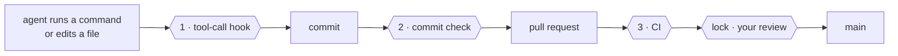
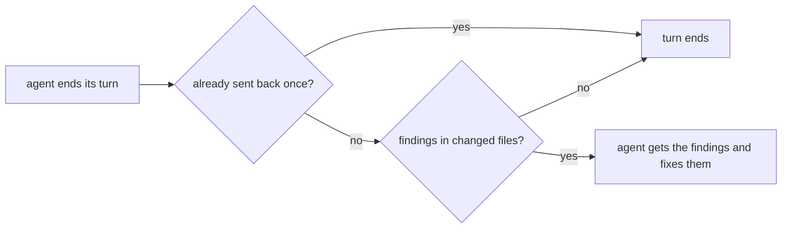

# The yokoten guide

The [README](../README.md) is the short version. This is everything else: why yokoten exists, how it works, the rules, the commands, and what it can't do.

## A race track

**Think of it as a race track.** An AI coding agent is a fast car. yokoten is the track
it runs on. The guardrails stop a mistake from becoming a wreck (the guard). The racing
line shows the next turn, one stage at a time (the guide). And every crash makes every
track safer: when one project learns a lesson, every project gets the check (*yokoten*).

## Words used here

- **Session**: one conversation with an AI coding agent, such as Claude Code.
- **Hook**: a small program the agent's tool runs at a set moment. yokoten adds one that
  runs before every command or edit (and can stop it), one when the agent ends its turn,
  and one at the start of each session.
- **Commit check**: a git hook (`.githooks/pre-commit`) that runs before each commit.
- **CI**: the checks GitHub runs on every pull request.
- **Ruleset**: a GitHub setting that protects a branch or tag, for example "no merge
  without review".
- **Owner, lead, worker**: you; the agent session you talk to; a session the lead starts
  for one task. See [Managing agents like a team](#managing-agents-like-a-team).
- **Exit code**: a number a command gives back when it ends. 0 means all is well. A
  script or an agent reads it. See [Exit codes](#exit-codes).
- **JSON**: a plain text format for data that programs read. `--json` prints it.

## The name

*Yokoten* (横展) is a word from Toyota's shop floors. When one production line finds a
fix for a defect, the fix goes to every line that could have the same defect, not just
the line that found it. yokoten does that for your projects: a lesson one project learns
is offered to the rest.

## The problem

You run a project with AI agents for a few months. You learn things the hard way: an
agent "fixes" a failing test by changing the test, a pull request merges with a commit
nobody reviewed, a server address ends up in a tracked file. You add a rule, a hook, a
check. That project gets better.

Then you start a new project, or go back to an old one, and none of it is there. The
lessons live in one repo and in your head. If you forget to ask for them, the agent
starts from zero.

yokoten turns those lessons into something that checks itself:

- **Rules with reasons.** Twelve core rules. Each one says why it exists (an incident,
  or a risk if nothing has gone wrong yet) and which check holds it. A rule without a
  check is a wish.
- **Guards that run on their own.** A tool-call hook stops an agent before a bad
  command runs. A commit check catches what the hook can't see. CI runs the same
  check for commits made without either.
- **A reminder you don't have to remember.** Every session starts with `doctor`. It
  tells the agent the project's stage on the road, and the one next step. The agent
  brings it up, so you don't have to.

## What changes on day one

| Your agent tries to… | Without yokoten | With yokoten |
|---|---|---|
| force-push, or tag a release | it happens | stopped before it runs, and told why |
| "fix" a failing test by editing the test | the test passes, the bug stays | not allowed in a fix |
| commit your email, a server IP, your city | it goes public | the commit stops; the report names the file and line, never the text |
| open a pull request | as you, with all your rights | as a bot; nothing merges without you |
| work in another project | starts from zero | sees what that project is missing, and offers to set it up |

## Three checks and a lock



| | Runs | Stops |
|-|------|-------|
| **1** | before each tool call | tag pushes, force pushes, skipped checks; test edits in a fix task; a worker editing the rules |
| **1b** | when a Claude Code agent ends its turn | the same personal data, secrets and file rules as the commit check, in the changed files. It sends the agent back once with the findings |
| **2** | on every commit | what the hook can't see: files changed by `sed` or a script, personal data, an overfull folder |
| **3** | on every pull request | a commit made with the hook off |
| **lock** | on the server | a merge without your review, a push to `main`, a release tag that isn't yours |

## What a session sees

At the start of a session in a project that hasn't adopted yokoten yet:

```
yokoten: stage 1 of 5, safety net. Next: no AGENTS.md, so the agents have no written rules here; `yokoten init` adds one.
Why: an agent follows the rules it can read, and only those.
Tell the user in plain words, one step at a time, and offer to do it (as-is, lighter, or not now with a reason).
```

The session hears about one step only: the stage, the next step, and why it matters.
The stage is worked out from the files each time; nothing saves it. A step you marked
"not now" is skipped. The order is advice: a later step done early counts as done.
When every step is done or "not now", the session hears one line that says so.
The agent tells you in your own language. yokoten prints English, which agents read most
reliably.

`yokoten doctor` shows the whole road. Each step is **done**, **next**, **to do**, **not
now** (with your reason) or **can't check**. Steps that yokoten can't check yet are not
listed:

| Stage | Steps |
|---|---|
| **1 · Safety net** | `rules`, `tool-hook`, `commit-check`, `runtime`, `tests` (a test command, and CI runs it) |
| **2 · Issues and pull requests** | `ci`, `issues` (no todo file), `templates`, `no-build-output` (nothing in `dist/`, `build/` or `out/`, no built binaries) |
| **3 · Release** | `changelog`, `titles` (CI runs `check --pr`) |
| **4 · A team of agents** | `codeowners`, `bot`, `skills`, `review` (a merge to the default branch needs one approval) |
| **5 · Going public** | `security-files` (a security policy, Dependabot, a license), `protection` (rulesets on the default branch and `v*` tags), `merge-settings` (squash only, delete branch on merge), `security-settings` (secret scanning, push protection, private reporting, Dependabot alerts) |

The last three are server settings. Full `doctor` reads them through `gh api`, and only reads.
Without `gh`, a sign-in, the network or a GitHub remote, they are **can't check**, never done.
A session never calls the network, so there they are always **can't check**.

`review` reads the server the same way. It is done when the default branch's ruleset, or
its branch protection, asks for at least one approving review. GitHub does not let you
approve your own pull request. So the bot opens the pull requests, and you approve and
merge them. To set it up, edit the ruleset on the default branch: in "Require a pull
request", set "Required approvals" to 1. OpenSSF Scorecard should then count each change
as reviewed, because the person who merges it did not write it. We read this in the
Scorecard docs and have not checked it in a real Scorecard run yet. A private repo on a
free plan has no rulesets, so there `review` is **can't check** and waits for stage 5,
when the repo goes public. It is not **not now**: that mark is only for a decision you
make.

After a step, `yokoten doctor` names the outside standard it meets, when there is one,
for example `ci (Scorecard: CI-Tests)`. The session message leaves it out.

[Record 0004](records/0004-the-road.md) says why the road looks like this.

This repo walks the same road, so you can see each stage working:

| Stage | You learn | See it here |
|---|---|---|
| **1 · Safety net** | rules your agents read, and checks that stop them when rules aren't enough | [AGENTS.md](../AGENTS.md) |
| **2 · Issues and pull requests** | every change starts as an issue and merges only when CI passes; labels, milestones, and a board keep track | [issues](https://github.com/yokoten-labs/yokoten/issues?q=is%3Aissue), [pull requests](https://github.com/yokoten-labs/yokoten/pulls?q=is%3Apr), [the board](https://github.com/orgs/yokoten-labs/projects/1) |
| **3 · Release** | commit messages that say what changed and why, a changelog, a version number for every release | [CHANGELOG.md](../CHANGELOG.md) |
| **4 · A team of agents** | a bot opens pull requests, workers take tasks, a reviewer checks them; only you merge | [Managing agents like a team](#managing-agents-like-a-team) |
| **5 · Going public** | scan every past commit for private data, turn on security settings, protect `main` | [security policy](../.github/SECURITY.md) |

And when an agent tries to push a release tag:

```
yokoten: git push --tags pushes tags. Only the owner decides when to release. If the owner asked for this, they start a new session with YOKOTEN_RELEASE_APPROVAL=1 (`YOKOTEN_RELEASE_APPROVAL=1 claude`); do not look for another way.
```

Every message has the same three parts: **what** happened, **why** it matters, and the
**fix**, a command or an edit. A problem in a file starts with its place, `file:line:`.
A hit names the kind of thing it found, never the thing: a secret or a private mark
is never printed. When a section of this guide explains the rule, the message ends with
a link to it, on its own line: `docs: <url>`.

To ask why a rule exists, run `yokoten explain <id>`. The id is the rule or step name,
such as `secret` or `commit-check`. With no id, or an unknown one, it lists every id.

```
$ yokoten explain force-push
force-push: no plain force push (core rule 7).
Why: a plain force push can throw away work that someone else pushed.
Check: the tool-call guard stops `git push --force`, `-f` and a `+ref`; `--force-with-lease` passes; a branch ruleset on the server is the lock.
Docs: https://github.com/yokoten-labs/yokoten/blob/main/docs/guide.md#the-core-rules
```

## Four layers

| Layer | What | How |
|-------|------|-----|
| **Machine** | Skills, agents, and two user-level hooks, the same on every computer | `yokoten install`, or the Claude Code plugin |
| **Project** | Rules, the commit check, the tool-call hook, CI, issue and PR templates, Dependabot (monthly, one pull request), a security policy | `yokoten init`, then the `yokoten` skill for an old project |
| **Server** | Branch and tag rulesets, squash merge, code owners, a bot with limited rights, the security switches | Set once by the owner; `doctor` lists the steps |
| **Rules** | `AGENTS.md`: twelve core rules, plus the project's own | Every rule names its check |

An old project isn't a blank slate. Some of its habits are better than ours. So the
`yokoten` skill goes through the practices one at a time with you, and each one gets a
decision: **as-is**, **lighter** (and what's left out), or **not now** (with the reason
and when to look again). "Not now" goes into `yokoten.json`, and `doctor` stops asking.

## Works with

yokoten guards three AI coding agents. Each one keeps the same rules.

| Agent | What yokoten adds |
|---|---|
| Claude Code | the tool-call guard (a hook), the stop check (a hook), the guide at the start of each session, skills and agents |
| Codex CLI | the tool-call guard, in `.codex/hooks.json`. Codex asks you once to trust project hooks (`/hooks`) |
| Gemini CLI | the tool-call guard, in `.gemini/settings.json` |
| Any other agent | the rules in `AGENTS.md`, and the commit check, which stops a bad commit whoever made it |

## Install and commands

Requires Node 22.18 or later, which runs TypeScript as it is. No dependencies. There
are two ways to install: the Claude Code plugin, or the `install` command, from npm or
from a clone. Use one, not both.

### The Claude Code plugin

In a Claude Code session:

```text
/plugin marketplace add yokoten-labs/yokoten
/plugin install yokoten@yokoten
```

The first command adds this repo as a plugin marketplace. The second opens the plugin.
Choose "Install for you" (user scope). From your shell, `claude plugin marketplace add
yokoten-labs/yokoten` and then `claude plugin install yokoten@yokoten` do the same.

The plugin is this repo. It uses the same files that `install` copies, so the two ways
can't drift apart:

| The plugin adds | From |
|---|---|
| The skills: `/yokoten:dispatch`, `/yokoten:inspect`, `/yokoten:rca`, `/yokoten:record`, `/yokoten:release`, `/yokoten:yokoten` | `kit/user/skills/` |
| The agents: `yokoten:worker`, `yokoten:reviewer`, `yokoten:verifier` | `kit/user/agents/` |
| `/yokoten:init` and `/yokoten:doctor`, which run yokoten from the plugin | `kit/plugin/skills/` |
| The SessionStart `doctor` hook and the command guard: the same two hooks that `install` adds | `.claude-plugin/plugin.json` |

Claude Code runs the plugin's `.ts` files with `node`. Node can do this because the
plugin folder is not under `node_modules`. To get a newer yokoten, open `/plugin`, select
yokoten on the **Installed** tab, and choose **Update now**. A third-party marketplace
does not update on its own until you turn on auto-update for it.

The plugin works in Claude Code only. It does not make the private-marks file: `doctor`
names the file, and you make it. When the plugin is on in your user settings, `doctor`
counts its hooks and skills as installed.

### Install with npx

For Codex CLI and Gemini CLI, or without the plugin:

```sh
npx yokoten install      # this machine: skills, agents, hooks
cd your-project
npx yokoten init         # this project: adds files, never overwrites
npx yokoten doctor       # the road: where you are, what's next
```

`npx` downloads the package and runs it. The package has no dependencies. `install`
and `init` copy yokoten's runtime out of the package: to `~/.local/share/yokoten` and
to `.yokoten/`. The hooks run these copies, so they need no network and no `npx`.

The package runs built JavaScript, because Node does not run TypeScript under
`node_modules`. The repo has no build; `npm pack` makes the package's `dist/`
([record 0008](records/0008-npm-package.md)).

The owner publishes the package, as the owner creates a release tag. Until the first
release is on npm, [install from a clone](#install-from-a-clone).

### Install from a clone

The same commands, from a copy of this repo. Use this way until the first release is
on npm:

```sh
git clone https://github.com/yokoten-labs/yokoten
node yokoten/bin/yokoten.ts install      # this machine: skills, agents, hooks
cd your-project
node ~/.local/share/yokoten/bin/yokoten.ts init     # this project: adds files, never overwrites
node ~/.local/share/yokoten/bin/yokoten.ts doctor   # the road: where you are, what's next
```

### Use it as a GitHub Action

Any repo on GitHub can run yokoten's checks in CI with one workflow file. Nothing is
installed in the repo, and nothing leaves the job: no token, no outside service.

```yaml
# .github/workflows/yokoten.yml
name: yokoten
on:
  pull_request:
    # `edited`, `labeled` and `milestoned` run `check --pr` again after a fix.
    types: [opened, edited, synchronize, reopened, labeled, unlabeled, milestoned, demilestoned]
  push:
    branches: [main]
permissions:
  contents: read
jobs:
  yokoten:
    runs-on: ubuntu-latest
    timeout-minutes: 10
    steps:
      - uses: actions/checkout@3d3c42e5aac5ba805825da76410c181273ba90b1 # v7.0.1
        with:
          fetch-depth: 0
          persist-credentials: false
      - uses: yokoten-labs/yokoten@<full commit SHA>
```

The action sets up Node, then runs `check`. On a pull request it also runs `check
--pr`. The findings show on the pull request page, as in yokoten's own CI.

- **Pin it.** Use a full commit SHA. A branch name like `@main` changes under you. Once
  there is a release, a release tag works too.
- **The checkout** needs `fetch-depth: 0`. `check --pr` lists the files between the base
  and the head commit, so it needs both.
- **Permissions**: `contents: read` is enough. The action takes no token.
- **Inputs**: `pr-check` (default `true`) and `node-version` (default `22`, at least
  22.18). Set `pr-check: false` to skip the pull request standard.
- **Node**: the action sets up Node for the rest of the job too.

`check --pr` holds a pull request to the standard of core rule 8. A repo that does not
follow it yet can start with `pr-check: false`. The `init` workflow in the kit still
runs `.yokoten/`. It moves to the action after the first release, so it never depends
on `@main`.

### Commands

`init` copies the runtime into `.yokoten/` in your project. Commit it: the hooks and CI
then run with no network and no global install.

`init` also puts two safe defaults in `.github/`:

- `dependabot.yml` updates the actions that CI runs. It opens one pull request a month,
  and takes a release only when it is a week old. A comment in the file shows how to
  add your own packages (npm, pip, Go) the same way.
- `SECURITY.md` asks people to report a vulnerability privately, not in a public issue.
  For this, turn on private vulnerability reporting. `doctor` lists it with the other
  security switches.

| Command | What it does |
|---------|--------------|
| `install` | Skills into `~/.claude/skills` and `~/.agents/skills`, agents into `~/.claude/agents`, a SessionStart `doctor` hook, a user-level command guard, and an empty private-marks file |
| `init [dir]` | Puts the practices into a project. Adds files; keeps any that are already there and says so |
| `init --github [--yes]` | Also adds the standard labels and a first milestone on GitHub, through `gh`. Without `--yes` it only says what it would make. It keeps every label and milestone that is there, and never deletes or renames one |
| `update [dir] [--write]` | Shows what this yokoten changes in the core rules of the project's `AGENTS.md`. `--write` replaces them, and keeps the "This project" part as it is. See [Updating the rules](#updating-the-rules) |
| `doctor [--session]` | The road: every stage and step, and what this machine is missing. `--session` prints only the next step, for the start of a session |
| `check [--staged]` | Layout, privacy and lead-only files, for the tree or the next commit. A commit may not add build output or binaries. For the tree, a translation behind its English source is a note. See [Translations](#translations) |
| `check --pr` | In CI: the pull request's title, `tier:` line, sections, linked issue, change file, milestone and labels. See [The changelog](#the-changelog). A file that CODEOWNERS owns needs `tier: A`. Long sentences in changed Markdown, hard-to-read names in changed code, and a diff over 400 changed lines, are notes |
| `check --issue` | In CI: the issue's title. See [Issue titles](#issue-titles) |
| `changelog [--write]` | Shows the entries the files in `changes/` add under `[Unreleased]`. `--write` puts them into `CHANGELOG.md` and deletes the files; run it before a release. See [The changelog](#the-changelog) |
| `check --history` | The privacy check over every commit on every branch. Run it before a private repo goes public |
| `hook [--agent <name>] [--commands-only]` | The tool-call guard. Reads one tool call on stdin: a Claude Code PreToolUse call by default, a Codex PreToolUse call with `--agent codex`, a Gemini CLI BeforeTool call with `--agent gemini` |
| `hook --stop` | The stop check. Reads a Claude Code Stop event on stdin and checks the changed files. See [The stop check](#the-stop-check) |
| `explain [<id>]` | A rule or a step on the road: what it is, why, and how yokoten checks it |
| `bot -- <command>` | Runs one command (`gh`, `git push`) as the bot, with a one-hour token it never prints. Before `gh issue` or `gh pr` `create` or `edit` with a title, it checks the title by the CI rules. A bad title is refused, and nothing is sent. Setup: [server.md](server.md#3-the-bot-a-github-app) |

`check`, `doctor`, `hook` and `explain` take `--json`. Then stdout holds JSON and
nothing else, for an agent or a script. Each finding has the same fields: `id`, `what`,
`why`, `fix`, `docs` (the link) when the guide explains the rule, and `file` and `line`
when it is in a file. `yokoten explain <id>` takes the `id`. No field holds a private
value.

- `check --json`: `{ check, ok, findings, notes }`. `check` is `tree`, `staged`,
  `history` or `pr`. A note never fails the check.
- `doctor --json`: `{ version, ok, selfTest, repo, stage, stages, next, findings, steps,
  notes, server }`. With `--session`, only the next step, the private-marks finding, and `core-rules` when the rules are behind.
- `hook --json`: `{ blocked, finding }` on stdout. The runtimes do not use it: they read
  the exit code and the reason on stderr, as their hook protocols say.
- `hook --stop --json`: `{ blocked, stop, findings }`. With `stop_hook_active`, also `skipped`.
- `explain --json`: `{ found, id, kind, what, why, check, docs, stage, standard }`, or
  `{ found: false, ids }`.

Output for people follows one rule. Results go to stdout. Problems, refusals and errors
go to stderr. An unknown option is refused, never ignored.

In CI, you don't need to open the log to see what failed. When `check` runs in GitHub
Actions, each finding is an annotation on the changed line of the pull request. The job
summary lists each finding with its place, rule, what, why and the fix. The rule links to
its section of this guide. A note shows as a warning and never fails the check. Like the rest of the output, these name a place,
never what matched.

### Exit codes

| Code | Means |
|------|-------|
| 0 | All is well. `doctor --session` always gives 0, so a session always starts |
| 1 | Problems found (`check`, `doctor`), an unknown id (`explain`), a usage error, or an error in yokoten itself |
| 2 | The hook blocked the tool call, or the stop check sent the agent back. The reason is on stderr |

These codes do not change. A broken guard gives 1, not 2: you see it, and it does not
block every tool call.

### The stop check

The tool-call hook reads commands. It does not see a file that `sed` or a script
changed. The commit check sees it, but only at the commit. The stop check runs earlier:
when a Claude Code agent tries to end its turn.



- It checks the changed files only: staged, not staged, and new files that git does not
  ignore. It uses the privacy, secret and file rules of `check --staged`.
- It sends the agent back once. Claude Code then sets `stop_hook_active`, and the next
  stop always ends the turn. There is no loop.
- It reads no history and uses no network.
- On an error in yokoten, the turn ends and stderr gets one line.
- A new file you want to keep out of the check goes in `.gitignore`, or in
  `privacy.skip` in `yokoten.json`.

`init` adds it to `.claude/settings.json`. `install` does not add it at user level: it
reads files, so each project turns it on, as with the file rules of the tool-call hook.

The commit check refuses a file in a `dist/`, `build/` or `out/` folder, and a binary file.
A build makes such files again, and a reviewer can't read a binary. Images and fonts
(`png`, `jpg`, `gif`, `webp`, `svg`, `ico`, `woff`, `woff2`) pass. To keep a file
anyway, list it in `yokoten.json` as a glob: `"allowBuild": ["docs/manual.pdf"]`.

### Issue titles

An issue title names the area, then the work. A list of issues then reads like a list of
commits to come.

- A task: `area: verb phrase`, for example `doctor: add the review step`.
- An incident: `area: symptom`, for example `check: misses a key in a JSON file`. Name
  what you saw, not the fix.
- At most 60 characters. No full stop at the end. No `#N`: link other issues in the body.
- The area is one lowercase word, or words joined by hyphens.

`init` adds `.github/workflows/issue.yml`. It runs `check --issue` when an issue is
opened or edited. It only reads: it never comments on the issue or renames it. A red run
tells the author to fix the title.

Any lowercase area passes. To limit the areas, list them in `yokoten.json`:
`"areas": ["doctor", "check", "docs"]`. Pull request titles then use the same list in
`type(area): summary`.

### The changelog

A pull request that changes what users notice adds one small file,
`changes/<issue>-<slug>.md`. It does not edit `CHANGELOG.md`. When every pull request
adds a line at the top of the same file, each merge makes the others conflict. Separate
files never conflict.

The file is plain Markdown. Line 1 is the section: Added, Changed, Deprecated, Removed,
Fixed, Security or Internal. Line 2 is blank. From line 3, write the entry as it should
read in the changelog. The `- ` is added for you. Several bullets in one file are fine.

```markdown
Fixed

`doctor` no longer stops when the repo has no remote (#42).
```

`yokoten changelog` shows what the files would add, and writes nothing. Before a release,
`yokoten changelog --write` puts each entry under its section in `[Unreleased]`, and
deletes the files it used. It never touches released versions. If a file is wrong,
it says which file and why, and writes nothing.

`check --pr` takes a new file in `changes/` as the pull request's changelog entry, and
checks its form. A line in `CHANGELOG.md` still passes, for a project that has not moved
yet. `init` adds `changes/README.md`, which shows the form. `changes/` may hold more
than 7 files, since each release empties it.

### Translations

English is the source; a translation follows it. When the English text changes, the
translation falls behind, and nobody sees it. So each translated file names its source
on line 1, in an HTML comment. GitHub does not show it.

```markdown
<!-- source: docs/guide.md blob 3b18e512dba79e4c8300dd08aeb37f8e728b8dad -->
```

The path is the English file, from the repo root. The blob is git's id for the English
text you translated: run `git hash-object docs/guide.md`. A blob, not a commit: a squash
merge keeps it, so you can change both files in one pull request.

`check` reads line 1 of each Markdown and HTML file. When the English file has changed
since, it gives a `translation-behind` note. The note says how many commits behind, and
how to see the change: `git diff <blob> HEAD:docs/guide.md`. A note never fails CI. To
make it fail, put `"translations": { "fail": true }` in `yokoten.json`.

A shallow clone can tell that a translation is behind, but not how far. In CI, use
`fetch-depth: 0` to see the count.

### Updating the rules

When yokoten learns a lesson, its core rules change. `yokoten install` updates the
skills and agents on your machine. Your project's `AGENTS.md` is your file, so it
changes only when you ask. `init` never touches it again.

`doctor` compares the part of `AGENTS.md` above `## This project` with the core rules
of the yokoten you run. When they differ, it reports `core-rules`, and a session hears
it too.

`yokoten update` shows the change and writes nothing. It names the sections that
changed, and lists each line it adds (`+`) or removes (`-`). `yokoten update --write`
replaces the core part. Everything from `## This project` down stays byte for byte.

A line you edited by hand in the core part shows as `-`, because the update replaces
it. Move your own rules under `## This project` first. Without that heading, yokoten
can't tell the core rules from yours. Then it says so, and compares and writes nothing.

Run `update` from an installed yokoten or a clone, not from `.yokoten/`. The copy in
your project has no kit to compare with.

With the Claude Code plugin, run `/yokoten:update`. It runs the plugin's own yokoten,
shows the change, and writes only after you agree.


## The core rules

The full table, with the reasons, is in [`kit/project/AGENTS.md`](../kit/project/AGENTS.md).

1. Every piece of work starts as an issue. No todo files.
2. Nothing reaches `main` without a pull request and green CI.
3. Only the owner creates tags and releases.
4. A fix task changes code, never tests.
5. A worker doesn't change lead-only files: the rules, agent config, hooks, CI.
6. Never skip the commit check.
7. No plain force push. Never rebase a shared branch.
8. Squash merge. One pull request, one purpose; small polish goes in one batch.
9. Review and test the exact commit that merges.
10. No folder holds more than 7 entries.
11. Nothing in the repo, or in what yokoten prints, points at a person or holds a secret.
12. Decisions are written down once and kept. Facts are replaced. Times are UTC.

## Naming

A name is the first thing a reader meets in code, and the thing they read most. A good
name tells them what a thing holds, so they don't scroll back to find out. In one study,
72 developers found defects about 19% faster when names were whole words.

yokoten's own code follows five rules. The reasons and the sources are in
[record 0006](records/0006-names.md).

1. Use whole English words. Use only the short forms everyone knows: `id`, `url`, `pr`,
   `ci`, `env`, `config`, `repo`, `dir`, `json`, `html`. Don't delete letters inside a word.
2. Use at most 4 words. There is no limit on characters, because a limit makes people
   cut words short.
3. Use one letter only for a name that is used within 10 lines and not exported. Use
   `_` only for a parameter you don't use.
4. Write values and functions in `camelCase` and types in `PascalCase`. Use
   `CONSTANT_CASE` only for a fixed value at the top of a file. Write an acronym as a
   word: `loadHttpUrl`.
5. Start a function with a verb. Start a true/false value with `is`, `has` or `can`.
   Give one idea one name, in every file.

| Instead of | Write | Why |
|---|---|---|
| `r`, used 30 lines later | `result` | By line 30, the reader has forgotten what `r` holds. |
| `cfgMgr` | `configManager` | Letters were deleted inside words; the reader must guess them. |
| `processTheUserInputDataNow` | `parseInput` | 6 words. "process", "data" and "now" tell the reader nothing new. |
| `_count` | `count` | The `_` adds nothing. |
| `MAX_TRIES`, inside a function | `maxTries` | `CONSTANT_CASE` says "fixed for the whole file". |
| `loadHTTPURL` | `loadHttpUrl` | Where does one acronym end and the next start? |
| `valid` | `isValid` | `is` says it is true or false. |
| `user()` | `loadUser()` | The verb says what the function does. |

Short is fine where the reader sees everything at once: `for (const n of numbers)` in a
three-line loop is clear. The further a name travels, the more it must say.

`test/architecture.test.ts` checks rules 2 and 3, and `CONSTANT_CASE` inside a function.
Each failure says what to change:

```
src/rules/guards.ts:195: "i" is used for 101 lines. A reader must scroll back to learn what it holds. Name what it is, e.g. "index".
```

In any project, `check --pr` notes a one-letter name used far from where it is made,
and a name of more than 4 words. It reads only the lines a pull request adds to
TypeScript and JavaScript files. A note never fails CI.

Rules 1 and 5 need judgement, so the reviewer checks them.

## Managing agents like a team

The setup treats agents like staff on a line, each with a clear role and limited rights:

- **The owner** (you) decides what gets built and when it ships. Only you approve pull
  requests, create release tags, and change repo settings.
- **The lead** is the session you talk to. It plans, splits the work, reviews, and opens
  pull requests through a **bot**, never with your account.
- **Workers** are sessions the lead starts for one task each, in their own worktree,
  with `YOKOTEN_ROLE=worker`. They change code and report back. They never push.
- **The bot** is a GitHub App installed on the repo. It can open pull requests but has
  no Workflows permission, so it can't change the CI that checks it. A ruleset requires
  your review, so nothing it opens merges without you.

Six skills carry the method: `dispatch` (brief a worker), `inspect` (review one exact
commit in three passes), `rca` (root cause, a check, then spread it), `record` (write
decisions down), `release` (pick the next version and prepare the changelog; the owner tags),
and `yokoten` (adopt the practices). Three agents do the work:
`worker`, `reviewer` (reads only), and `verifier` (runs, never fixes).

### Who reviews what

Review follows risk. The tier on a pull request's first line says how hard a mistake
is to undo (record 0004):

| Tier | Kind of change | Who reviews |
|------|----------------|-------------|
| C | Standard: docs, wording, styles | The lead |
| B | Normal: other code, with tests | The lead |
| A | Hard to undo: secrets, data, install, releases, owned files | The owner |

`.github/CODEOWNERS` lists the owned files: the rules, the kit, agent config, CI and the
records. It does not list every file. With "require review from code owners" on, the
host asks the owner to review a pull request that changes one of them.

`check --pr` ties the two together. A pull request that changes an owned file fails
unless its first line is `tier: A`. The paths set the lowest tier. The author can raise
a tier, never lower it. The check reads CODEOWNERS from the base branch, so a pull
request can't edit the file to lower its own tier. Without a base commit, on a local run,
it reads the working tree. The message says which one it read. No CODEOWNERS file, no
check.

Server setup, step by step: [`docs/server.md`](server.md).

## Privacy

Rule 11 has a check. It scans for personal email addresses and IP addresses, in CI and
on every commit. On your own machine it also reads `~/.config/yokoten/private-marks`:
your name, your city, your domains, your server names. That file stays outside the
repo, because a list of what must not be published can't itself be published. A hit
is reported by file and line; the mark itself is never printed.

The same check catches secrets: GitHub, npm, Slack, Stripe, Google, OpenAI and
Anthropic tokens, AWS access key ids, and PEM private keys. A hit names the kind of
secret, never the secret. Deleting it is not enough, since git keeps it: rotate it.

A commit also records the time it was made, with your time zone, and a time zone
narrows down where you live. So the commit check asks for UTC: `init` sets `TZ=UTC` for
agent sessions, and for your own commits it tells you how.

## What it doesn't do

Honest limits:

- **The guards read command text.** They read bash syntax (quotes, heredocs, `bash -c`,
  substitutions), and they block when they can't tell what runs. A command assembled in
  pieces still gets past them. They catch mistakes and drift; they aren't a lock. The
  lock is on the server: branch protection, code owners, and a bot without the rights to
  release or change CI.
- **Server settings are read on GitHub only.** Another host shows the server steps as
  **can't check**. `doctor` does not check the bot's rights yet.
- **Claude Code first.** Agents and the user-level hooks follow Claude Code's formats.
  Skills are the open SKILL.md format, so `install` also puts them in `~/.agents/skills`,
  where Codex, Gemini CLI, Copilot, Cursor and other agents find them. The tool-call
  guard also runs in Codex and Gemini CLI: `init` writes `.codex/hooks.json` and
  `.gemini/settings.json`, and each tool asks you once to trust the hook. Nobody has yet
  seen a real Codex or Gemini CLI session blocked by it (#30), so `doctor` reports those
  two hooks but does not count them as missing. The rules are plain `AGENTS.md`, which
  Claude Code reads when a project has no `CLAUDE.md`, and so do most other agents. Muse
  Code's skills and hooks are planned.

## What was left out on purpose

These came from the same projects and worked there, but cost more than they saved for
a general kit: a check that every commit's type matches the files it touches; byte-level
replay of merges in the queue; a folder taxonomy for todo files; a 978-line rules file;
signed release verdicts committed to the repo; a controlled-English style standard as a
hard rule (a light version came back as guidance with a soft check:
[record 0005](records/0005-plain-english.md)). A practice earns a place by paying for itself in more than one project.


## Status

Version 0.1. The decisions behind it are in [`docs/records/`](records/). Work is
tracked in issues; the rules for working on yokoten are in [`AGENTS.md`](../AGENTS.md).

### Where this is going

The dream: anyone can build software the way good teams do. The whole cycle is the
SDLC: plan, build, test, review, release, maintain. You learn it by doing it in your
own project, one stage at a time.

| Stage | Name | What it means | Now |
|---|---|---|---|
| 1 | **Guard** | AI agents are stopped before a dangerous action: a force push, a test edited to pass, a private detail leaked | ✅ done |
| 2 | **Guide** | a beginner walks the five stages with `doctor`, one thing at a time; an agent reads an old project and drafts how to adopt yokoten | 🚧 now, around the hackathon |
| 3 | **Any tool, any host** | Claude Code, Codex, Gemini CLI and Muse Code keep the same rules; GitHub, Gitea and GitLab all work | next |
| 4 | **The whole cycle** | from a short spec to build, test, review, release and maintenance, the full SDLC has a guide | later |
| 5 | **Yokoten** | a lesson one project learns becomes a check, and the check spreads to every project. What one person learns, everyone gets | the goal |

The near steps are in [M0](https://github.com/yokoten-labs/yokoten/milestone/1) and
[M1](https://github.com/yokoten-labs/yokoten/milestone/2). The
[board](https://github.com/orgs/yokoten-labs/projects/1) shows what is being built today.
