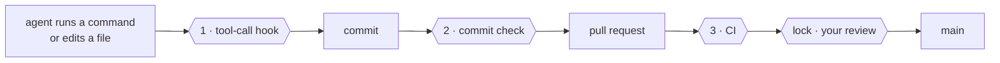
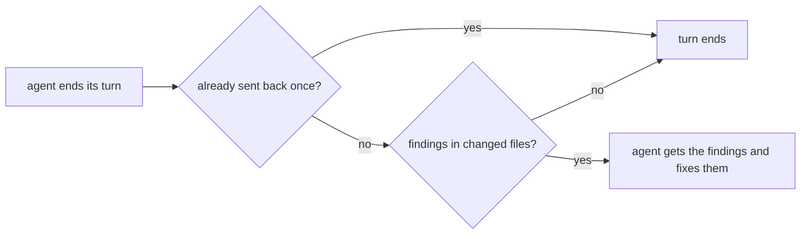

# The yokoten guide

The [README](../README.md) is the short version. This is everything else: why yokoten exists, how it works, the rules, the commands, and what it can't do.

## Words used here

- **Session**: one conversation with an AI coding agent, such as Claude Code.
- **Hook**: a small program the agent's tool runs at a set moment. yokoten adds one that
  runs before every command or edit (and can stop it), one when the agent ends its turn,
  and one at the start of each session.
- **Commit check**: a git hook (`.githooks/pre-commit`) that runs before each commit.
- **CI**: the checks GitHub runs on every pull request.
- **Ruleset**: a GitHub setting that protects a branch or tag, for example "no merge
  without review".
- **Owner, lead, worker**: you; the agent session you talk to; a session the lead starts
  for one task. See [Managing agents like a team](#managing-agents-like-a-team).
- **Exit code**: a number a command gives back when it ends. 0 means all is well. A
  script or an agent reads it. See [Exit codes](#exit-codes).
- **JSON**: a plain text format for data that programs read. `--json` prints it.

## The name

*Yokoten* (横展) is a word from Toyota's shop floors. When one production line finds a
fix for a defect, the fix goes to every line that could have the same defect, not just
the line that found it. yokoten does that for your projects: a lesson one project learns
is offered to the rest.

## The problem

You run a project with AI agents for a few months. You learn things the hard way: an
agent "fixes" a failing test by changing the test, a pull request merges with a commit
nobody reviewed, a server address ends up in a tracked file. You add a rule, a hook, a
check. That project gets better.

Then you start a new project, or go back to an old one, and none of it is there. The
lessons live in one repo and in your head. If you forget to ask for them, the agent
starts from zero.

yokoten turns those lessons into something that checks itself:

- **Rules with reasons.** Twelve core rules. Each one says why it exists (an incident,
  or a risk if nothing has gone wrong yet) and which check holds it. A rule without a
  check is a wish.
- **Guards that run on their own.** A tool-call hook stops an agent before a bad
  command runs. A commit check catches what the hook can't see. CI runs the same
  check for commits made without either.
- **A reminder you don't have to remember.** Every session starts with `doctor`. It
  tells the agent the project's stage on the road, and the one next step. The agent
  brings it up, so you don't have to.

## Three checks and a lock



| | Runs | Stops |
|-|------|-------|
| **1** | before each tool call | tag pushes, force pushes, skipped checks; test edits in a fix task; a worker editing the rules |
| **1b** | when a Claude Code agent ends its turn | the same personal data, secrets and file rules as the commit check, in the changed files. It sends the agent back once with the findings |
| **2** | on every commit | what the hook can't see: files changed by `sed` or a script, personal data, an overfull folder |
| **3** | on every pull request | a commit made with the hook off |
| **lock** | on the server | a merge without your review, a push to `main`, a release tag that isn't yours |

## What a session sees

At the start of a session in a project that hasn't adopted yokoten yet:

```
yokoten: stage 1 of 5, safety net. Next: no AGENTS.md, so the agents have no written rules here; `yokoten init` adds one.
Why: an agent follows the rules it can read, and only those.
Tell the user in plain words, one step at a time, and offer to do it (as-is, lighter, or not now with a reason).
```

The session hears about one step only: the stage, the next step, and why it matters.
The stage is worked out from the files each time; nothing saves it. A step you marked
"not now" is skipped. The order is advice: a later step done early counts as done.
When every step is done or "not now", the session hears one line that says so.
The agent tells you in your own language. yokoten prints English, which agents read most
reliably.

`yokoten doctor` shows the whole road. Each step is **done**, **next**, **to do**, **not
now** (with your reason) or **can't check**. Steps that yokoten can't check yet are not
listed:

| Stage | Steps |
|---|---|
| **1 · Safety net** | `rules`, `tool-hook`, `commit-check`, `runtime`, `tests` (a test command, and CI runs it) |
| **2 · Issues and pull requests** | `ci`, `issues` (no todo file), `templates`, `no-build-output` (nothing in `dist/`, `build/` or `out/`, no built binaries) |
| **3 · Release** | `changelog`, `titles` (CI runs `check --pr`) |
| **4 · A team of agents** | `codeowners`, `bot`, `skills` |
| **5 · Going public** | `security-files` (a security policy, Dependabot, a license) |

After a step, `yokoten doctor` names the outside standard it meets, when there is one,
for example `ci (Scorecard: CI-Tests)`. The session message leaves it out.

[Record 0004](records/0004-the-road.md) says why the road looks like this.

And when an agent tries to push a release tag:

```
yokoten: git push --tags pushes tags. Only the owner decides when to release. If the owner asked for this, they start the session with YOKOTEN_RELEASE_APPROVAL set.
```

Every message has the same three parts: **what** happened, **why** it matters, and the
**fix**, a command or an edit. A problem in a file starts with its place, `file:line:`.
A hit names the kind of thing it found, never the thing: a secret or a private mark
is never printed.

To ask why a rule exists, run `yokoten explain <id>`. The id is the rule or step name,
such as `secret` or `commit-check`. With no id, or an unknown one, it lists every id.

```
$ yokoten explain force-push
force-push: no plain force push (core rule 7).
Why: a plain force push can throw away work that someone else pushed.
Check: the tool-call guard stops `git push --force`, `-f` and a `+ref`; `--force-with-lease` passes; a branch ruleset on the server is the lock.
```

## Four layers

| Layer | What | How |
|-------|------|-----|
| **Machine** | Skills, agents, and two user-level hooks, the same on every computer | `yokoten install`, or the Claude Code plugin |
| **Project** | Rules, the commit check, the tool-call hook, CI, issue and PR templates, Dependabot (monthly, one pull request), a security policy | `yokoten init`, then the `yokoten` skill for an old project |
| **Server** | Branch and tag rulesets, squash merge, code owners, a bot with limited rights, the security switches | Set once by the owner; `doctor` lists the steps |
| **Rules** | `AGENTS.md`: twelve core rules, plus the project's own | Every rule names its check |

An old project isn't a blank slate. Some of its habits are better than ours. So the
`yokoten` skill goes through the practices one at a time with you, and each one gets a
decision: **as-is**, **lighter** (and what's left out), or **not now** (with the reason
and when to look again). "Not now" goes into `yokoten.json`, and `doctor` stops asking.

## Works with

yokoten guards three AI coding agents. Each one keeps the same rules.

| Agent | What yokoten adds |
|---|---|
| Claude Code | the tool-call guard (a hook), the stop check (a hook), the guide at the start of each session, skills and agents |
| Codex CLI | the tool-call guard, in `.codex/hooks.json`. Codex asks you once to trust project hooks (`/hooks`) |
| Gemini CLI | the tool-call guard, in `.gemini/settings.json` |
| Any other agent | the rules in `AGENTS.md`, and the commit check, which stops a bad commit whoever made it |

## Install and commands

Requires Node 22.18 or later, which runs TypeScript as it is. No build step, no
dependencies. There are two ways to install. Use one, not both.

### The Claude Code plugin

In a Claude Code session:

```text
/plugin marketplace add coo1white/yokoten
/plugin install yokoten@yokoten
```

The first command adds this repo as a plugin marketplace. The second opens the plugin.
Choose "Install for you" (user scope). From your shell, `claude plugin marketplace add
coo1white/yokoten` and then `claude plugin install yokoten@yokoten` do the same.

The plugin is this repo. It uses the same files that `install` copies, so the two ways
can't drift apart:

| The plugin adds | From |
|---|---|
| The skills: `/yokoten:dispatch`, `/yokoten:inspect`, `/yokoten:rca`, `/yokoten:record`, `/yokoten:release`, `/yokoten:yokoten` | `kit/user/skills/` |
| The agents: `yokoten:worker`, `yokoten:reviewer`, `yokoten:verifier` | `kit/user/agents/` |
| `/yokoten:init` and `/yokoten:doctor`, which run yokoten from the plugin | `kit/plugin/skills/` |
| The SessionStart `doctor` hook and the command guard: the same two hooks that `install` adds | `.claude-plugin/plugin.json` |

Claude Code runs the plugin's `.ts` files with `node`. Node can do this because the
plugin folder is not under `node_modules`. To get a newer yokoten, open `/plugin`, select
yokoten on the **Installed** tab, and choose **Update now**. A third-party marketplace
does not update on its own until you turn on auto-update for it.

The plugin works in Claude Code only. It does not make the private-marks file: `doctor`
names the file, and you make it. When the plugin is on in your user settings, `doctor`
counts its hooks and skills as installed.

### Install from a clone

For Codex CLI and Gemini CLI, or without the plugin:

```sh
git clone https://github.com/coo1white/yokoten
node yokoten/bin/yokoten.ts install      # this machine: skills, agents, hooks
cd your-project
node ~/.local/share/yokoten/bin/yokoten.ts init     # this project: adds files, never overwrites
node ~/.local/share/yokoten/bin/yokoten.ts doctor   # the road: where you are, what's next
```

### Commands

`init` copies the runtime into `.yokoten/` in your project. Commit it: the hooks and CI
then run with no network and no global install.

`init` also puts two safe defaults in `.github/`:

- `dependabot.yml` updates the actions that CI runs. It opens one pull request a month,
  and takes a release only when it is a week old. A comment in the file shows how to
  add your own packages (npm, pip, Go) the same way.
- `SECURITY.md` asks people to report a vulnerability privately, not in a public issue.
  For this, turn on private vulnerability reporting. `doctor` lists it with the other
  security switches.

| Command | What it does |
|---------|--------------|
| `install` | Skills into `~/.claude/skills` and `~/.agents/skills`, agents into `~/.claude/agents`, a SessionStart `doctor` hook, a user-level command guard, and an empty private-marks file |
| `init [dir]` | Puts the practices into a project. Adds files; keeps any that are already there and says so |
| `init --github [--yes]` | Also adds the standard labels and a first milestone on GitHub, through `gh`. Without `--yes` it only says what it would make. It keeps every label and milestone that is there, and never deletes or renames one |
| `doctor [--session]` | The road: every stage and step, and what this machine is missing. `--session` prints only the next step, for the start of a session |
| `check [--staged]` | Layout, privacy and lead-only files, for the tree or the next commit. A commit may not add build output or binaries |
| `check --pr` | In CI: the pull request's title, `tier:` line, sections, linked issue, changelog line, milestone and labels. Long sentences in changed Markdown, and a diff over 400 changed lines, are notes |
| `check --issue` | In CI: the issue's title. See [Issue titles](#issue-titles) |
| `check --history` | The privacy check over every commit on every branch. Run it before a private repo goes public |
| `hook [--agent <name>] [--commands-only]` | The tool-call guard. Reads one tool call on stdin: a Claude Code PreToolUse call by default, a Codex PreToolUse call with `--agent codex`, a Gemini CLI BeforeTool call with `--agent gemini` |
| `hook --stop` | The stop check. Reads a Claude Code Stop event on stdin and checks the changed files. See [The stop check](#the-stop-check) |
| `explain [<id>]` | A rule or a step on the road: what it is, why, and how yokoten checks it |
| `bot -- <command>` | Runs one command (`gh`, `git push`) as the bot, with a one-hour token it never prints. Setup: [server.md](server.md#3-the-bot-a-github-app) |

`check`, `doctor`, `hook` and `explain` take `--json`. Then stdout holds JSON and
nothing else, for an agent or a script. Each finding has the same fields: `id`, `what`,
`why`, `fix`, and `file` and `line` when it is in a file. `yokoten explain <id>` takes
the `id`. No field holds a private value.

- `check --json`: `{ check, ok, findings, notes }`. `check` is `tree`, `staged`,
  `history` or `pr`. A note never fails the check.
- `doctor --json`: `{ version, ok, selfTest, repo, stage, stages, next, findings, steps,
  notes, server }`. With `--session`, only the next step and the private-marks finding.
- `hook --json`: `{ blocked, finding }` on stdout. The runtimes do not use it: they read
  the exit code and the reason on stderr, as their hook protocols say.
- `hook --stop --json`: `{ blocked, stop, findings }`. With `stop_hook_active`, also `skipped`.
- `explain --json`: `{ found, id, kind, what, why, check, stage, standard }`, or
  `{ found: false, ids }`.

Output for people follows one rule. Results go to stdout. Problems, refusals and errors
go to stderr. An unknown option is refused, never ignored.

### Exit codes

| Code | Means |
|------|-------|
| 0 | All is well. `doctor --session` always gives 0, so a session always starts |
| 1 | Problems found (`check`, `doctor`), an unknown id (`explain`), a usage error, or an error in yokoten itself |
| 2 | The hook blocked the tool call, or the stop check sent the agent back. The reason is on stderr |

These codes do not change. A broken guard gives 1, not 2: you see it, and it does not
block every tool call.

### The stop check

The tool-call hook reads commands. It does not see a file that `sed` or a script
changed. The commit check sees it, but only at the commit. The stop check runs earlier:
when a Claude Code agent tries to end its turn.



- It checks the changed files only: staged, not staged, and new files that git does not
  ignore. It uses the privacy, secret and file rules of `check --staged`.
- It sends the agent back once. Claude Code then sets `stop_hook_active`, and the next
  stop always ends the turn. There is no loop.
- It reads no history and uses no network.
- On an error in yokoten, the turn ends and stderr gets one line.
- A new file you want to keep out of the check goes in `.gitignore`, or in
  `privacy.skip` in `yokoten.json`.

`init` adds it to `.claude/settings.json`. `install` does not add it at user level: it
reads files, so each project turns it on, as with the file rules of the tool-call hook.

The commit check refuses a file in a `dist/`, `build/` or `out/` folder, and a binary file.
A build makes such files again, and a reviewer can't read a binary. Images and fonts
(`png`, `jpg`, `gif`, `webp`, `svg`, `ico`, `woff`, `woff2`) pass. To keep a file
anyway, list it in `yokoten.json` as a glob: `"allowBuild": ["docs/manual.pdf"]`.

### Issue titles

An issue title names the area, then the work. A list of issues then reads like a list of
commits to come.

- A task: `area: verb phrase`, for example `doctor: add the review step`.
- An incident: `area: symptom`, for example `check: misses a key in a JSON file`. Name
  what you saw, not the fix.
- At most 60 characters. No full stop at the end. No `#N`: link other issues in the body.
- The area is one lowercase word, or words joined by hyphens.

`init` adds `.github/workflows/issue.yml`. It runs `check --issue` when an issue is
opened or edited. It only reads: it never comments on the issue or renames it. A red run
tells the author to fix the title.

Any lowercase area passes. To limit the areas, list them in `yokoten.json`:
`"areas": ["doctor", "check", "docs"]`. Pull request titles then use the same list in
`type(area): summary`.


## The core rules

The full table, with the reasons, is in [`kit/project/AGENTS.md`](../kit/project/AGENTS.md).

1. Every piece of work starts as an issue. No todo files.
2. Nothing reaches `main` without a pull request and green CI.
3. Only the owner creates tags and releases.
4. A fix task changes code, never tests.
5. A worker doesn't change lead-only files: the rules, agent config, hooks, CI.
6. Never skip the commit check.
7. No plain force push. Never rebase a shared branch.
8. Squash merge. One pull request, one purpose; small polish goes in one batch.
9. Review and test the exact commit that merges.
10. No folder holds more than 7 entries.
11. Nothing in the repo, or in what yokoten prints, points at a person or holds a secret.
12. Decisions are written down once and kept. Facts are replaced. Times are UTC.

## Managing agents like a team

The setup treats agents like staff on a line, each with a clear role and limited rights:

- **The owner** (you) decides what gets built and when it ships. Only you approve pull
  requests, create release tags, and change repo settings.
- **The lead** is the session you talk to. It plans, splits the work, reviews, and opens
  pull requests through a **bot**, never with your account.
- **Workers** are sessions the lead starts for one task each, in their own worktree,
  with `YOKOTEN_ROLE=worker`. They change code and report back. They never push.
- **The bot** is a GitHub App installed on the repo. It can open pull requests but has
  no Workflows permission, so it can't change the CI that checks it. A ruleset requires
  your review, so nothing it opens merges without you.

Six skills carry the method: `dispatch` (brief a worker), `inspect` (review one exact
commit in three passes), `rca` (root cause, a check, then spread it), `record` (write
decisions down), `release` (pick the next version and prepare the changelog; the owner tags),
and `yokoten` (adopt the practices). Three agents do the work:
`worker`, `reviewer` (reads only), and `verifier` (runs, never fixes).

Server setup, step by step: [`docs/server.md`](server.md).

## Privacy

Rule 11 has a check. It scans for personal email addresses and IP addresses, in CI and
on every commit. On your own machine it also reads `~/.config/yokoten/private-marks`:
your name, your city, your domains, your server names. That file stays outside the
repo, because a list of what must not be published can't itself be published. A hit
is reported by file and line; the mark itself is never printed.

The same check catches secrets: GitHub, npm, Slack, Stripe, Google, OpenAI and
Anthropic tokens, AWS access key ids, and PEM private keys. A hit names the kind of
secret, never the secret. Deleting it is not enough, since git keeps it: rotate it.

A commit also records the time it was made, with your time zone, and a time zone
narrows down where you live. So the commit check asks for UTC: `init` sets `TZ=UTC` for
agent sessions, and for your own commits it tells you how.

## What it doesn't do

Honest limits:

- **The guards read command text.** A command assembled in pieces gets past them.
  They catch mistakes and drift; they aren't a lock. The lock is on the server: branch
  protection, code owners, and a bot without the rights to release or change CI.
- **Server settings aren't checked yet.** `doctor` lists the three steps for the owner.
  Checking them through the API is planned.
- **Claude Code first.** Agents and the user-level hooks follow Claude Code's formats.
  Skills are the open SKILL.md format, so `install` also puts them in `~/.agents/skills`,
  where Codex, Gemini CLI, Copilot, Cursor and other agents find them. The tool-call
  guard also runs in Codex and Gemini CLI: `init` writes `.codex/hooks.json` and
  `.gemini/settings.json`, and each tool asks you once to trust the hook. Nobody has yet
  seen a real Codex or Gemini CLI session blocked by it (#30), so `doctor` reports those
  two hooks but does not count them as missing. The rules are plain `AGENTS.md`, which
  Claude Code reads when a project has no `CLAUDE.md`, and so do most other agents. Muse
  Code's skills and hooks are planned.

## What was left out on purpose

These came from the same projects and worked there, but cost more than they saved for
a general kit: a check that every commit's type matches the files it touches; byte-level
replay of merges in the queue; a folder taxonomy for todo files; a 978-line rules file;
signed release verdicts committed to the repo; a controlled-English style standard as a
hard rule (a light version came back as guidance with a soft check:
[record 0005](records/0005-plain-english.md)). A practice earns a place by paying for itself in more than one project.


## Status

Version 0.1. The decisions behind it are in [`docs/records/`](records/). Work is
tracked in issues; the rules for working on yokoten are in [`AGENTS.md`](../AGENTS.md).
