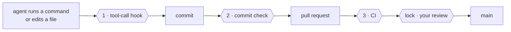

# The yokoten guide

The [README](../README.md) is the short version. This is everything else: why yokoten exists, how it works, the rules, the commands, and what it can't do.

## Words used here

- **Session**: one conversation with an AI coding agent, such as Claude Code.
- **Hook**: a small program the agent's tool runs at a set moment. yokoten adds one that
  runs before every command or edit (and can stop it), and one at the start of each
  session.
- **Commit check**: a git hook (`.githooks/pre-commit`) that runs before each commit.
- **CI**: the checks GitHub runs on every pull request.
- **Ruleset**: a GitHub setting that protects a branch or tag, for example "no merge
  without review".
- **Owner, lead, worker**: you; the agent session you talk to; a session the lead starts
  for one task. See [Managing agents like a team](#managing-agents-like-a-team).

## The name

*Yokoten* (横展) is a word from Toyota's shop floors. When one line finds a fix for a
defect, the fix is rolled out to every line that could have the same defect, not just
the line that found it. This repo does that for software built with AI coding agents.

## The problem

You run a project with AI agents for a few months. You learn things the hard way: an
agent "fixes" a failing test by changing the test, a pull request merges with a commit
nobody reviewed, a server address ends up in a tracked file. You add a rule, a hook, a
check. That project gets better.

Then you start a new project, or go back to an old one, and none of it is there. The
lessons live in one repo and in your head. If you forget to ask for them, the agent
starts from zero.

yokoten turns those lessons into something that checks itself:

- **Rules with reasons.** Twelve core rules. Each one says why it exists (an incident,
  or a risk if nothing has gone wrong yet) and which check holds it. A rule without a
  check is a wish.
- **Guards that run on their own.** A tool-call hook stops an agent before a bad
  command runs. A commit check catches what the hook can't see. CI runs the same
  check for commits made without either.
- **A reminder you don't have to remember.** Every session starts with `doctor`, which
  tells the agent what this project is missing. The agent brings it up, so you don't
  have to.

## Three checks and a lock



| | Runs | Stops |
|-|------|-------|
| **1** | before each tool call | tag pushes, force pushes, skipped checks; test edits in a fix task; a worker editing the rules |
| **2** | on every commit | what the hook can't see: files changed by `sed` or a script, personal data, an overfull folder |
| **3** | on every pull request | a commit made with the hook off |
| **lock** | on the server | a merge without your review, a push to `main`, a release tag that isn't yours |

## What a session sees

At the start of a session in a project that hasn't adopted yokoten yet:

```
yokoten: this project is missing 5 practice(s):
- rules: no AGENTS.md: the agents have no written rules here
- commit-check: commits are not checked (core.hooksPath is not .githooks, or .githooks/pre-commit does not run yokoten)
- tool-hook: no tool-call guard in .claude/settings.json
- ci: CI does not run `yokoten check`, so a commit made without the hook gets through
- runtime: no .yokoten/ runtime
Tell the user, and offer the yokoten skill to adopt them (each one: as-is, lighter, or not now with a reason).
```

And when an agent tries to push a release tag:

```
yokoten: git push --tags pushes tags. Only the owner decides when to release. If the owner asked for this, they start the session with YOKOTEN_RELEASE_APPROVAL set.
```

## Four layers

| Layer | What | How |
|-------|------|-----|
| **Machine** | Skills, agents, and two user-level hooks, the same on every computer | `yokoten install` |
| **Project** | Rules, the commit check, the tool-call hook, CI, issue and PR templates, Dependabot (monthly, one pull request), a security policy | `yokoten init`, then the `yokoten` skill for an old project |
| **Server** | Branch and tag rulesets, squash merge, code owners, a bot with limited rights, the security switches | Set once by the owner; `doctor` lists the steps |
| **Rules** | `AGENTS.md`: twelve core rules, plus the project's own | Every rule names its check |

An old project isn't a blank slate. Some of its habits are better than ours. So the
`yokoten` skill goes through the practices one at a time with you, and each one gets a
decision: **as-is**, **lighter** (and what's left out), or **not now** (with the reason
and when to look again). "Not now" goes into `yokoten.json`, and `doctor` stops asking.

## Install and commands

Requires Node 22.18 or later, which runs TypeScript as it is. No build step, no
dependencies.

```sh
git clone https://github.com/coo1white/yokoten
node yokoten/bin/yokoten.ts install      # this machine: skills, agents, hooks
cd your-project
node ~/.local/share/yokoten/bin/yokoten.ts init     # this project: adds files, never overwrites
node ~/.local/share/yokoten/bin/yokoten.ts doctor   # what's still missing
```

`init` copies the runtime into `.yokoten/` in your project. Commit it: the hooks and CI
then run with no network and no global install.

`init` also puts two safe defaults in `.github/`:

- `dependabot.yml` updates the actions that CI runs. It opens one pull request a month,
  and takes a release only when it is a week old. A comment in the file shows how to
  add your own packages (npm, pip, Go) the same way.
- `SECURITY.md` asks people to report a vulnerability privately, not in a public issue.
  For this, turn on private vulnerability reporting. `doctor` lists it with the other
  security switches.

| Command | What it does |
|---------|--------------|
| `install` | Skills and agents into `~/.claude`, a SessionStart `doctor` hook, a user-level command guard, and an empty private-marks file |
| `init [dir]` | Puts the practices into a project. Adds files; keeps any that are already there and says so |
| `doctor [--session]` | What this project and machine are missing. `--session` is the short form for the start of a session |
| `check [--staged]` | Layout, privacy and lead-only files, for the tree or the next commit |
| `check --history` | The privacy check over every commit on every branch. Run it before a private repo goes public |
| `hook [--commands-only]` | The tool-call guard. Reads a Claude Code PreToolUse call on stdin |
| `bot -- <command>` | Runs one command (`gh`, `git push`) as the bot, with a one-hour token it never prints. Setup: [server.md](server.md#3-the-bot-a-github-app) |


## The core rules

The full table, with the reasons, is in [`kit/project/AGENTS.md`](../kit/project/AGENTS.md).

1. Every piece of work starts as an issue. No todo files.
2. Nothing reaches `main` without a pull request and green CI.
3. Only the owner creates tags and releases.
4. A fix task changes code, never tests.
5. A worker doesn't change lead-only files: the rules, agent config, hooks, CI.
6. Never skip the commit check.
7. No plain force push. Never rebase a shared branch.
8. Squash merge. One pull request, one purpose; small polish goes in one batch.
9. Review and test the exact commit that merges.
10. No folder holds more than 7 entries.
11. Nothing in the repo, or in what yokoten prints, points at a person.
12. Decisions are written down once and kept. Facts are replaced. Times are UTC.

## Managing agents like a team

The setup treats agents like staff on a line, each with a clear role and limited rights:

- **The owner** (you) decides what gets built and when it ships. Only you approve pull
  requests, create release tags, and change repo settings.
- **The lead** is the session you talk to. It plans, splits the work, reviews, and opens
  pull requests through a **bot**, never with your account.
- **Workers** are sessions the lead starts for one task each, in their own worktree,
  with `YOKOTEN_ROLE=worker`. They change code and report back. They never push.
- **The bot** is a GitHub App installed on the repo. It can open pull requests but has
  no Workflows permission, so it can't change the CI that checks it. A ruleset requires
  your review, so nothing it opens merges without you.

Five skills carry the method: `dispatch` (brief a worker), `inspect` (review one exact
commit in three passes), `rca` (root cause, a check, then spread it), `record` (write
decisions down), and `yokoten` (adopt the practices). Three agents do the work:
`worker`, `reviewer` (reads only), and `verifier` (runs, never fixes).

Server setup, step by step: [`docs/server.md`](server.md).

## Privacy

Rule 11 has a check. It scans for personal email addresses and IP addresses, in CI and
on every commit. On your own machine it also reads `~/.config/yokoten/private-marks`:
your name, your city, your domains, your server names. That file stays outside the
repo, because a list of what must not be published can't itself be published. A hit
is reported by file and line; the mark itself is never printed.

A commit also records the time it was made, with your time zone, and a time zone
narrows down where you live. So the commit check asks for UTC: `init` sets `TZ=UTC` for
agent sessions, and for your own commits it tells you how.

## What it doesn't do

Honest limits:

- **The guards read command text.** A command assembled in pieces gets past them.
  They catch mistakes and drift; they aren't a lock. The lock is on the server: branch
  protection, code owners, and a bot without the rights to release or change CI.
- **Server settings aren't checked yet.** `doctor` lists the three steps for the owner.
  Checking them through the API is planned.
- **Claude Code first.** Hooks, skills and agents follow Claude Code's formats. The rules
  are plain `AGENTS.md`, which Claude Code reads when a project has no `CLAUDE.md`, and
  so do most other agents. Muse Code's skills and hooks are planned.

## What was left out on purpose

These came from the same projects and worked there, but cost more than they saved for
a general kit: a check that every commit's type matches the files it touches; byte-level
replay of merges in the queue; a folder taxonomy for todo files; a 978-line rules file;
signed release verdicts committed to the repo; a controlled-English style standard as a
hard rule (a light version came back as guidance with a soft check:
[record 0005](records/0005-plain-english.md)). A practice earns a place by paying for itself in more than one project.


## Status

Version 0.1. The decisions behind it are in [`docs/records/`](records/). Work is
tracked in issues; the rules for working on yokoten are in [`AGENTS.md`](../AGENTS.md).
