<!-- source: README.md -->
<div align="center">

<picture>
  <source media="(prefers-color-scheme: dark)" srcset="../../assets/banner-zh-dark.svg">
  
</picture>

<br/>

**人人都能像好团队那样做软件。**

给你带路，替你看住 AI。

**[yokoten.app](https://yokoten.app/?from=github)** &nbsp;·&nbsp; [English](../../../README.md) | 简体中文 | [繁體中文](../zh-TW/README.md) | [日本語](../ja/README.md)

[](https://github.com/yokoten-labs/yokoten/actions/workflows/yokoten.yml)
[](../../../LICENSE)
[](https://nodejs.org/)

</div>

## 用什么 agent 都行

在下面这些 agent 里，危险操作在执行前就会被拦住（[各自怎么设置](guide.md#支持哪些-agent)）：

- Claude Code
- Codex CLI
- GitHub Copilot CLI
- Antigravity CLI
- Muse Code
- DeepSeek Harness

用别的 agent，或者根本不用 agent，提交检查和 CI 照样会拦下坏的改动。

## 为什么做它

好团队里，每次改动都有原因、有测试、有人审过。这些习惯，很多人要干上好几年、吃过几次亏才学会。
有了 yokoten，新手第一天就能照着做：计划、开发、测试、审查、发版，一次走一关。
AI 想闯大祸时，比如强推、改测试蒙混过关、把隐私传上去，桥头有人先拦下。

经验也不会只留在一个项目里。「横展」是丰田工厂的说法：一条产线找到的对策，推广到所有产线。
一个项目吃过的亏，yokoten 会把对应的检查送到你别的项目里。

## 安装

只要装 [Node](https://nodejs.org/) 22.18 或更高版本，别的都不用装。

```sh
npx yokoten install      # 每台电脑做一次
cd your-project
npx yokoten init         # 每个项目做一次
npx yokoten doctor       # 看看走到了第几关、下一步做什么
```

npm 上的第一个版本（10 月 24 日）出来之前，先[从 clone 下来的仓库装](guide.md#从-clone-下来的仓库装)。

### 先知道这几件事

- **提交用 UTC 时间。** 用 `TZ=UTC git commit` 提交，或者在 shell 配置文件里加一行 `export TZ=UTC`。
  提交里带的时区会让陌生人猜到你大概住在哪里，所以提交检查只认 UTC。
- **用 Claude Code 的话，也可以装插件。** 先输入 `/plugin marketplace add yokoten-labs/yokoten`，
  再输入 `/plugin install yokoten@yokoten`。插件和 `npx` 选一种就行，别都装（[详细说明](guide.md#用-claude-code-插件装)）。
- **只想在 CI 里用？** [当成 GitHub Action 用](guide.md#当成-github-action-用)。

## 装好以后是什么样

agent 想强推，yokoten 把它拦下，说清为什么，再给出改法。接着 `doctor` 告诉你下一步做哪一件事：


## 往哪里去

<p align="center">
<picture>
  <source media="(prefers-color-scheme: dark)" srcset="../../assets/road-dark.svg">
  
</picture>
</p>

守桥已经做好了，带路正在做。再往后，支持更多 AI 工具和代码平台，然后把整个开发流程都带上。
山顶就是「横展」：一个项目学到的，所有项目都能用上。
五个阶段写在[路线图](guide.md#往哪里去)里，[看板](https://github.com/orgs/yokoten-labs/projects/1)上能看到今天在做什么。

## 了解更多

- **[yokoten.app](https://yokoten.app/?from=github)**：官网，使用指南和决定记录都能在上面直接看。
- **[使用指南](guide.md)**：12 条规则、所有命令、它怎么工作，还有它做不到的事。
- **[服务器设置](../../server.md)**：在 GitHub 上保护 `main` 分支和发版 tag（英文）。
- **[决定记录](../../records/)**：为什么这样做（英文）。
- **[参与开发](../../../AGENTS.md)**：给 yokoten 干活要守的规矩（英文）。
- **[安全](../../../.github/SECURITY.md)**：发现安全问题怎么报告（英文）。

---

<p align="center"><sub>MIT · <a href="https://coolwhite.us/">coolwhite</a> 做的。里面不少东西，是在工厂车间里学来的。</sub></p>
