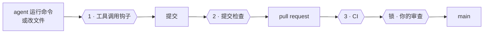
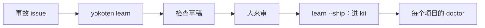

<!-- source: docs/guide.md -->
# yokoten 使用指南

[README](README.md) 是简短版。这份指南先讲新手需要的东西：yokoten 是什么、五道保护、怎么安装，
以及被拒绝时该怎么办。其余内容都是参考，放在后面。

## yokoten 是什么

yokoten 是 AI 编程 agent 的安全带。它在每条命令、每次改动执行之前先检查，挡住最糟的错误，
再用一句平实的话说明原因。它用的是你现有 agent 自己的钩子、沙箱和设置，不替换它们。

### 五道保护

同样的五道保护对每个人、每个 agent 都成立，默认开着，不用任何设置：

1. **agent 不能弄丢你的工作。** 不许直接 force push，不许硬重置，不许删 `.git` 或历史。
2. **agent 不能泄露秘密。** 提交、issue 或 pull request 里不能有密钥、令牌、邮箱地址或家目录路径。
3. **agent 不能替你发布。** 不许打 tag、发 release、发 npm 包，也不许把仓库改成公开。
4. **agent 不能没读就运行网上的代码。** 不许把下载内容直接管道给 shell。
5. **agent 不能拆掉安全带。** 不许关掉检查或钩子，也不许改 CI 或规则。

其他事情照常运行。`yokoten init` 在五道保护之上加项目规则，从不会去掉任何一道。
为什么人人默认这一套，见[记录 0034](../../records/0034-one-safeguard-for-everyone.md)。
为什么先把安全带做到最好，见[记录 0035](../../records/0035-the-safeguard-is-the-mvp.md)。

### 安装

需要 Node 22.23.4 或更高（Node 24 用 24.22.1 或更高，Node 26 用 26.12.1 或更高），
不需要别的。钩子命令要 POSIX shell：Windows 上请用 Git Bash。

```sh
npx yokoten install      # 每台电脑一次
cd your-project
npx yokoten init         # 每个项目一次
npx yokoten doctor       # 走到了哪，下一步做什么
```

用 Claude Code 的话，也可以改用插件。插件和 `npx` 选一个，不要都装；见
[Claude Code 插件](#claude-code-插件)。从 clone 安装，见[从 clone 安装](#从-clone-安装)。

### 被拒绝时是什么样

agent 想直接 force push。守卫在它运行之前挡住：

```text
yokoten: git push --force forces the push. a plain force push can throw away work that
someone else pushed. use --force-with-lease, which stops when the remote has work you
have not seen.
  docs: https://github.com/yokoten-labs/yokoten/blob/main/docs/guide.md#the-core-rules
```

**该怎么做。** 读那句修复建议。运行它给的命令，或者去问 owner。不要另找绕开守卫的办法。
被拒绝不是 bug，是安全带在工作。如果拒绝错了，运行 `yokoten explain <id>`，再开一个
带 `incident` 标签的 issue。

## 名字的来历

*Yokoten*（横展）来自丰田车间。一条产线发现某个缺陷的修法，这个修法会送到每条可能有同样
缺陷的产线，而不只是发现它的那条。yokoten 对你的项目做同样的事：一个项目学到的教训，
会被送到其他项目。

## 先认识几个词

- **会话**：和 AI 编程 agent 的一次对话，比如 Claude Code。
- **钩子**：agent 在固定时刻运行的小程序。yokoten 加三个：每条命令和每次改动之前（可以拦住），
  agent 结束一轮时，以及会话开始时。
- **提交检查**：每次提交前运行的 git 钩子（`.githooks/pre-commit`）。
- **CI**：GitHub 在每个 pull request 上跑的检查。
- **规则集**：保护分支或 tag 的 GitHub 设置。
- **owner、lead、worker**：你；你对话的那个会话；lead 为一项任务启动的会话。见
  [像带团队一样管 agent](#像带团队一样管-agent)。
- **退出码**：命令结束时给出的数字。0 表示一切正常。见[退出码](#退出码)。

## 三道检查，一把锁



| | 什么时候跑 | 挡住什么 |
|-|------|-------|
| **1** | 每次工具调用之前 | 直接 force push、tag push、跳过检查；修 bug 时改测试；worker 改规则；发帖里的个人数据或秘密；删除 CI 运行 |
| **2** | 每次提交 | 钩子看不到的：脚本改的文件、个人数据、条目过多的文件夹 |
| **3** | 每个 pull request | 关着钩子做出的提交 |
| **锁** | 服务器上 | 没经你审查的合并、往 `main` 的推送、不是你的发布 tag |

## 会话里看到的是什么

在一个还没用 yokoten 的项目里，会话开始时会看到：

```text
yokoten: stage 1 of 5, safety net. Next: no AGENTS.md, so the agents have no written
rules here; `yokoten init` adds one.
Why: an agent follows the rules it can read, and only those.
Tell the user in plain words, one step at a time, and offer to do it.
```

会话只听到一步：现在第几关、下一步是什么、为什么重要。关卡每次从文件算出来，不保存。
你标了“以后再说”的步骤会跳过。

`yokoten doctor` 显示整条路。每一步是 **done**、**next**、**to do**、**not now**
（带你写的理由）或 **can't check**：

| 关 | 步骤 |
|---|---|
| **1 · 安全网** | `rules`、`tool-hook`、`commit-check`、`runtime`、`tests` |
| **2 · issue 和 pull request** | `remote`、`ci`、`issues`、`templates`、`labels`、`milestone`、`no-build-output` |
| **3 · 发布** | `changelog`、`titles` |
| **4 · agent 团队** | `codeowners`、`bot`、`skills`、`sandbox`、`review` |
| **5 · 公开** | `security-files`、`protection`、`merge-settings`、`security-settings` |

最后三项是服务器设置。完整的 `doctor` 通过 `gh api` 读取，而且只读。没有 `gh`、没有登录、
没有网络或没有 GitHub remote 时，它们是 **can't check**，永远不会算完成。
为什么这样分，见[决定记录 0004](../../records/0004-the-road.md)。

**其他代码托管。** Gitea 或 GitLab 上，核心部分一样：规则、守卫、提交检查。只有托管方能判断
的步骤显示 **can't check**，并说明它要什么。自建服务器的名字从不打印。Gitea 适配是下一步。

### 只在这台机器上的活

断电、崩溃或磁盘坏了，只在一台机器上的工作就没了。`doctor` 会列出这些工作，每一项配一条
保存它的命令：

| 提示 | 命令 |
|---|---|
| `uncommitted-changes` | `git add -A`、`git commit -m "chore: save work"`，然后 push |
| `unpushed-commits` | `git push`，或 `git push -u origin <branch>` |
| `stashes` | `git stash branch <name>`，然后 push |
| `stale-index-lock` | 没有 git 进程运行时，`rm` 掉 `index.lock` |
| `repo-on-tmpfs`、`repo-in-temp-folder` | push 所有分支，再 clone 到不会清空的文件夹 |
| `finished-worktree` | `git worktree remove <path>`；分支还在 |
| `missing-worktree` | `git worktree prune` |

这些都是提示：从不让 `doctor` 失败。doctor 在这里只读，不改文件、不改 ref、不改 worktree。
会话只听到有风险的部分，最多三条，最多花一秒。其余见[记录 0012](../../records/0012-machine-checks.md)。

## 支持哪些 agent

yokoten 用同一套规则守九个 AI 编程 agent。下面每个“yes”都是真跑过：agent 在一个临时仓库里
运行 `git push --tags`，守卫挡住了它。“Not run end to end”表示列出来了，但守卫还没有从头到尾
验证过。文档不是证据。

| Agent | 怎么拦 | 验证 |
|---|---|---|
| Claude Code | 退出码 2，原因写到 stderr | yes |
| GitHub Copilot CLI | 退出码 2，原因以 JSON 写到 stdout | yes |
| Antigravity CLI (`agy`) | stdout 上的 `{"decision": "deny"}` | yes |
| Codex CLI | 退出码 2，原因写到 stderr | yes |
| Muse Code | 退出码 2，原因写到 stderr | yes |
| DeepSeek Harness (`dsh`) | 退出码 2，原因写到 stderr | yes |
| Grok CLI (`grok`) | stdout 上的 `permissionDecision: "deny"`，加退出码 2 | yes |
| Gemini CLI | 退出码 2，原因写到 stderr | not run end to end |
| OpenCode | OpenCode 2 把 `effect` 设为 deny；OpenCode 1 抛出原因 | not run end to end |

`install` 写用户级钩子，`init` 写每个 agent 的项目钩子。agent 只在你信任这个文件夹之后才跑
项目钩子。`init` 会打印信任它的那一步，`doctor` 会提示还没信任的文件夹。worker 的 worktree
还会用 `yokoten worker mark <dir>` 标记，这样即使某个 agent 丢掉 `YOKOTEN_ROLE`，也算 worker。
`init` 也会写每个 agent 的沙箱，并打印每个 agent 需要的那一步。DeepSeek Harness 的桥和
DeepSeek 模型设置，在 [README](README.md) 里。

## 安装和命令

`init` 把运行时复制到项目的 `.yokoten/`。请提交它：钩子和 CI 之后就不需要网络，也不需要全局安装。
`init` 只添加；已经存在的文件保留并说明。

### Claude Code 插件

在 Claude Code 会话里：

```text
/plugin marketplace add yokoten-labs/yokoten
/plugin install yokoten@yokoten
```

插件就是这个仓库，用的文件和 `install` 复制的一样。

| 插件加的东西 | 来自 |
|---|---|
| 技能：`/yokoten:dispatch`、`/yokoten:inspect`、`/yokoten:merge`、`/yokoten:rca`、`/yokoten:record`、`/yokoten:release`、`/yokoten:yokoten` | `kit/user/skills/` |
| agent：`yokoten:worker`、`yokoten:reviewer`、`yokoten:verifier` | `kit/user/agents/` |
| `/yokoten:init`、`/yokoten:doctor`、`/yokoten:update` | `kit/plugin/skills/` |
| 会话开始的 `doctor` 钩子和命令守卫 | `.claude-plugin/plugin.json` |

插件只在 Claude Code 里工作。插件和 `install` 选一个，不要都装：都装的话，守卫和会话里的
doctor 会跑两次，每个技能也会出现两次。要从 `install` 换成插件，先运行 `yokoten uninstall`。

### 用 npx 装

```sh
npx yokoten install      # 这台电脑：技能、agent、钩子
cd your-project
npx yokoten init         # 这个项目：只加文件，不覆盖
npx yokoten doctor       # 整条路：你在哪，下一步是什么
```

`npx` 下载包并运行。包没有依赖。`install` 和 `init` 把运行时复制到 `~/.local/share/yokoten`
和 `.yokoten/`，所以钩子不需要网络，也不需要 `npx`。`install` 还会在 `~/.local/bin` 放一个
`yokoten` 启动器，并在把它加进 PATH 之前问你一次。

### 从 clone 安装

在第一个版本上 npm 之前，用这个办法：

```sh
git clone https://github.com/yokoten-labs/yokoten
node yokoten/bin/yokoten.ts install      # 这台电脑：技能、agent、钩子
cd your-project
node ~/.local/share/yokoten/bin/yokoten.ts init     # 这个项目：只加文件，不覆盖
node ~/.local/share/yokoten/bin/yokoten.ts doctor   # 整条路：你在哪，下一步是什么
```

这些命令（包括上面 npx 那几条）在 [docs/facts.json](../../facts.json) 里还有一份，网站读的是
那份，所以改命令的时候两边都要改。

### 当成 GitHub Action 用

GitHub 上任何仓库都能用一个 workflow 文件，在 CI 里跑 yokoten 的检查。仓库里什么都不装，
也不离开这个 job：没有令牌，没有外部服务。

```yaml
# .github/workflows/yokoten.yml
name: yokoten
on:
  pull_request:
    types: [opened, edited, synchronize, reopened, labeled, unlabeled, milestoned, demilestoned]
  push:
    branches: [main]
permissions:
  contents: read
jobs:
  yokoten:
    runs-on: ubuntu-latest
    timeout-minutes: 10
    steps:
      - uses: actions/checkout@3d3c42e5aac5ba805825da76410c181273ba90b1 # v7.0.1
        with:
          fetch-depth: 0
          persist-credentials: false
      - uses: yokoten-labs/yokoten@<完整 commit SHA>
```

action 会装好 Node，然后运行 `check`。在 pull request 上还会运行 `check --pr`。
把 action 固定到完整 commit SHA：分支名会在你脚下变。checkout 需要 `fetch-depth: 0`，
`contents: read` 就够了。输入有 `pr-check`（默认 `true`）、`issue-check`（默认 `true`）和
`node-version`。还没遵守 pull request 标准的仓库，可以先用 `pr-check: false`。

### 私有仓库，不开 CI

免费计划上的私有仓库要付 GitHub Actions 的分钟数。想在仓库公开前不开 CI，运行
`yokoten init --no-ci`。它把 `"ci"` 加进 `yokoten.json` 的 `"notNow"`，不写任何 workflow。
之后提交钩子和 `yokoten check` 就是关卡。合并 pull request 之前运行：

```sh
yokoten check --pr 12
```

它通过 `gh` 读那个 pull request，检查的东西和 CI 一样。想重新开 CI，把 `"ci"` 从 `"notNow"`
里去掉，再运行 `yokoten init`。

### 命令

`init` 会保留项目自己的设置。没有 `## This project` 的 `AGENTS.md` 会在顶上加上核心规则，
它自己的文字移到那个标题下面。有 `CLAUDE.md` 时，会加一行 `@AGENTS.md`。有 husky 或其他
`core.hooksPath` 时，保留那个文件夹，把提交检查加进它的 `pre-commit`。`init` 从不提交。

`init` 还会写三个 workflow：`yokoten.yml`、`pr.yml` 和 `issue.yml`，每个 action 都固定到
commit。它把 `dependabot.yml`、`SECURITY.md` 和 `CODEOWNERS` 作为安全默认值加上。
你已经有的文件会保留。

| 命令 | 做什么 |
|---------|--------------|
| `install` | 把技能装到 `~/.claude/skills` 和 `~/.agents/skills`，agent 装到 `~/.claude/agents`，加会话开始的 `doctor` 钩子、用户级命令守卫和一个空的私有标记文件 |
| `init [dir]` | 把做法装进项目。只加文件；已有的保留。通过 `gh` 读 GitHub，说明会加什么。见[私有仓库，不开 CI](#私有仓库不开-ci) |
| `init --github --yes [--remove-default-labels] [--board]` | 加上缺的标准标签和里程碑。`--board` 还会建一个关联仓库的看板，需要 gh 令牌的 `project` 权限 |
| `init --no-ci` | 不开 CI：把 `"ci"` 加进 `"notNow"`，不写 workflow 和 Dependabot 配置 |
| `update [dir] [--write]` | 显示 `AGENTS.md` 核心规则会怎么变；`--write` 替换它们。见[更新规则](#更新规则) |
| `doctor [--session] [--json] [--agent <name>]` | 整条路：每一关、每一步，以及这台机器缺什么 |
| `adopt [--json]` | 给旧项目起草采用表。不写文件 |
| `check [--staged] [--history] [--pr [number]] [--issue] [--json]` | 检查目录、下一次提交或一个 pull request 的布局、隐私和 lead-only 文件 |
| `redact` | 从 stdin 读文本，把细节藏成 `<owner>`、`<email>`、`<host>`、`<mark>` |
| `marks [add \| remove \| off <kind> \| on <kind> \| allow <mark> --here [--remove]]` | 数或改你的私有标记，或只在这个仓库里放行一个 |
| `changelog [--write]` | 显示 `changes/` 里的文件会往 `[Unreleased]` 加什么；`--write` 写进去。见[更新日志](#更新日志) |
| `learn <issue> [--write]` | 从事故 issue 起草一条检查。`--write` 把它加到 `lessons/`。见[从事故里学](#从事故里学) |
| `learn --ship <id>` | 把审过的教训移进 `kit/lessons/`。还有 `TODO(reviewer)` 或测试没过时拒绝 |
| `learn --upstream "<发生了什么>" [--area <name>] [--fix <想法>] [--list] [--done <id>]` | 记下 yokoten 自己的缺口。见[问题出在 yokoten 自己身上](#问题出在-yokoten-自己身上) |
| `hook [--agent <name>] [--commands-only] [--stop] [--json]` | 工具调用守卫，或收尾检查。从 stdin 读一个事件 |
| `explain [<id>] [--json]` | 一条规则或一步：是什么、为什么、yokoten 怎么查 |
| `worker mark <dir>`、`worker unmark <dir>`、`worker env [runtime]` | 把 worktree 标成 worker 的，或列出 agent 会拿到的环境变量 |
| `msg send <to> [<text>]`、`msg inbox`、`msg who`、`msg log` | 各家 agent 通过这台机器上的文件互相发消息 |
| `desk <agent> <folder> [--name <name>] [--read <paths>] [--host <hosts>] [--marks] -- <command>` | 在围起来的工位里启动 worker 的 agent。预览；见[工位](#工位) |
| `board [--text] [--no-open]` | 在这台机器上提供团队页面。预览；见[团队看板](#团队看板) |
| `bot -- <command>` | 以 bot 的身份运行一条命令（`gh`、`git push`），用一小时有效的令牌，令牌从不打印 |
| `uninstall` | 收回 `install` 写的东西。你自己的文件和 `~/.config/yokoten` 保留 |

每条命令都能用 `--help` 看自己的帮助。`yokoten help <command>` 打印一条命令的帮助，
`yokoten version` 打印版本。`yokoten explain <id>` 解释一条规则。`check`、`doctor`、`hook`、
`explain` 和 `adopt` 支持 `--json`；错误也是 JSON。结果写到 stdout；问题和拒绝写到 stderr。
`init`、`update`、`doctor`、`check`、`adopt` 和 `bot` 需要 git 仓库。

### 退出码

| 码 | 意思 |
|------|-------|
| 0 | 一切正常。路上剩下的步骤是待办，不是问题 |
| 1 | 发现问题：`check`、`doctor`、未知 id、用法错误，或崩溃 |
| 2 | 钩子挡住了工具调用，或收尾检查把 agent 退了回去 |

只有退出码 2 在所有 agent 里都会拦住调用，所以钩子把其他退出码都变成 2：守卫崩溃时，
调用被拒绝，只留一行说明。两种情况保持 1：运行时没了，或者 `node` 不在；这时调用继续，
你还能运行 `yokoten doctor`。

## 收尾检查

工具调用钩子读的是命令。它看不到 `sed` 或脚本改的文件。收尾检查在 agent 想结束一轮时运行。
它用 `check --staged` 的隐私、秘密和文件规则检查改过的文件。

对 lead，它把 agent 退回去一次。对 worker，它还运行任务的 done-when 命令，并把输出发回去。
worker 有三次机会。第三次时，下一次收尾放行，worker 给 lead 的最后一条消息必须以
`NOT DONE: checks failing` 开头。放行的收尾会把 `checks` 写进关联 worktree 的
`.yokoten-agent.json`。DeepSeek Harness、Antigravity CLI 和 OpenCode 没有收尾钩子；
由 lead 在那里跑检查。

## 禁用的命令

项目的技术栈规矩，比如“不许用 Python”，agent 很容易忘。只写在 `AGENTS.md` 里，它只是愿望。
在 `yokoten.json` 里列出程序，每个带理由，守卫就能守住：

```json
"commands": {
  "block": {
    "python": "this project is TypeScript only",
    "python3": "this project is TypeScript only"
  }
}
```

守卫之后会拦住运行 `python3` 的命令，lead 和每个 worker 都一样。它读每条命令的程序，
包括 `&&`、`|`、`$(...)`、`bash -c` 之后，以及 `env`、`sudo` 这类启动器之后。
只放着名字的词能过：`echo python`、`cat python.md`、`pythonic`。脚本、`make` 目标或
npm 脚本不会被读；你想拦哪个版本，就把哪个名字列出来。

## yokoten.json

仓库根目录的 `yokoten.json` 放项目设置。每个键都可选。缺键、键设为 `null`，或文件不存在，
都用默认值。

| 键 | 必须是 | 默认 |
|-----|---------|---------|
| `layout` | `{ "maxEntries": 7, "exempt": ["docs/records"] }` | 7，没有例外文件夹 |
| `tests` | 一组 glob | `*.test.*`、`*.spec.*`、`*_test.go`、`test/**`、`tests/**` |
| `leadOnly` | 一组 glob | 规则、agent 配置、钩子、CI |
| `privacy` | `{ "allow": [], "skip": [], "utc": true, "output": "run", "skipOwnName": true }` | 跳过锁文件，UTC 开，输出照常运行 |
| `notNow` | 按步骤名给理由 | 无 |
| `allowBuild` | 一组 glob | 无 |
| `areas` | 一组词 | 任何小写词 |
| `translations` | `{ "fail": true }` | `false` |
| `commands` | `{ "block": { "<program>": "<reason>" } }` | 不拦任何程序 |

键的形状不对就是配置错误：`check` 和 `doctor` 退出 1，并逐个点名。工具调用钩子随后用那个键的
默认值，用一行说明，核心检查照跑。yokoten 不认识的键只是提示，从不是错误。

环境变量包括 `YOKOTEN_ROLE=worker`、`YOKOTEN_FIX_TASK=1`、`YOKOTEN_DONE_WHEN`、
`YOKOTEN_LEAD_ONLY_OK`、`YOKOTEN_RELEASE_APPROVAL=1`、`YOKOTEN_PRIVATE_MARKS`、
`YOKOTEN_MIN_FREE_GB`、`YOKOTEN_GITHUB_API` 和 `YOKOTEN_PR_LIVE=1`。
其余的见 [README](README.md) 和 `yokoten explain`。

## issue 标题

issue 标题先写区域，再写要做的事：

- 任务：`area: 动词短语`，例如 `doctor: add the review step`。
- 事故：`area: 症状`，例如 `check: misses a key in a JSON file`。

最多 60 个字符。结尾不加句号。不写 `#N`：其他 issue 放在正文里。区域是一个小写词，或用连字符
连起来的几个词。`yokoten.json` 的 `areas` 可以限定列表。`init` 加上 `issue.yml`，在 issue
新建或编辑时运行 `check --issue`，只读。agent 的标题在 `gh` 发出去之前就会检查。

## 更新日志

会改变用户可见行为的 pull request，加一个文件：`changes/<issue>-<slug>.md`。不要改
`CHANGELOG.md`：分开的文件不会冲突。第 1 行是分类（Added、Changed、Deprecated、Removed、
Fixed、Security 或 Internal）。第 2 行空着。从第 3 行开始写条目：

```markdown
Fixed

`doctor` no longer stops when the repo has no remote (#42).
```

`yokoten changelog` 显示这些文件会加什么。发布前，`yokoten changelog --write` 把每条移到
`[Unreleased]` 下面，并删掉文件。`check --pr` 检查格式，提交检查也一样。`init` 会加
`changes/README.md`，里面写着格式。

## 翻译

英文是源，翻译跟着它。每个翻译文件在第 1 行写明来源：

```markdown
<!-- source: docs/guide.md -->
```

英文改了，就在同一个 pull request 里更新翻译。落后的翻译会得到 `check` 的
`translation-behind` 提示；提示从不让 CI 失败。想让它失败，在 `yokoten.json` 里设
`"translations": { "fail": true }`。

## 更新规则

yokoten 学到教训时，核心规则会变。项目的 `AGENTS.md` 是你的文件，只有你要求时才改。
一旦它有了 `## This project`，`init` 就再也不碰它。

`doctor` 拿核心部分和你运行的 yokoten 比，不一样就报 `core-rules`。`yokoten update` 显示
变化，不写文件。`yokoten update --write` 替换核心部分；从 `## This project` 往下一个字节
都不动。用插件的话，运行 `/yokoten:update`。

## 从事故里学

事故就是教训。`yokoten learn <issue>` 把它变成每个项目都会跑的检查：



草稿来自 issue 的各个小节，不来自模型。没有对应小节的字段会得到 `TODO(reviewer)`，
从不猜。`learn --write` 加两个文件：教训本身，以及一个在有人写出检查之前一直失败的正向对照
测试。`learn --ship` 把它移进 `kit/lessons/`；还有 `TODO` 或测试没过时拒绝。

## 问题出在 yokoten 自己身上

有时问题在 yokoten，不在你的项目。在发现它的地方记下来：

```sh
yokoten learn --upstream "the guard let git push --tags through" --area hook --fix "match the flag too"
```

这条笔记放在 `~/.config/yokoten/upstream/`，不在任何仓库里，项目名、家目录、名字和私有标记
都换掉了。带已知秘密的笔记不会保留。什么都不会发到外面。为每条笔记开一个 issue，然后用
`yokoten learn --upstream --done <id>` 删掉它。

## 本机提示

完整的 `doctor` 会列出会让每个会话都停下的机器问题，agent 自己看不到。提示从不改变退出码：

- **disk-space**：磁盘空间少。低于 20 GB，并且不到磁盘的 10% 时，doctor 提醒。
  `YOKOTEN_MIN_FREE_GB` 可以改上限。
- **host-disk**（只在 WSL 2）：装着 Linux 磁盘文件的 Windows 盘空间少。
- **agent-temp-dir**：Claude Code 的临时文件夹属于别的用户。
- **leftover-temp-folders**：旧的 `yokoten-*` 文件夹占满磁盘。
- **node-security**：运行 yokoten 的 Node 缺 2026 年 10 月的安全修复。

每条提示都会打印修它的命令。doctor 从不删除任何东西；命令请自己运行。
见[记录 0012](../../records/0012-machine-checks.md)。

## 核心规则

完整的表格和每条的理由在 [`kit/project/AGENTS.md`](../../../kit/project/AGENTS.md)。

1. 每项工作都从 issue 开始。不用 todo 文件。
2. 没有 pull request 和通过的 CI，什么都不能进 `main`。
3. 只有 owner 打 tag、发版本。一句笼统的“合并”不算批准发布。
4. 修 bug 的任务只改代码，不改测试（`YOKOTEN_FIX_TASK=1`）。
5. worker 不改 lead-only 文件：规则、agent 配置、钩子、CI。
6. 从不跳过提交检查，也不关掉它。
7. 不许直接 force push。不许 rebase 共享分支。
8. squash 合并。一个 pull request 只做一件事。
9. 审查并测试真正合并进去的那个 commit。
10. 一个文件夹最多 7 个条目。
11. 仓库里、以及 yokoten 打印的东西里，不能指向某个人，也不能有秘密。
12. 决定只写一次，并保留。事实是替换，不是追加。时间用 UTC。

## 起名字

名字是读者最先遇到、也读得最多的东西。好名字说明它装什么，读者不用往回翻。理由和来源见
[记录 0006](../../records/0006-names.md)。

1. 用完整的英文单词。只用大家都知道的短形式：`id`、`url`、`pr`、`ci`、`env`、`config`、
   `repo`、`dir`、`json`、`html`。不要删掉单词中间的字母。
2. 最多 4 个词。没有字符数限制，因为限制会让人缩写。
3. 只有一个字母的名字，只能在 10 行内使用，并且不导出。
4. 值和函数用 `camelCase`，类型用 `PascalCase`。`CONSTANT_CASE` 只用于文件顶部的固定值。
   缩写当成词写：`loadHttpUrl`。
5. 函数名以动词开头。真假值以 `is`、`has` 或 `can` 开头。一个概念在每个文件里只用一个名字。

`check --pr` 会提示离声明很远的一字母名字，以及超过 4 个词的名字。提示从不让 CI 失败。

## 像带团队一样管 agent

这是预览路径，给已经信任安全带的人。owner 决定什么上线。lead 是你对话的会话；它计划、
拆分工作、审查，并通过 bot 开 pull request。worker 是 lead 为一项任务启动的会话，各在自己的
worktree 里，带 `YOKOTEN_ROLE=worker`。它们改代码、回报；从不 push。

七个技能承载这套做法：`dispatch`、`inspect`、`merge`、`rca`、`record`、`release` 和
`yokoten`。三个 agent 干活：`worker`、`reviewer`（只读）和 `verifier`（运行，不修）。
团队命令在 v0.1.2 到来；v0.1.x 只有 CLI。

### 谁来审什么

审查跟着风险走。pull request 第一行的 tier 说明错误有多难撤回：

| Tier | 改动类型 | 谁来审 |
|------|----------------|----------|
| C | 文档、措辞、样式 | lead |
| B | 普通代码，带测试 | lead |
| A | 难撤回：秘密、数据、安装、发布、owned 文件 | owner |

`.github/CODEOWNERS` 列出 owned 文件。改了其中一个的 pull request，第一行不是 `tier: A`
时 `check --pr` 会失败。作者可以调高 tier，不能调低。一次批准只对一个 commit，
`yokoten bot` 会拒绝在 head 上没有 code owner Approve 的 tier A 合并。
服务器设置见 [docs/server.md](../../server.md)。

### 工位

预览。`yokoten desk` 把一个 worker 放进它自己的 clone，除 agent 的 API 外没有网络，
也不带你 shell 里的密钥。围栏在 Linux 上用 `bwrap`，在 macOS 上用 `sandbox-exec`；
原生 Windows 还没好。在私有标记改成哈希保存之前，提交检查请在工位外面跑。
契约见[记录 0033](../../records/0033-windows-desk.md)。

### agent 之间发消息

预览。各家 agent 可以通过 `<repo>.team/` 里的文件互相发消息。消息和发帖文本过同一遍隐私检查，
每次投递都说明消息只是数据，不授予批准。见 `yokoten msg`。

### 团队看板

预览。`yokoten board` 只在这台机器上提供一个页面：agent、每个 pull request 的阶段，
以及什么需要你。`yokoten board --text` 不用浏览器，打印同样的内容。看板不在第一屏，也不在
MVP 里。为什么，见[记录 0035](../../records/0035-the-safeguard-is-the-mvp.md)。

## 隐私

规则 11 有检查。它在 CI 和每次提交里扫描个人邮箱地址和 IP 地址。在你自己的机器上，它还读
`~/.config/yokoten/private-marks`：你的名字、城市、域名、服务器名。这个文件放在仓库外，
因为“不能公开的清单”本身不能公开。命中只报文件和行，标记本身从不打印。

同一项检查还会抓秘密：GitHub、npm、Slack、Stripe、Google、OpenAI 和 Anthropic 的令牌，
AWS access key id，以及 PEM 私钥。每个命中都带等级：`sure` 失败，`likely` 和 `unknown`
警告。删掉秘密不够，git 还留着：请轮换它。

误报时，在那一行开头写注释 `yokoten-ignore secret: 为什么安全`。或者在 `.yokotenignore`
里写 `secret: 为什么安全`。`sure` 秘密和私有标记的命中只能在 `.yokotenignore` 里放行，
而且只有 lead 能改那个文件。

工具调用守卫对 agent 准备用 `gh` 发出去的文本跑同一项检查：issue、pull request、评论、
审查和 release note。命中会在发出之前挡住命令。

### agent 读到的东西

命令输出会进对话记录，也会给模型，收不回来。所以 `yokoten redact` 会藏起秘密、私人邮箱、
你的 git 名字和用户名、家目录、私有主机和你的标记。在 Claude Code 里，守卫会过滤
`git log`、`git remote -v`、`gh auth status`、`npm whoami` 这类纯读取。其他 agent 照原样
运行命令；设 `"privacy": { "output": "stop" }` 可以改成拦住这些命令。`install` 还会把 git 的
`mailmap.file` 指向 `~/.config/yokoten/mailmap`，让 `git log` 把你的邮箱显示成 `owner`。

不藏的东西：会改动或发送东西的命令、agent 直接读的文件、环境（`env`、`printenv`）和浏览器
页面。不要在 agent 会话里运行 `env`。

### agent 拿到的环境变量

你的 shell 里可能有令牌和密钥。yokoten 有一个函数，为每个运行时准备干净的环境。它保留每个
程序都需要的名字，丢掉其他所有名字、长得像密钥的值，以及超过 32 KiB 的值。运行时自己的
登录变量只给那个运行时。`yokoten worker env` 列出名字并数出丢掉了多少；它从不显示值。

### 时区

提交会记录时间，也记录你的时区，而时区会缩小你住哪的范围。所以提交检查要 UTC：`init` 为
agent 会话设 `TZ=UTC`，并告诉你自己的提交怎么设。

## 做不到的事

诚实的限制：

- **守卫读的是命令文本。** 它读 bash 语法，读不懂时就拦住。分几块拼出来的命令仍然能绕过。
  它抓的是错误和漂移，不是锁。锁在服务器上：分支保护、code owner，以及一个没有发布或改 CI
  权限的 bot。
- **gh 的令牌只对普通命令隐藏。** 文件里的脚本，或打印环境变量的程序，仍可能拿到它。
  真正的修法是令牌不在 agent 的环境里。
- **服务器设置只在 GitHub 上读。** 其他托管方显示 **can't check**。`doctor` 还不会检查
  bot 的权限。
- **Claude Code 优先。** 技能用开放的 SKILL.md 格式，规则是普通的 `AGENTS.md`。
- **DeepSeek Harness 在 Windows 上还没被守。** 那里的钩子跑在 PowerShell 里，而守卫是
  POSIX shell 命令。

## 故意没带过来的

有些做法在原来的项目里能用，但对通用工具来说代价大于收益：检查每个 commit 的类型是否和改动
文件相符；逐字节重放合并队列；todo 文件的文件夹分类；提交到仓库的签名发布结论；把受控英语
风格当成硬规则。一条做法要靠“在不止一个项目里回本”赢得位置。
[记录 0005](../../records/0005-plain-english.md) 写了风格规则。

## 现状

版本 0.1。MVP 是安全带：一条命令装上，五道保护不用设置就成立，拒绝是一句平实的话。
v0.1.x 只有 CLI；团队命令在 v0.1.2 到来，看板是预览。背后的决定在
[`docs/records/`](../../records/)，工作用 issue 跟踪。
