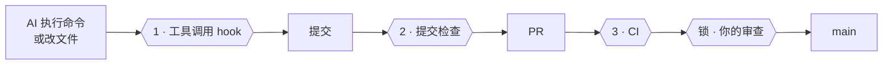
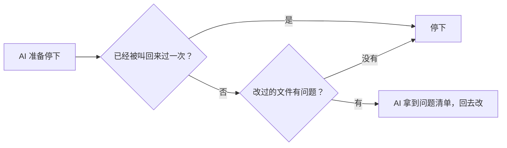

<!-- source: docs/guide.md blob e331f730bc208fe78fd0f4ae5fc79f0dc5962b04 -->
# yokoten 使用指南

[README](README.md) 是简短版。剩下的都在这里：yokoten 为什么要做、它怎么工作、有哪些规则和命令，还有它做不到的事。

## 一条赛道

**可以把它想成一条赛道。** AI 编程助手是一辆快车，yokoten 是它跑的那条赛道。护栏让一次失误不至于变成翻车，这是「守桥」；路线告诉你下一个弯怎么过，一次一关，这是「带路」；而每一次事故都会让所有赛道更安全：一个项目吃过的亏，会变成所有项目的检查，这就是「横展」。

## 先认识几个词

- **会话**：和 AI 编程助手（比如 Claude Code）的一次对话。
- **hook**：AI 工具在固定时刻自动运行的小程序。yokoten 加了三个：一个在每条命令、每次改
  文件之前运行（可以拦下来），一个在 AI 说完这一轮、准备停下时运行，一个在每次会话开头运行。
- **提交检查**：每次 git 提交前运行的检查（`.githooks/pre-commit`）。
- **CI**：GitHub 在每个 PR 上自动跑的检查。
- **规则集（ruleset）**：GitHub 上保护分支或 tag 的设置，比如「没有审查不能合并」。
- **主人、lead、worker**：主人就是你；lead 是跟你对话的那个 AI 会话；worker 是 lead 为某一个
  任务另开的会话。详见[像带团队一样管 agent](#像带团队一样管-agent)。
- **退出码**：命令结束时交回的一个数字。0 表示一切正常。脚本和 AI 靠它判断结果。
  详见[退出码](#退出码)。
- **JSON**：一种给程序读的纯文本数据格式。加上 `--json` 就输出这种格式。

## 名字的来历

「横展」（yokoten）是丰田车间里的说法：一条产线找到了某个缺陷的对策，不光这条线改，
所有可能出同样问题的产线都要跟着改。yokoten 把这件事搬到你的项目上：一个项目踩过的坑，
它会提醒别的项目先填上。

## 要解决的问题

你带着 AI 做一个项目，做了几个月，踩过不少坑：AI 为了让测试通过，直接把测试改了；
一个 PR 合并时带进了没人审过的提交；服务器地址被写进了仓库里的文件。每踩一次坑，你就加一条
规则、一个 hook、一项检查，这个项目越来越稳。

可是一开新项目，或者回到老项目，这些全都不在。这些经验只留在那个仓库里，和你的脑子里。
你忘了提，AI 就一切从头来。

yokoten 把这些经验写成规则，再配上会自己跑的检查：

- **每条规则都说得出为什么。** 一共 12 条核心规则。每条都写明为什么要有它：是真出过事，
  还是事还没出、先看到了风险；也写明由哪项检查守着。没有检查的规则只是愿望。
- **守卫自己会跑。** AI 要执行坏命令，工具调用 hook 先拦下；hook 看不到的，提交检查来抓；
  有的提交绕过了前两道，CI 再跑一遍同样的检查，把它兜住。
- **不用你记着提醒。** 每次会话一开头先跑 `doctor`，告诉 AI 这个项目走到了第几关、
  下一步做什么。AI 会主动跟你提，你不用记。

## 装上的第一天，有什么不同

| AI 想做的事 | 没有 yokoten | 有 yokoten |
|---|---|---|
| 强推（force push），或者自己打 tag 发版 | 直接就做了 | 还没执行就被拦下，并告诉它为什么 |
| 测试不过，就去改测试 | 测试通过了，bug 还在 | 修 bug 时不许改测试 |
| 提交里带上你的邮箱、服务器 IP、所在城市 | 被公开出去 | 提交被拦下；报告只指出哪个文件第几行，不把内容打出来 |
| 开 PR | 用你的账号开，权限和你一样大 | 用 bot 账号开；你不点头，什么都合不进去 |
| 换到另一个项目 | 一切从头来 | 看出这个项目缺什么，问你要不要补上 |

## 三道检查，一把锁



| | 什么时候跑 | 拦下什么 |
|-|-----------|---------|
| **1** | 每次工具调用之前 | 推 tag、强制推送、跳过检查；修复任务里改测试；worker 改规则 |
| **1b** | Claude Code 的 AI 准备结束这一轮时 | 改过的文件里有没有个人信息、密钥，有没有改了不该改的文件（和提交检查一样）。有问题就把它叫回来改一次 |
| **2** | 每次提交 | hook 看不到的：用 `sed` 或脚本改的文件、个人信息、超过 7 项的文件夹 |
| **3** | 每个 PR | 关掉 hook 做出来的提交 |
| **锁** | 服务器上 | 没经过你审查的合并、直接推 `main`、不是你打的发版 tag |

## 会话里看到的是什么

项目还没用上 yokoten 时，会话一开始，AI 会看到：

```
yokoten: stage 1 of 5, safety net. Next: no AGENTS.md, so the agents have no written rules here; `yokoten init` adds one.
Why: an agent follows the rules it can read, and only those.
Tell the user in plain words, one step at a time, and offer to do it (as-is, lighter, or not now with a reason).
```

会话里一次只说一步：在第几关、下一步做什么、为什么要做。第几关不存在哪里，每次都是看项目
里有哪些文件现算的。你说过「暂不」的步骤会跳过。顺序只是建议：后面关里的步骤提前做了，也算
做完。所有步骤都做完了，或者都说了「暂不」，会话里就只有一行，告诉你路走完了。

AI 会用你的语言跟你讲。yokoten 自己的提示用英文写，因为 AI 读英文最不容易出错。

`yokoten doctor` 会列出整条路。每一步标成 done（做完了）、next（下一步）、to do（还没做）、
not now（暂不，后面跟着你给的原因）或者 can't check（这里查不了）。yokoten 还查不了的步骤
先不列出来：

| 关 | 步骤 |
|---|---|
| **1 · 安全网** | `rules`、`tool-hook`、`commit-check`、`runtime`、`tests`（有测试命令，CI 会跑） |
| **2 · 先开 issue，再走 PR** | `ci`、`issues`（没有 todo 文件）、`templates`、`no-build-output`（`dist/`、`build/`、`out/` 里没有提交的文件，也没有编译出来的二进制文件） |
| **3 · 发版** | `changelog`、`titles`（CI 跑 `check --pr`） |
| **4 · 带一支 AI 团队** | `codeowners`、`bot`、`skills` |
| **5 · 公开** | `security-files`（安全说明、Dependabot、许可证）、`protection`（默认分支和 `v*` tag 上的规则集）、`merge-settings`（只许 squash 合并，合并后自动删分支）、`security-settings`（secret scanning、push protection、私下报告漏洞、Dependabot 提醒） |

后三步是服务器上的设置。完整的 `doctor` 用 `gh api` 去读，只读不改。
没装 `gh`、没登录、没网，或者远程仓库不在 GitHub 上，这三步就标 can't check，绝不会算作做完。
会话开头不联网，所以那里这三步总是 can't check。

如果某一步对应外部的标准，`yokoten doctor` 会在步骤名后面写出来，比如 `ci (Scorecard: CI-Tests)`。
会话开头那三行不写。

为什么这样分，见[决定记录 0004](../records/0004-the-road.md)。

这个仓库自己也在走这条路，每一关你都能直接看它怎么运转：

| 关 | 学会什么 | 在这里看 |
|---|---|---|
| **1 · 安全网** | AI 要读的规则，以及规则管不住时拦下它的检查 | [AGENTS.md](../../AGENTS.md) |
| **2 · 先开 issue，再走 PR** | 每次改动先开 issue 说清为什么；CI 通过了才合并；用标签、里程碑（milestone）和看板管起来 | [issue](https://github.com/yokoten-labs/yokoten/issues?q=is%3Aissue)、[PR](https://github.com/yokoten-labs/yokoten/pulls?q=is%3Apr)、[看板](https://github.com/orgs/yokoten-labs/projects/1) |
| **3 · 发版** | 写明改了什么、为什么改的提交信息；CHANGELOG；每次发版一个版本号 | [CHANGELOG.md](../../CHANGELOG.md) |
| **4 · 带一支 AI 团队** | bot 开 PR，worker 领任务，reviewer 审查；最后拍板的永远是你 | [像带团队一样管 agent](#像带团队一样管-agent) |
| **5 · 公开** | 把全部提交历史查一遍，看有没有漏出隐私；打开安全设置；保护 `main` 分支 | [安全说明](../../.github/SECURITY.md) |

AI 想推送发版 tag 时，会看到：

```
yokoten: git push --tags pushes tags. Only the owner decides when to release. If the owner asked for this, they start a new session with YOKOTEN_RELEASE_APPROVAL=1 (`YOKOTEN_RELEASE_APPROVAL=1 claude`); do not look for another way.
```

（提示用英文写，因为 AI 读英文最不容易出错。）

每条提示都是同样的三段：**出了什么事**（what）、**为什么要紧**（why）、**怎么改**（fix，
一条命令或者一处改动）。问题出在某个文件里时，开头先写位置：`文件:行号:`。查到问题时，
只说是哪一类，不说内容：密钥、私有词表里的词，都不会打印出来。如果指南里有一节专门讲这条
规则，提示最后会另起一行，给出那一节的链接：`docs: <链接>`。

想知道某条规则为什么存在，就跑 `yokoten explain <id>`。id 就是规则或步骤的名字，比如
`secret`、`commit-check`。不写 id，或者写了一个不存在的，它会把所有 id 列出来。

```
$ yokoten explain force-push
force-push: no plain force push (core rule 7).
Why: a plain force push can throw away work that someone else pushed.
Check: the tool-call guard stops `git push --force`, `-f` and a `+ref`; `--force-with-lease` passes; a branch ruleset on the server is the lock.
Docs: https://github.com/yokoten-labs/yokoten/blob/main/docs/guide.md#the-core-rules
```

## 四层

| 层 | 管什么 | 怎么装 |
|----|--------|--------|
| **机器** | 技能、agent 定义、两个用户级 hook，每台电脑都一样 | `yokoten install`，或者 Claude Code 插件 |
| **项目** | 规则、提交检查、工具调用 hook、CI、issue 和 PR 模板、Dependabot（每月一个 PR）、安全说明 | `yokoten init`；老项目再用 `yokoten` 技能 |
| **服务器** | 分支和 tag 规则集、squash 合并、代码负责人、权限受限的 bot、几个安全开关 | 由仓库主人设置一次；`doctor` 会列出步骤 |
| **规则** | `AGENTS.md`：12 条核心规则，加上项目自己的规则 | 每条规则都写明由哪项检查守着 |

老项目不是一张白纸，有些习惯比 yokoten 的还好。所以 `yokoten` 技能会跟你一条一条过，每条
做法都由你定：**照搬**、**减量**（说清去掉了哪部分），或者**暂不**（写明原因，以及什么
时候再看）。「暂不」会写进 `yokoten.json`，`doctor` 就不再追问。

## 支持哪些 agent

yokoten 能管住三种 AI 编程 agent，它们守的是同一套规矩。

| Agent | yokoten 给它加了什么 |
|---|---|
| Claude Code | 工具调用拦截（钩子）、收尾检查（钩子）、每次会话开头的带路提示、skills 和 agents |
| Codex CLI | 工具调用拦截，写在 `.codex/hooks.json`。第一次用时 Codex 会请你确认信任项目钩子（`/hooks`） |
| Gemini CLI | 工具调用拦截，写在 `.gemini/settings.json` |
| 其他 agent | `AGENTS.md` 里的规则；还有提交检查，不管是谁提交的，坏提交都会被拦下 |

## 安装和命令

需要 Node 22.18 或更高版本：它能直接运行 TypeScript，不用先编译。没有任何依赖。
装法有两种：一种是 Claude Code 插件，一种是 `install` 命令（从 npm 跑，或者从 clone
下来的仓库跑）。选一种就行，别两种都装。

### 用 Claude Code 插件装

在 Claude Code 里输入：

```text
/plugin marketplace add yokoten-labs/yokoten
/plugin install yokoten@yokoten
```

第一条把这个仓库加成插件市场，第二条打开插件页面，选「Install for you」（给自己装，
所有项目都能用）。不进 Claude Code 也行，在终端里先跑
`claude plugin marketplace add yokoten-labs/yokoten`，再跑 `claude plugin install yokoten@yokoten`。

插件就是这个仓库本身。它用的文件和 `install` 复制的是同一份，所以两种装法不会越走越不一样：

| 插件带来的 | 来自 |
|---|---|
| 技能：`/yokoten:dispatch`、`/yokoten:inspect`、`/yokoten:rca`、`/yokoten:record`、`/yokoten:release`、`/yokoten:yokoten` | `kit/user/skills/` |
| agent：`yokoten:worker`、`yokoten:reviewer`、`yokoten:verifier` | `kit/user/agents/` |
| `/yokoten:init` 和 `/yokoten:doctor`：直接用插件里的 yokoten 跑这两个命令 | `kit/plugin/skills/` |
| 会话开头跑 `doctor` 的 hook 和命令守卫，跟 `install` 加的两个一样 | `.claude-plugin/plugin.json` |

Claude Code 用 `node` 直接跑插件里的 `.ts` 文件。之所以能跑，是因为插件不放在
`node_modules` 下面（Node 不处理 `node_modules` 里的 TypeScript）。想更新，就打开 `/plugin`，
在 **Installed** 里选 yokoten，点 **Update now**。别人做的插件市场默认不自动更新，要自己打开。

插件只管 Claude Code。它不会帮你建私有词表文件：`doctor` 会告诉你文件在哪，你自己建。
插件在你的用户设置里开着的时候，`doctor` 就把它的 hook 和技能算作已经装好。

### 用 npx 装

用 Codex CLI、Gemini CLI，或者不想用插件，就这样装：

```sh
npx yokoten install      # 这台电脑：技能、agent、hook
cd your-project
npx yokoten init         # 这个项目：只加文件，不覆盖
npx yokoten doctor       # 看看走到哪一关，下一步做什么
```

`npx` 会先把包下载下来再运行。这个包没有任何依赖。`install` 和 `init` 会把 yokoten
的运行文件从包里拷出来，一份放到 `~/.local/share/yokoten`，一份放到项目的 `.yokoten/`。
hook 跑的是这两份拷贝，所以不用联网，也不用再经过 `npx`。

npm 上的包跑的是编译好的 JavaScript，因为 Node 不处理 `node_modules` 里的 TypeScript。
仓库本身还是不用编译，只有 `npm pack` 打包的时候才生成 `dist/`
（见[记录 0008](../records/0008-npm-package.md)，英文）。

发布到 npm 是主人的事，跟打发版 tag 一样。第一个版本发布之前，先
[从 clone 下来的仓库装](#从-clone-下来的仓库装)。

### 从 clone 下来的仓库装

命令一样，只是从 clone 下来的仓库跑。npm 上还没有第一个版本的时候，就用这种装法：

```sh
git clone https://github.com/yokoten-labs/yokoten
node yokoten/bin/yokoten.ts install      # 这台电脑：技能、agent、hook
cd your-project
node ~/.local/share/yokoten/bin/yokoten.ts init     # 这个项目：只加文件，不覆盖
node ~/.local/share/yokoten/bin/yokoten.ts doctor   # 看看走到哪一关，下一步做什么
```

### 当成 GitHub Action 用

GitHub 上的任何仓库，加一个 workflow 文件，就能在 CI 里跑 yokoten 的检查。仓库里不用装
任何东西，数据也不会离开这次 CI：不用令牌，不连外面的服务。

```yaml
# .github/workflows/yokoten.yml
name: yokoten
on:
  pull_request:
    # 有了 edited、labeled、milestoned，改完标题或标签，check --pr 会再跑一遍。
    types: [opened, edited, synchronize, reopened, labeled, unlabeled, milestoned, demilestoned]
  push:
    branches: [main]
permissions:
  contents: read
jobs:
  yokoten:
    runs-on: ubuntu-latest
    timeout-minutes: 10
    steps:
      - uses: actions/checkout@3d3c42e5aac5ba805825da76410c181273ba90b1 # v7.0.1
        with:
          fetch-depth: 0
          persist-credentials: false
      - uses: yokoten-labs/yokoten@<完整的 commit SHA>
```

这个 action 先装好 Node，再跑 `check`；如果是 PR，还会接着跑 `check --pr`。查出来的问题
会标在 PR 页面上，跟 yokoten 自己的 CI 一样。

- **版本要钉死。** 写完整的 commit SHA。写 `@main` 这种分支名，哪天内容变了你都不知道。
  等发布了正式版本，也可以写版本标签。
- **checkout** 要加 `fetch-depth: 0`。`check --pr` 要比较 PR 的起点和最新提交，两个都得拉下来。
- **权限**只要 `contents: read`。这个 action 不要令牌。
- **参数**只有两个：`pr-check`（默认 `true`）和 `node-version`（默认 `22`，最低 22.18）。
  不想查 PR 的格式，就写 `pr-check: false`。
- **Node**：action 装的 Node，这个 job 后面的步骤也会用到。

`check --pr` 按核心规则第 8 条检查 PR。还没按这条规则走的仓库，可以先写 `pr-check: false`。
kit 里 `init` 放的 workflow 暂时还是跑 `.yokoten/` 里的那份，等第一个正式版本发布以后再换成
这个 action，这样就不会依赖 `@main`。

### 命令

`init` 会把 yokoten 运行要用的文件复制到项目的 `.yokoten/` 里。把它一起提交：这样不联网、
不全局安装，hook 和 CI 也能跑。

`init` 还会在 `.github/` 里放两个文件，默认设置就是安全的：

- `dependabot.yml`：自动更新 CI 用到的 action。一个月只开一个 PR，所有更新都在里面；
  新版本发布满一周才会用。文件里的注释写了怎么用同样的方式加上你自己的包（npm、pip、Go 等）。
- `SECURITY.md`：告诉别人发现漏洞要私下报告，不要发公开 issue。要让私下报告能用，得在仓库
  设置里打开 private vulnerability reporting（私下报告漏洞）。`doctor` 会把它和其他安全开关
  一起列出来。

| 命令 | 做什么 |
|------|--------|
| `install` | 把技能装进 `~/.claude/skills` 和 `~/.agents/skills`，agent 装进 `~/.claude/agents`，加上会话开头的 `doctor` hook 和用户级命令守卫，再建一个空的私有词表 |
| `init [dir]` | 把这套做法放进一个项目。只加文件；已有的文件保留，并告诉你保留了哪些 |
| `update [dir] [--write]` | 看看这个版本的 yokoten 会怎么改项目 `AGENTS.md` 里的核心规则。加上 `--write` 才真的替换；「This project」那部分原样保留。见[更新规则](#更新规则) |
| `doctor [--session]` | 整条路：每一关、每一步，加上这台电脑还缺什么。`--session` 只说下一步，会话开头用 |
| `check [--staged]` | 检查目录层级、隐私和只有 lead 能改的文件；`--staged` 只查下一次提交。提交里不能有构建产物和二进制文件。查整个目录时，落后于英文的译文会给一条提醒，见[翻译](#翻译) |
| `check --pr` | 在 CI 里检查 PR：标题格式、第一行的 `tier:`、三个小节、关联的 issue、需要时的变更文件、milestone 和标签，见下面的「更新日志」。改到 CODEOWNERS 里列出的文件，必须写 `tier: A`。改动的文档里句子太长、改动的代码里名字难读、改动超过 400 行，都只提醒，不算失败 |
| `check --issue` | 在 CI 里检查 issue 的标题，见下面的「issue 标题」 |
| `changelog [--write]` | 列出 `changes/` 里的文件会往 `[Unreleased]` 下面加哪些条目。加上 `--write` 就真的写进 `CHANGELOG.md`，再删掉这些文件；发版前跑。见下面的「更新日志」 |
| `check --history` | 对所有分支的每一个提交做隐私检查。私有仓库公开之前跑一遍 |
| `hook [--agent <name>] [--commands-only]` | 工具调用守卫，从标准输入读一次工具调用：默认读 Claude Code 的 PreToolUse；加 `--agent codex` 读 Codex 的 PreToolUse，加 `--agent gemini` 读 Gemini CLI 的 BeforeTool |
| `hook --stop` | 收尾检查。从标准输入读 Claude Code 的 Stop 事件，检查改过的文件。见[收尾检查](#收尾检查) |
| `explain [<id>]` | 讲一条规则或者路上的一步：它是什么、为什么要有、yokoten 怎么检查 |
| `bot -- <命令>` | 以 bot 的身份运行一条命令（`gh`、`git push`），用一小时有效的令牌，令牌不会打印出来。如果命令是 `gh issue` 或 `gh pr` 的 `create`、`edit`，并且带了标题，它会先按 CI 的规则检查标题；标题不合格就直接拒绝，什么都不会发出去。设置方法见 [server.md](../server.md#3-the-bot-a-github-app) |

`check`、`doctor`、`hook`、`explain` 都可以加 `--json`。加了以后，标准输出里只有 JSON，
别的什么都没有，方便 AI 和脚本读。每条结果的字段都一样：`id`、`what`、`why`、`fix`；
指南里讲到这条规则的，再加 `docs`（链接）；问题出在文件里的，再加 `file` 和 `line`。
拿 `id` 去跑 `yokoten explain` 就能看到详细说明。任何字段里都不会有隐私内容。

- `check --json`：`{ check, ok, findings, notes }`。`check` 是 `tree`、`staged`、`history`
  或 `pr`，说明查的是哪一种。`notes` 只是提醒，不会让检查失败。
- `doctor --json`：`{ version, ok, selfTest, repo, stage, stages, next, findings, steps,
  notes, server }`。加 `--session` 时只给下一步、私有词表缺失的提醒，以及核心规则落后时的 `core-rules`。
- `hook --json`：在标准输出给出 `{ blocked, finding }`。AI 工具本身不用它：它们按各自的
  hook 协议，看退出码，再从标准错误读原因。
- `hook --stop --json`：`{ blocked, stop, findings }`。`stop_hook_active` 为真时多一个 `skipped`。
- `explain --json`：`{ found, id, kind, what, why, check, docs, stage, standard }`；找不到时是
  `{ found: false, ids }`。

输出的规矩只有一条：结果写到标准输出（stdout），问题、拒绝和出错写到标准错误（stderr）。
不认识的选项会直接拒绝，不会悄悄忽略。

CI 没过，不用再翻日志找原因。`check` 在 GitHub Actions 里跑的时候，每个问题都会标在 PR
改动的那一行上；任务摘要（job summary）里也会列出来：在哪、哪条规则、出了什么问题、
为什么、怎么改。规则名可以点，点开就是指南里讲它的那一节。
只是提醒的，显示成黄色警告，不会让检查失败。和平时的输出一样，这里只说问题在哪，
不会把查到的内容打出来。

### 退出码

| 退出码 | 意思 |
|------|------|
| 0 | 一切正常。`doctor --session` 永远是 0，保证会话总能开始 |
| 1 | 查出了问题（`check`、`doctor`）、id 不存在（`explain`）、命令用法不对，或者 yokoten 自己出错 |
| 2 | hook 拦下了这次工具调用，或者收尾检查把 AI 叫回来了，原因在标准错误里 |

这几个数字定下来就不改。守卫自己坏了会给 1，不给 2：这样你看得到它坏了，它也不会把每次
工具调用都拦住。

### 收尾检查

工具调用 hook 只看命令。AI 用 `sed` 或脚本改了文件，它看不到。提交检查看得到，但要等到
提交的时候。收尾检查更早：Claude Code 的 AI 说完这一轮、准备停下时就跑。



- 只查改过的文件：已暂存的、没暂存的，还有 git 没忽略的新文件。用的是 `check --staged`
  那一套：个人信息、密钥、不该改的文件。
- 只叫回来一次。叫回来以后 Claude Code 会把 `stop_hook_active` 设成真，下次停下就一定放行，
  不会来回打转。
- 不读历史，不联网。
- yokoten 自己出错时直接放行，只在标准错误里写一行。
- 有个新文件你想留着、不想被查，就把它写进 `.gitignore`，或者写进 `yokoten.json` 的
  `privacy.skip`。

`init` 会把它写进 `.claude/settings.json`。`install` 不在用户级加它：它要读文件，所以由
每个项目自己打开，跟工具调用 hook 里管文件的规则一样。

提交检查不让你提交 `dist/`、`build/`、`out/` 文件夹里的文件，也不让你提交二进制文件。
这些文件每次构建都会重新生成，二进制文件审查的人也看不懂。图片和字体（`png`、`jpg`、`gif`、
`webp`、`svg`、`ico`、`woff`、`woff2`）可以提交。某个文件确实要留在仓库里，就在 `yokoten.json`
里写上它的路径（可以用通配符）：`"allowBuild": ["docs/manual.pdf"]`。

### issue 标题

issue 标题先写改哪一块，再写要做什么。这样一排 issue 看下来，就像以后要合进来的一排提交。

- 任务：`模块: 动词开头的短语`，比如 `doctor: add the review step`。
- 事故（incident）：`模块: 看到的现象`，比如 `check: misses a key in a JSON file`。写你看到了什么，
  别写打算怎么修。
- 最多 60 个字符，结尾不加句号，标题里不写 `#N`，要提别的 issue 就写在正文里。
- 模块名全小写，一个词；要用几个词就用连字符连起来。

`init` 会加上 `.github/workflows/issue.yml`。有人开 issue 或改 issue 时，它跑一次
`check --issue`。它只读不写：不会去 issue 下面留言，也不会帮你改标题。跑红了，作者自己改标题就行。

默认任何小写的模块名都能过。想限定只用哪几个，就在 `yokoten.json` 里列出来：
`"areas": ["doctor", "check", "docs"]`。列了以后，PR 标题 `type(area): summary` 里的模块名也只能用这几个。

### 更新日志

PR 改了用户能感觉到的东西，就加一个小文件：`changes/<issue>-<slug>.md`，不去改
`CHANGELOG.md`。要是每个 PR 都往同一个文件的开头加一行，合进去一个，别的 PR 就全冲突了。
每个 PR 各写各的文件，就不会冲突。

文件就是普通的 Markdown。第 1 行写分类：Added、Changed、Deprecated、Removed、Fixed、Security
或 Internal。第 2 行空着。从第 3 行开始写条目，写成它在更新日志里该有的样子。前面的 `- `
会自动加上。一个文件里写好几条也可以。

```markdown
Fixed

`doctor` no longer stops when the repo has no remote (#42).
```

`yokoten changelog` 只把这些文件会加什么列出来，不写任何东西。发版前跑
`yokoten changelog --write`：每一条放进 `[Unreleased]` 里对应的分类下面，用过的文件删掉。
已经发布的版本它不碰。有文件格式不对，它会说是哪个文件、错在哪，一个字都不写。

`check --pr` 把 `changes/` 里新加的文件当成这个 PR 的更新日志，还会检查格式。直接改
`CHANGELOG.md` 也照样能过，还没换过来的项目不受影响。`init` 会加上 `changes/README.md`，
里面有格式说明。`changes/` 里的文件可以超过 7 个，因为每次发版都会清空。

### 翻译

英文是原文，译文跟着英文走。英文改了，译文就落后了，可往往没人发现。所以每个译文文件的第 1 行
都写明它是从哪个英文文件翻的，用 HTML 注释写，GitHub 上看不到。

```markdown
<!-- source: docs/guide.md blob 3b18e512dba79e4c8300dd08aeb37f8e728b8dad -->
```

路径是英文文件的路径，从仓库根目录算起。blob 是 git 给你翻译时那版英文内容算出的编号，
跑 `git hash-object docs/guide.md` 就能拿到。更新译文时把第 1 行一起改掉，和英文放在
同一个 commit 或同一个 PR 里。

`check` 会读每个 Markdown 和 HTML 文件的第 1 行。blob 和工作区里的英文对得上，译文就算
最新。对不上的话，`check` 再看当前分支的提交（只沿第一个父提交往回找）：最后一次改译文
第 1 行的提交，和最后一次改英文的提交是同一个，或者更晚，译文也算最新。为什么要看提交？
两个 PR 可能同时改英文。两个都合进来以后，英文变成了哪个分支都没见过的 blob。光看 blob
就会说译文落后，其实两边都翻好了。

有两种改动不算数。英文改了还没提交，译文算落后。提交里改了译文、却没动第 1 行（比如只改
个错字），译文也不算最新。

译文落后时，`check` 给一条 `translation-behind` 提醒：落后了几个 commit，怎么看英文改了
什么（`git diff <blob> HEAD:docs/guide.md`）。提醒不会让 CI 失败。想让它失败，就在
`yokoten.json` 里写 `"translations": { "fail": true }`。

浅克隆里可能没有要比的那些提交。这时 `check` 给一条提醒，不会当成最新。CI 里 checkout
时设 `fetch-depth: 0`。

### 更新规则

yokoten 每学到一个教训，核心规则就会改。`yokoten install` 会更新你电脑上的技能和 agent。
项目里的 `AGENTS.md` 是你自己的文件，你不开口，它就不会变；`init` 也不会再去动它。

`doctor` 会拿 `AGENTS.md` 里 `## This project` 上面的部分，跟你正在用的 yokoten
自带的核心规则比。两边不一样，它就报 `core-rules`，会话开头也会提一句。

`yokoten update` 只把要改的地方列出来，不写任何东西：哪几节变了，每一行是加（`+`）
还是删（`-`）。跑 `yokoten update --write` 才会替换核心规则那部分。从 `## This project`
往下的内容一个字节都不动。

核心规则里你自己手改过的行，也会显示成 `-`，因为更新会把它换掉。所以先把你自己的规则
挪到 `## This project` 下面。要是文件里没有这个标题，yokoten 分不清哪些是核心规则、
哪些是你的，它会直接告诉你，不比也不写。

`update` 要用装好的 yokoten 或者 clone 下来的仓库跑，别用 `.yokoten/` 里的那份：
项目里那份没有带 kit，没东西可比。

装了 Claude Code 插件的话，直接用 `/yokoten:update`。它跑的是插件自己那份 yokoten，
先给你看要改什么，你点头了才写。


## 核心规则

完整的表格和每条的来由在 [`kit/project/AGENTS.md`](../../kit/project/AGENTS.md)。

1. 所有工作从 issue 开始，不用 todo 文件。
2. 没有 PR、CI 没过，什么都进不了 `main`。
3. 只有仓库主人能打 tag、发版。
4. 修复任务只改代码，不改测试。
5. worker 不改只有 lead 能改的文件：规则、agent 配置、hook、CI。
6. 不许跳过提交检查。
7. 不用普通的强制推送，不对共享分支做 rebase。
8. 用 squash 合并。一个 PR 只做一件事；零碎的小改动攒成一批再提。
9. 审查和测试的，必须是最终合并的那个提交。
10. 每个文件夹最多 7 项。
11. 仓库里，以及 yokoten 打印出来的内容里，都不能有任何能指向某个人的信息，也不能有密钥。
12. 决定只写一次并保留下来；事实直接替换；时间一律用 UTC。

## 起名字

读代码时，最先看到的是名字，看得最多的也是名字。名字起得好，读的人不用往回翻，就知道它装的是什么。
有一项研究请 72 位开发者在代码里找错：名字是完整单词时，他们比看单个字母或缩写快了大约 19%。

yokoten 自己的代码守五条规矩。为什么这么定、参考了哪些资料，写在[记录 0006](../records/0006-names.md)。

1. 用完整的英文单词。缩写只用人人都认识的：`id`、`url`、`pr`、`ci`、`env`、`config`、`repo`、`dir`、`json`、`html`。不要从单词中间删字母。
2. 一个名字最多 4 个词。不限字符数：一限字符，大家就会去缩写。
3. 只有 10 行之内就用完、也不导出给别的文件的名字，才能用单个字母。`_` 只留给用不到的参数。
4. 变量和函数用 `camelCase`，类型用 `PascalCase`。`CONSTANT_CASE` 只给写在文件开头、不会变的值。缩写词当成普通单词来写：`loadHttpUrl`。
5. 函数名用动词开头。表示「是或否」的值，用 `is`、`has` 或 `can` 开头。同一个东西，在哪个文件里都叫同一个名字。

| 别这么写 | 这么写 | 原因 |
|---|---|---|
| `r`，30 行以后还在用 | `result` | 读到第 30 行，早就忘了 `r` 是什么。 |
| `cfgMgr` | `configManager` | 单词中间删了字母，读的人只能猜。 |
| `processTheUserInputDataNow` | `parseInput` | 6 个词，其中 process、data、now 都没多说什么。 |
| `_count` | `count` | 前面的 `_` 没有任何意思。 |
| 函数里的 `MAX_TRIES` | `maxTries` | `CONSTANT_CASE` 的意思是「整个文件里都不变」。 |
| `loadHTTPURL` | `loadHttpUrl` | 两个缩写连在一起，分不清哪里断开。 |
| `valid` | `isValid` | 看到 `is` 就知道它只有「是」和「否」两种值。 |
| `user()` | `loadUser()` | 动词说清楚这个函数要做什么。 |

名字也不是越长越好。一眼就能看完的地方，短名字反而清楚：三行的循环里写 `for (const n of numbers)` 就很好。
名字用到的地方离得越远，就越要说清楚。

`test/architecture.test.ts` 会检查第 2、3 条，还有函数里的 `CONSTANT_CASE`。每处不合格都会写明该怎么改：

```
src/rules/guards.ts:195: "i" is used for 101 lines. A reader must scroll back to learn what it holds. Name what it is, e.g. "index".
```

别的项目里，`check --pr` 也会提醒两种名字：单个字母却用到很远的地方，或者超过 4 个词。它只看 PR 在 TypeScript 和 JavaScript 文件里新加的行。只是提醒，CI 不会因此失败。

第 1 条和第 5 条要靠人判断，所以交给审查的人来看。

## 像带团队一样管 agent

这套做法把 AI 当成产线上的员工：每个人分工清楚，权限也有限。

- **主人**（你）决定做什么、什么时候发布。只有你能批准 PR、打发版 tag、改仓库设置。
- **lead** 是和你对话的那个会话。它做计划、拆任务、做审查，通过 **bot** 开 PR，从不用你的
  账号。
- **worker** 是 lead 为单个任务启动的会话，各自在自己的 worktree 里，带着
  `YOKOTEN_ROLE=worker`。它改代码、交报告，从不推送。
- **bot** 是装在仓库上的 GitHub App。它能开 PR，但没有 Workflows 权限，改不了检查它的
  CI。规则集要求你审查，所以它开的 PR，你不点头就合不进去。

这套方法靠五个技能来做：`dispatch`（给 worker 派活）、`inspect`（分三轮审查某一个具体提交）、
`rca`（找根因、加检查、再推广到其他项目）、`record`（把决定写下来）、`yokoten`（采用这套
做法）。三个 agent 干活：`worker`、`reviewer`（只读）、`verifier`（只跑不修）。

### 谁来审什么

风险越大，越要主人来看。PR 第一行的 tier 说的是：改错了有多难收回（记录 0004）。

| tier | 什么样的改动 | 谁来审 |
|------|--------------|--------|
| C | 日常小改：文档、措辞、样式 | lead 审 |
| B | 普通改动：其他代码，带测试 | lead 审 |
| A | 改错了很难收回：密钥、数据、安装、发版、CODEOWNERS 里的文件 | 主人审 |

`.github/CODEOWNERS` 只列出改错了很难收回的文件：规则、kit、agent 配置、CI、记录。
不是每个文件都列。仓库打开「需要 code owner 审查」以后，PR 一改到这些文件，GitHub
就会请主人来审。

`check --pr` 把这两件事接起来。PR 改到 CODEOWNERS 里的文件，第一行却不是 `tier: A`，
检查就不通过。改了哪些路径，决定 tier 最低是多少。作者可以把 tier 往高了写，不能往低了写。

检查读的是目标分支（base）上的 CODEOWNERS，不是 PR 自己改过的那份。这样 PR 没法靠改这个
文件来给自己降级。本地跑、没有 base 的时候，读工作区里的文件，提示里会说读的是哪一份。
没有 CODEOWNERS 文件，就不查。

服务器怎么设置，一步一步写在 [`docs/server.md`](../server.md)。

## 隐私

第 11 条规则有检查守着。CI 和每次提交都会扫个人邮箱和 IP 地址。在你自己的电脑上，它还会读
`~/.config/yokoten/private-marks`，里面是你的名字、所在城市、域名、服务器名。这个文件放在
仓库外面，因为「不能公开的东西」这张清单本身也不能公开。查到问题时只报文件和行号，不会把
词表里的词打印出来。

这个检查也会查密钥：GitHub、npm、Slack、Stripe、Google、OpenAI 和 Anthropic 的 token，
AWS 的 access key id，还有 PEM 私钥。查到了只说是哪一种密钥，不会把密钥本身打印出来。光删掉
不够，git 历史里还留着，得去把它作废，换一个新的。

每个提交还会记下提交时间和你的时区，而时区能大致看出你住在哪里。所以提交检查要求用 UTC：
`init` 会给 agent 会话设好 `TZ=UTC`，你自己提交时，它会告诉你怎么设。

## 做不到的事

如实说明：

- **守卫只看命令文本。** 它看得懂 bash 的写法（引号、heredoc、`bash -c`、`$(...)` 这类替换），
  看不准会跑什么就拦下。但把命令拆开再拼起来，还是能绕过。它防的是失误和走样，不是一把锁。真正
  的锁在服务器上：分支保护、代码负责人，以及一个没有发版权限、改不了 CI 的 bot。
- **服务器设置只能读 GitHub 的。** 换成别的代码托管平台，这几步就标 can't check。bot 的权限 `doctor` 还查不了。
- **先支持 Claude Code。** agent 和用户级 hook 都按 Claude Code 的格式写。技能用的是公开
  的 SKILL.md 格式，所以 `install` 也会把它们放进 `~/.agents/skills`，Codex、Gemini CLI、
  Copilot、Cursor 这些 AI 会去那里找。工具调用守卫在 Codex 和 Gemini CLI 里也能用：`init`
  会写好 `.codex/hooks.json` 和 `.gemini/settings.json`，这两个工具第一次碰到这个 hook
  时会让你确认一次。还没有人在真的 Codex 或 Gemini CLI 里看到它拦下过命令（#30），所以
  `doctor` 只说这两个 hook 在不在，不算作缺少。规则就是普通的 `AGENTS.md`：项目里没有
  `CLAUDE.md` 时 Claude Code 会直接读它，大多数别的 AI 也读。Muse Code 的技能和 hook
  还在计划中。

## 故意没带过来的

这些做法也出自那几个项目，在那里也管用。可放进一套通用的工具里，花的力气比省下的多：检查每个提交的
类型是否和改动的文件对得上；在合并队列里逐字节重放合并；给 todo 文件分门别类的目录；
978 行的规则文件；把签过名的发版结论提交进仓库；把受控英语写作规范当硬性规则（后来带回了一个轻量版，只做提醒、不卡 CI，见
[记录 0005](../records/0005-plain-english.md)）。一条做法
要在不止一个项目里证明过值得，才能进来。


## 现状

版本 0.1。背后的决定记录在 [`docs/records/`](../records/)。工作用 issue 跟踪；参与开发
yokoten 本身的规则在 [`AGENTS.md`](../../AGENTS.md)。

### 往哪里去

梦想：人人都能像好团队那样做软件。软件开发是一整圈：计划、开发、测试、审查、发版、维护，
也就是 SDLC。yokoten 带你在自己的项目里亲手走一遍，一次一关。

| 阶段 | 名字 | 意思 | 现在 |
|---|---|---|---|
| 1 | **守桥** | AI agent 做危险操作之前就被拦下：force push、改测试让它通过、泄露隐私 | ✅ 已完成 |
| 2 | **带路** | 新手跟着 `doctor` 走完五关，一次只做一件事；agent 读懂老项目，起草接入 yokoten 的方案 | 🚧 正在做，黑客松前后 |
| 3 | **任何工具，任何平台** | Claude Code、Codex、Gemini CLI 和 Muse Code 守同一套规则；GitHub、Gitea、GitLab 都能用 | 下一步 |
| 4 | **完整的循环** | 从一份简短的方案开始，到开发、测试、审查、发版、维护，整个 SDLC 每一步都有人带路 | 之后 |
| 5 | **横展** | 一个项目学到的教训，变成一条检查；这条检查推广到所有项目。一个人学到的，大家都能用上 | 目标 |

近期要做的事在 [M0](https://github.com/yokoten-labs/yokoten/milestone/1) 和 [M1](https://github.com/yokoten-labs/yokoten/milestone/2) 里，[看板](https://github.com/orgs/yokoten-labs/projects/1)上能看到今天在做什么。
