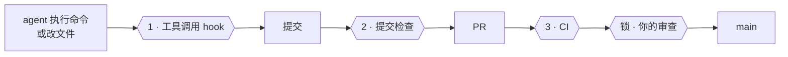

# yokoten 使用指南

[README](README.md) 是简短版。这里是其余的全部内容：为什么要有 yokoten、它怎么工作、规则、命令，以及它做不到的事。

## 先认识几个词

- **会话**：和 AI 编程助手（比如 Claude Code）的一次对话。
- **hook**：AI 工具在固定时刻自动运行的小程序。yokoten 加了两个：一个在每条命令、每次改
  文件之前运行（可以拦下来），一个在每次会话开头运行。
- **提交检查**：每次 git 提交前运行的检查（`.githooks/pre-commit`）。
- **CI**：GitHub 在每个 PR 上自动跑的检查。
- **规则集（ruleset）**：GitHub 上保护分支或 tag 的设置，比如「没有审查不能合并」。
- **主人、lead、worker**：你；和你对话的那个 agent 会话；lead 为单个任务启动的会话。详见
  [像带团队一样管 agent](#像带团队一样管-agent)。

## 名字的来历

「横展」（yokoten）是丰田车间里的说法：一条产线找到了某个缺陷的对策，不光这条线改，
所有可能出同样问题的产线都要跟着改。这个仓库把同样的做法用在 AI agent 写的软件上。

## 要解决的问题

你用 AI agent 做一个项目，做了几个月，踩过不少坑：agent 为了让测试通过，直接把测试改了；
一个 PR 合并时带进了没人审过的提交；服务器地址被写进了仓库里的文件。每踩一次坑，你就加一条
规则、一个 hook、一项检查，这个项目越来越稳。

可是一开新项目，或者回到老项目，这些全都不在。经验只存在于那一个仓库和你的脑子里。你忘了
提，agent 就从零开始。

yokoten 把这些经验做成会自己检查的东西：

- **每条规则都有来由。** 12 条核心规则，每条写明为什么要有它（出过的事故，或者还没出事
  时预见的风险），以及由哪项检查守着。没有检查的规则只是愿望。
- **守卫自己会运行。** 工具调用 hook 在坏命令执行之前就拦下来；提交检查抓 hook 看不到的；
  CI 再跑一遍同样的检查，兜住绕过前两道的提交。
- **不用你记着提醒。** 每次会话开头先跑 `doctor`，告诉 agent 这个项目走到了哪一关，
  下一步做什么。由 agent 主动提出来，你不用记。

## 三道检查，一把锁



| | 什么时候跑 | 拦下什么 |
|-|-----------|---------|
| **1** | 每次工具调用之前 | 推 tag、强制推送、跳过检查；修复任务里改测试；worker 改规则 |
| **2** | 每次提交 | hook 看不到的：用 `sed` 或脚本改的文件、个人信息、超过 7 项的文件夹 |
| **3** | 每个 PR | 关掉 hook 做出来的提交 |
| **锁** | 服务器上 | 没经过你审查的合并、直接推 `main`、不是你打的发版 tag |

## 会话里看到的是什么

在一个还没采用 yokoten 的项目里，会话一开始会看到：

```
yokoten: stage 1 of 5, safety net. Next: no AGENTS.md, so the agents have no written rules here; `yokoten init` adds one.
Why: an agent follows the rules it can read, and only those.
Tell the user in plain words, one step at a time, and offer to do it (as-is, lighter, or not now with a reason).
```

会话里只说一步：在第几关，下一步做什么，为什么要做。第几关是每次看项目里的文件算出来的，
不存在哪里。你说过「暂不」的步骤会跳过。顺序只是建议：后面关卡的步骤提前做了，也算做完。
所有步骤都做完或者「暂不」的时候，会话里只有一行，说路走完了。

agent 会用你的语言跟你讲。yokoten 自己输出英文，因为 agent 读英文最稳。

`yokoten doctor` 会列出整条路。每一步标成 done（做完了）、next（下一步）、to do（还没做）、
not now（暂不，后面跟着你给的原因）或者 can't check（这里查不了）。yokoten 还查不了的步骤
先不列出来：

| 关卡 | 步骤 |
|---|---|
| **1 · 安全网** | `rules`、`tool-hook`、`commit-check`、`runtime` |
| **2 · 先开 issue，再走 PR** | `ci`、`issues`（没有 todo 文件）、`templates` |
| **3 · 发版** | `changelog`、`titles`（CI 跑 `check --pr`） |
| **4 · 带一支 AI 团队** | `codeowners`、`bot`、`skills` |
| **5 · 公开** | `security-files`（安全说明、Dependabot、许可证） |

为什么这样分，见[决策记录 0004](../records/0004-the-road.md)。

agent 想推送发版 tag 的时候：

```
yokoten: git push --tags pushes tags. Only the owner decides when to release. If the owner asked for this, they start the session with YOKOTEN_RELEASE_APPROVAL set.
```

（提示是英文的，因为 agent 读英文最稳。）

## 四层

| 层 | 管什么 | 怎么装 |
|----|--------|--------|
| **机器** | 技能、agent 定义、两个用户级 hook，每台电脑都一样 | `yokoten install` |
| **项目** | 规则、提交检查、工具调用 hook、CI、issue 和 PR 模板、Dependabot（每月一个 PR）、安全说明 | `yokoten init`；老项目再用 `yokoten` 技能 |
| **服务器** | 分支和 tag 规则集、squash 合并、代码负责人、权限受限的 bot、几个安全开关 | 由仓库主人设置一次；`doctor` 会列出步骤 |
| **规则** | `AGENTS.md`：12 条核心规则，加上项目自己的规则 | 每条规则都写明由哪项检查守着 |

老项目不是一张白纸，它有些习惯比我们的还好。所以 `yokoten` 技能会和你一条一条过，每条
做法都要定下来：**照搬**、**减量**（说明去掉了哪部分），或者**暂不**（写明原因，以及什么
时候再看）。「暂不」会写进 `yokoten.json`，`doctor` 就不再追问。

## 安装和命令

需要 Node 22.18 或更高版本：它能直接运行 TypeScript，不用先编译。没有任何依赖。

```sh
git clone https://github.com/coo1white/yokoten
node yokoten/bin/yokoten.ts install      # 这台电脑：技能、agent、hook
cd your-project
node ~/.local/share/yokoten/bin/yokoten.ts init     # 这个项目：只加文件，不覆盖
node ~/.local/share/yokoten/bin/yokoten.ts doctor   # 看看走到哪一关，下一步做什么
```

`init` 会把运行时复制到项目的 `.yokoten/` 里。把它一起提交：这样 hook 和 CI 不联网、
不用全局安装也能跑。

`init` 还会在 `.github/` 里放两个默认就安全的文件：

- `dependabot.yml`：自动更新 CI 用到的 action。一个月只开一个 PR，所有更新都在里面；
  新版本发布满一周才会用。文件里的注释写了怎么用同样的方式加上你自己的包（npm、pip、Go 等）。
- `SECURITY.md`：告诉别人发现漏洞要私下报告，不要发公开 issue。要让私下报告能用，得在仓库
  设置里打开 private vulnerability reporting（私下报告漏洞）。`doctor` 会把它和其他安全开关
  一起列出来。

| 命令 | 做什么 |
|------|--------|
| `install` | 把技能装进 `~/.claude/skills` 和 `~/.agents/skills`，agent 装进 `~/.claude/agents`，加上会话开头的 `doctor` hook 和用户级命令守卫，再建一个空的私有词表 |
| `init [dir]` | 把这套做法放进一个项目。只加文件；已有的文件保留，并告诉你保留了哪些 |
| `doctor [--session]` | 整条路：每一关、每一步，加上这台电脑还缺什么。`--session` 只说下一步，会话开头用 |
| `check [--staged]` | 检查目录层级、隐私和只有 lead 能改的文件；`--staged` 只查下一次提交 |
| `check --pr` | 在 CI 里检查 PR：标题格式、第一行的 `tier:`、三个小节、关联的 issue、需要时的 CHANGELOG、milestone 和标签。改动的文档里句子太长、改动超过 400 行，都只提醒，不算失败 |
| `check --history` | 对所有分支的每一个提交做隐私检查。私有仓库公开之前跑一遍 |
| `hook [--agent <name>] [--commands-only]` | 工具调用守卫，从标准输入读一次工具调用：默认读 Claude Code 的 PreToolUse；加 `--agent codex` 读 Codex 的 PreToolUse，加 `--agent gemini` 读 Gemini CLI 的 BeforeTool |
| `bot -- <命令>` | 以 bot 的身份运行一条命令（`gh`、`git push`），用一小时有效的令牌，令牌不会打印出来。设置方法见 [server.md](../server.md#3-the-bot-a-github-app) |


## 核心规则

完整的表格和每条的来由在 [`kit/project/AGENTS.md`](../../kit/project/AGENTS.md)。

1. 所有工作从 issue 开始，不用 todo 文件。
2. 没有 PR、CI 没过，什么都进不了 `main`。
3. 只有仓库主人能打 tag、发版。
4. 修复任务只改代码，不改测试。
5. worker 不改只有 lead 能改的文件：规则、agent 配置、hook、CI。
6. 不许跳过提交检查。
7. 不用普通的强制推送，不对共享分支做 rebase。
8. 用 squash 合并。一个 PR 只做一件事；零碎的小改动攒成一批再提。
9. 审查和测试的，必须是最终合并的那个提交。
10. 每个文件夹最多 7 项。
11. 仓库里，以及 yokoten 打印出来的内容里，都不能有任何能指向某个人的信息，也不能有密钥。
12. 决定只写一次并保留下来；事实直接替换；时间一律用 UTC。

## 像带团队一样管 agent

这套做法把 agent 当作产线上的员工，每人角色清楚、权限有限：

- **主人**（你）决定做什么、什么时候发布。只有你能批准 PR、打发版 tag、改仓库设置。
- **lead** 是和你对话的那个会话。它做计划、拆任务、做审查，通过 **bot** 开 PR，从不用你的
  账号。
- **worker** 是 lead 为单个任务启动的会话，各自在自己的 worktree 里，带着
  `YOKOTEN_ROLE=worker`。它改代码、交报告，从不推送。
- **bot** 是装在仓库上的 GitHub App。它能开 PR，但没有 Workflows 权限，改不了检查它的
  CI。规则集要求你审查，所以它开的任何 PR 都要经过你才能合并。

五个技能承载这套方法：`dispatch`（给 worker 派活）、`inspect`（分三轮审查某一个具体提交）、
`rca`（找根因、加检查、再推广到其他项目）、`record`（把决定写下来）、`yokoten`（采用这套
做法）。三个 agent 干活：`worker`、`reviewer`（只读）、`verifier`（只跑不修）。

服务器怎么设置，一步一步写在 [`docs/server.md`](../server.md)。

## 隐私

第 11 条规则有检查守着。CI 和每次提交都会扫个人邮箱和 IP 地址。在你自己的电脑上，它还会读
`~/.config/yokoten/private-marks`，里面是你的名字、所在城市、域名、服务器名。这个文件放在
仓库外面，因为「不能公开的东西」这张清单本身也不能公开。查到问题时只报文件和行号，不会把
词表里的词打印出来。

这个检查也会查密钥：GitHub、npm、Slack、Stripe、Google、OpenAI 和 Anthropic 的 token，
AWS 的 access key id，还有 PEM 私钥。查到了只说是哪一种密钥，不会把密钥本身打印出来。光删掉
不够，git 历史里还留着，得去把它作废，换一个新的。

每个提交还会记下提交时间和你的时区，而时区能大致看出你住在哪里。所以提交检查要求用 UTC：
`init` 会给 agent 会话设好 `TZ=UTC`，你自己提交时，它会告诉你怎么设。

## 做不到的事

如实说明：

- **守卫只看命令文本。** 把命令拆开再拼起来就能绕过。它防的是失误和走样，不是一把锁。真正
  的锁在服务器上：分支保护、代码负责人，以及一个没有发版权限、改不了 CI 的 bot。
- **还不检查服务器设置。** `doctor` 目前只列出主人要做的三步，通过 API 自动检查还在计划中。
- **先支持 Claude Code。** agent 和用户级 hook 都按 Claude Code 的格式写。技能用的是公开
  的 SKILL.md 格式，所以 `install` 也会把它们放进 `~/.agents/skills`，Codex、Gemini CLI、
  Copilot、Cursor 这些 AI 会去那里找。工具调用守卫在 Codex 和 Gemini CLI 里也能用：`init`
  会写好 `.codex/hooks.json` 和 `.gemini/settings.json`，这两个工具第一次碰到这个 hook
  时会让你确认一次。还没有人在真的 Codex 或 Gemini CLI 里看到它拦下过命令（#30），所以
  `doctor` 只说这两个 hook 在不在，不算作缺少。规则就是普通的 `AGENTS.md`：项目里没有
  `CLAUDE.md` 时 Claude Code 会直接读它，大多数别的 AI 也读。Muse Code 的技能和 hook
  还在计划中。

## 故意没带过来的

这些做法来自同样的项目，在那里也管用，但放进一套通用工具里，成本比收益高：检查每个提交的
类型是否和改动的文件对得上；在合并队列里逐字节重放合并；给 todo 文件分门别类的目录；
978 行的规则文件；把签过名的发版结论提交进仓库；把受控英语写作规范当硬性规则（后来带回了一个轻量版，只做提醒、不卡 CI，见
[记录 0005](../records/0005-plain-english.md)）。一条做法
要在不止一个项目里证明值得，才配进来。


## 现状

版本 0.1。背后的决定记录在 [`docs/records/`](../records/)。工作用 issue 跟踪；参与开发
yokoten 本身的规则在 [`AGENTS.md`](../../AGENTS.md)。
