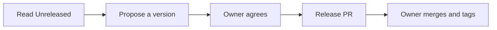

<!-- managed by yokoten; `yokoten install` replaces this file -->

# Prepare a release

The owner decides when to release, and only the owner creates the tag (core rule 3).
Your job is to make that one step easy: propose the version, and prepare the
changelog in a pull request.

## 1. Read what changed

Open `CHANGELOG.md` and read the `[Unreleased]` section. If it is empty, there is
nothing to release. Tell the user and stop.

Compare it with the merged pull requests since the last tag:
`git log --oneline "$(git describe --tags --abbrev=0)"..HEAD`. With no tag yet, read
the whole log. A `feat:` or `fix:` commit with no changelog line is a gap. Add the
line before you go on.

## 2. Pick the next version

A version is `MAJOR.MINOR.PATCH`. Find the change with the most effect, then use
this table.

| The biggest change | 1.0 or later | Before 1.0 |
|---|---|---|
| Something users rely on now works differently or is gone (Removed, or a Changed line that breaks) | MAJOR: 1.4.2 to 2.0.0 | MINOR: 0.4.2 to 0.5.0 |
| Something new, and nothing breaks (Added, Deprecated) | MINOR: 1.4.2 to 1.5.0 | MINOR: 0.4.2 to 0.5.0 |
| Only fixes (Fixed, Security) | PATCH: 1.4.2 to 1.4.3 | PATCH: 0.4.2 to 0.4.3 |

Before 1.0, a minor bump may break things. Write each break in the changelog under
Changed or Removed, and say what users must do.

Go to 1.0.0 when people depend on the project and you will keep its behaviour
stable. The owner makes that decision.

A first release with no tag yet is usually `0.1.0`.

## 3. Ask the owner

Tell the owner the version and the one line that decided it. Wait for a yes. The
owner can choose a different version.

## 4. Prepare the release pull request

1. In `CHANGELOG.md`, add `## [X.Y.Z] - YYYY-MM-DD` (today, UTC) under `[Unreleased]`.
   Move the lines below it. Leave `[Unreleased]` empty.
2. Set the version in the project's version file, such as `package.json`.
3. Open a pull request titled `chore: release vX.Y.Z`.

## Do not

- Create, push or delete a tag. The choice is the owner's, and the tool guard stops a tag push.
- Publish a package or create a host release. These are release actions too.
- Start a release when the owner has not asked for one.

After the owner merges, tell them the command to run: `git tag vX.Y.Z && git push origin vX.Y.Z`.
